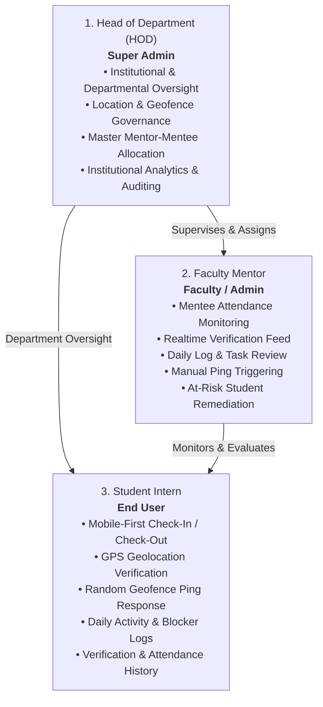
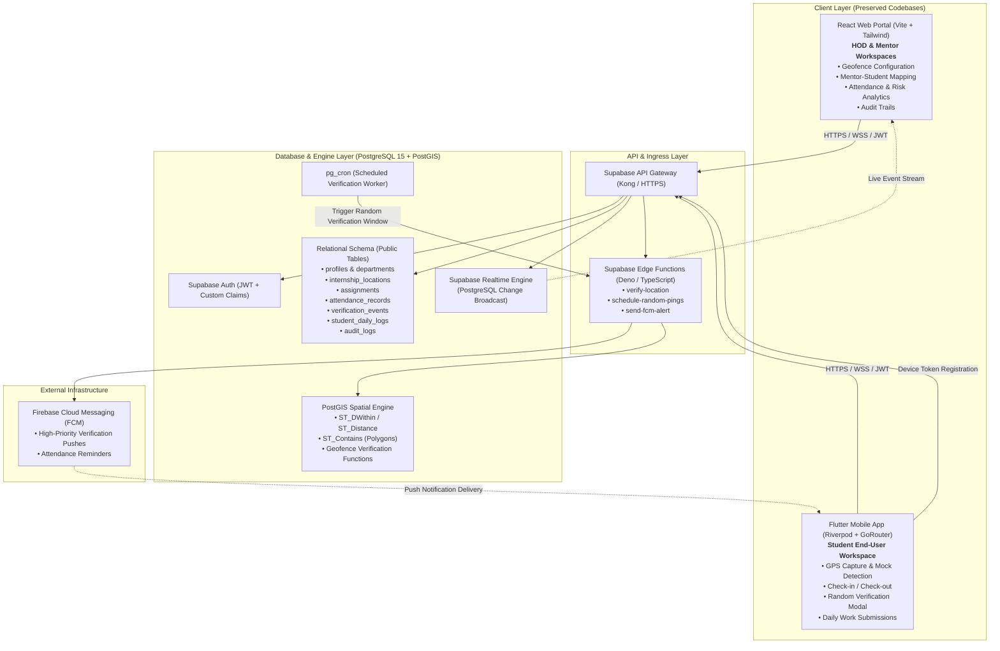
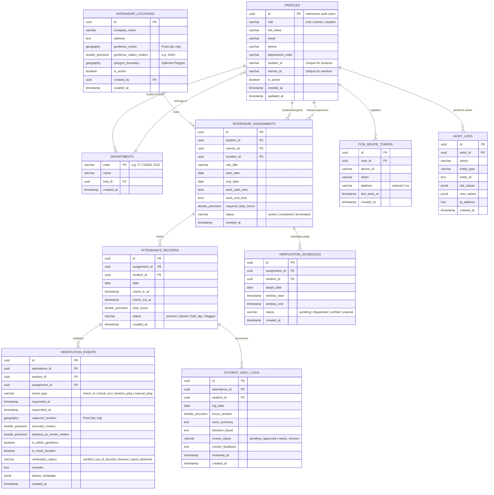
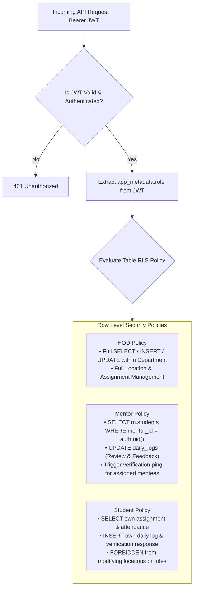
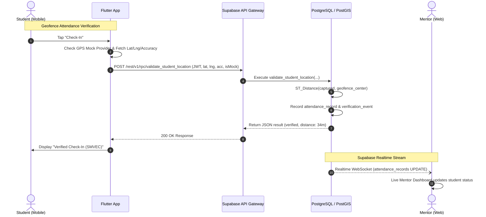
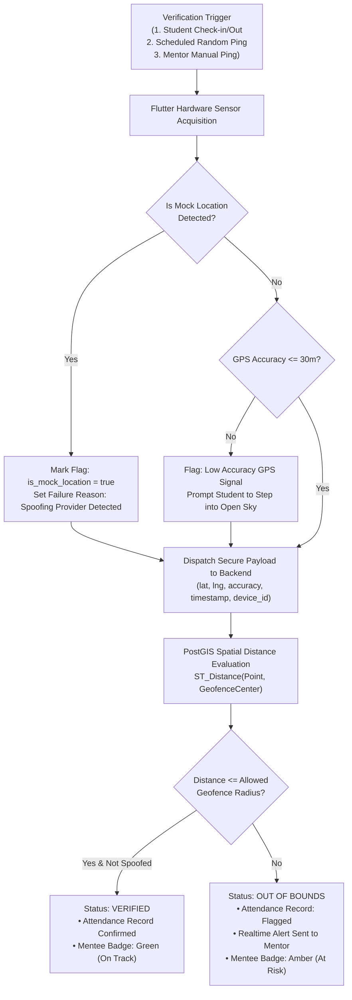
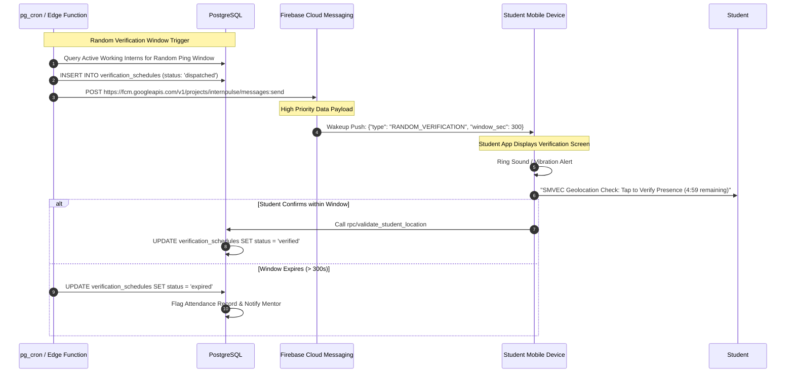
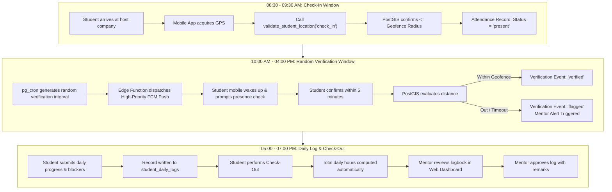
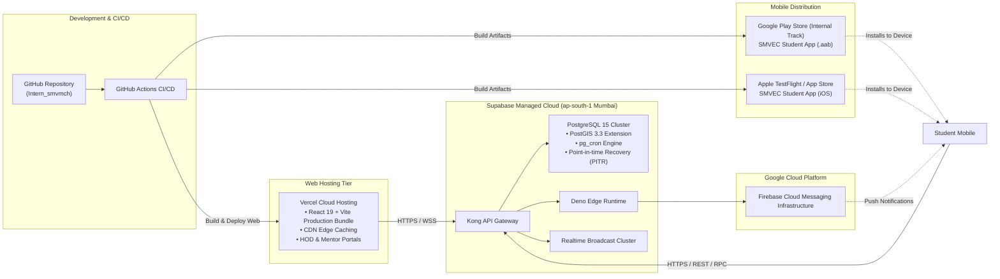

# InternPulse Target Architecture Specification

**Document Version:** 1.0.0  
**Status:** Approved Target Architecture  
**System Classification:** Institutional Internship Governance, Geolocation & Attendance Verification Platform  
**Target Institution:** Sri Manakula Vinayagar Engineering College (SMVEC)  
**Target Repository:** `Intern_smvmch`

---

## 1. Executive & Product Overview

### 1.1 Product Mission
**InternPulse** is an enterprise-grade institutional internship management, attendance, and geolocation verification platform. It enables educational institutions to govern distributed off-campus student internships through tamper-evident attendance tracking, cryptographic role isolation, and real-time geospatial validation.

### 1.2 Primary Application Roles
The system enforces **exactly three primary roles**:



1. **HOD (Super Admin):** Has overarching institutional authority over departments, faculty mentors, internship host locations (geofences), student assignments, institutional audit logs, and compliance analytics.
2. **Mentor (Faculty / Admin):** Manages a designated cohort of student mentees across host organizations. Responsible for reviewing daily logs, monitoring real-time geofence checks, dispatching manual verification checks, and intervening when students are flagged as at-risk.
3. **Student (End User):** Off-campus intern utilizing the Flutter mobile application to complete geofence-validated attendance, fulfill random verification pings, submit daily progress logs, and inspect verification records.

---

## 2. System Architecture

InternPulse follows a **hybrid multi-client cloud architecture** powered by a unified **Supabase (PostgreSQL + PostGIS)** data engine:



---

## 3. Component Responsibilities

### 3.1 Web Application (React + Vite)
The web application is dedicated exclusively to administrative and supervisory workflows:

| Domain | Functional Responsibilities | Targeted Role |
| :--- | :--- | :--- |
| **HOD Portal** | • Department-wide metric dashboards (Attendance %, At-Risk Count, Active Companies)<br/>• Mentor workload allocation and capacity management<br/>• Master student directory with batch CSV export<br/>• Cross-department institutional auditing | HOD |
| **Mentor Portal** | • Cohort-specific mentee list (only assigned students visible)<br/>• Real-time attendance verification status feed<br/>• Daily log review, approval, and feedback submission<br/>• Manual instant verification ping triggering<br/>• At-risk mentee flagging and escalation | Mentor |
| **Location Governance** | • Interactive map interface to configure host organization geofences<br/>• Center coordinate picking (Latitude / Longitude), radius definition (50m to 500m)<br/>• Optional campus boundary polygon drawing (GeoJSON)<br/>• Location activation and deactivation | HOD |
| **Assignment Hub** | • Binding students to active host organization locations and faculty mentors<br/>• Start/end date scheduling and expected daily hours allocation | HOD |
| **Analytics & Reporting** | • Historical attendance trends and compliance reports<br/>• Verification failure rate analysis (Spoof attempts, Out-of-bounds, Timeouts)<br/>• Official SMVEC university report generation | HOD, Mentor |

### 3.2 Mobile Application (Flutter)
The mobile application is the dedicated instrument for student interns on-site:

| Domain | Functional Responsibilities | Targeted Role |
| :--- | :--- | :--- |
| **Authentication** | • Secure credential login against Supabase Auth (with biometric unlock where supported)<br/>• Automatic FCM push token registration upon login | Student |
| **Internship Card** | • Active internship profile (Host Company, Mentor details, Assigned Geofence name, Period)<br/>• Emergency contact links to faculty mentor and department | Student |
| **Attendance Engine** | • Daily Check-In and Check-Out actions<br/>• Mandatory on-demand location capture during attendance events<br/>• Live distance readout to assigned host organization geofence | Student |
| **Geolocation Sensor** | • System location permission verification (`Permission.locationWhenInUse`)<br/>• Hardware GPS acquisition with minimum accuracy threshold enforcement (< 30 meters)<br/>• Mock/spoof location detection (Android `isMockProvider`, iOS simulation checks) | Student |
| **Verification Modal** | • Instant foreground/background wake-up upon receiving high-priority FCM verification ping<br/>• Time-bound countdown timer (e.g., 5-minute response window)<br/>• One-tap cryptographic location dispatch | Student |
| **Daily Work Log** | • Structured work report submission (Hours logged, Tasks completed, Blockers encountered)<br/>• Mentor feedback reading and revision resubmission | Student |
| **Audit Logbook** | • Chronological timeline of attendance records and geofence verification attempts<br/>• Clear status indicators: `Verified`, `Out of Bounds`, `Spoof Detected`, `Timeout` | Student |

### 3.3 Backend Services (Supabase + PostgreSQL + PostGIS)
A single, cohesive backend eliminates redundant microservices:

| Domain | Functional Responsibilities | Implementation Mechanism |
| :--- | :--- | :--- |
| **Identity & Access** | • Role verification via custom claims in JWT (`app_metadata.role`)<br/>• Row Level Security (RLS) policies on all tables | Supabase Auth & PostgreSQL RLS |
| **Geospatial Processing**| • Computing proximity between capture coordinates and company geofence<br/>• Polygon boundary containment testing<br/>• Accuracy gating and spoof rejection | PostGIS Extension (`ST_DWithin`, `ST_Contains`) |
| **Attendance Logic** | • Calculating shift durations, check-in/out timestamps, and daily attendance state (`present`, `half_day`, `flagged`) | PostgreSQL Stored Procedures |
| **Random Verification**| • Automated generation of random verification check windows during working hours<br/>• Expiration handling for missed pings | `pg_cron` & Supabase Edge Functions |
| **Push Notification** | • Dispatching push payloads via Firebase Cloud Messaging HTTP v1 API | Supabase Edge Function (`send-fcm-alert`) |
| **System Audit Log** | • Tamper-evident recording of geofence modifications, role changes, and verification events | PostgreSQL Trigger & Dedicated Audit Table |

---

## 4. Database Architecture (PostgreSQL + PostGIS)

### 4.1 Entity Relationship Diagram



### 4.2 PostGIS Spatial Schema Implementation Details
Spatial computations rely on `GEOGRAPHY(Point, 4326)` representing longitude and latitude on the WGS 84 ellipsoidal surface:

```sql
-- Enable PostGIS
CREATE EXTENSION IF NOT EXISTS postgis WITH SCHEMA extensions;

-- Table Geofence Column Definition
ALTER TABLE internship_locations 
ADD COLUMN geofence_center extensions.geography(POINT, 4326) NOT NULL;

-- Spatial Indexing for Fast Proximity Queries
CREATE INDEX idx_locations_geofence_center 
ON internship_locations USING GIST (geofence_center);

CREATE INDEX idx_verification_captured_location 
ON verification_events USING GIST (captured_location);
```

### 4.3 Stored Geofence Validation Function (`validate_student_location`)
To ensure zero business logic bypass, geospatial verification is evaluated inside the database transaction:

```sql
CREATE OR REPLACE FUNCTION validate_student_location(
    p_student_id UUID,
    p_latitude DOUBLE PRECISION,
    p_longitude DOUBLE PRECISION,
    p_accuracy DOUBLE PRECISION,
    p_is_mock BOOLEAN,
    p_event_type VARCHAR,
    p_device_info JSONB
)
RETURNS JSONB
LANGUAGE plpgsql
SECURITY DEFINER
SET search_path = public, extensions
AS $$
DECLARE
    v_assignment RECORD;
    v_captured_point geography;
    v_distance DOUBLE PRECISION;
    v_is_inside BOOLEAN;
    v_status VARCHAR;
    v_event_id UUID;
    v_attendance_id UUID;
    v_today DATE := CURRENT_DATE;
BEGIN
    -- 1. Anti-Spoofing Gate
    IF p_is_mock = TRUE THEN
        v_status := 'spoof_detected';
    ELSIF p_accuracy > 50.0 THEN
        v_status := 'low_accuracy_rejected';
    END IF;

    -- 2. Resolve Active Assignment
    SELECT a.id, a.location_id, l.geofence_center, l.geofence_radius_meters
    INTO v_assignment
    FROM internship_assignments a
    JOIN internship_locations l ON l.id = a.location_id
    WHERE a.student_id = p_student_id
      AND a.status = 'active'
      AND v_today BETWEEN a.start_date AND a.end_date
    LIMIT 1;

    IF NOT FOUND THEN
        RAISE EXCEPTION 'No active internship assignment found for student %', p_student_id;
    END IF;

    -- 3. Compute Distance via PostGIS
    v_captured_point := ST_SetSRID(ST_MakePoint(p_longitude, p_latitude), 4326)::geography;
    v_distance := ST_Distance(v_captured_point, v_assignment.geofence_center);
    v_is_inside := (v_distance <= v_assignment.geofence_radius_meters);

    -- 4. Determine Status if not already flagged
    IF v_status IS NULL THEN
        IF v_is_inside THEN
            v_status := 'verified';
        ELSE
            v_status := 'out_of_bounds';
        END IF;
    END IF;

    -- 5. Link with or Create Today's Attendance Record
    SELECT id INTO v_attendance_id
    FROM attendance_records
    WHERE student_id = p_student_id AND date = v_today;

    IF v_attendance_id IS NULL THEN
        INSERT INTO attendance_records (assignment_id, student_id, date, status, check_in_at)
        VALUES (v_assignment.id, p_student_id, v_today, 
                CASE WHEN v_status = 'verified' THEN 'present' ELSE 'flagged' END,
                CLOCK_TIMESTAMP())
        RETURNING id INTO v_attendance_id;
    ELSIF p_event_type = 'check_out' AND v_status = 'verified' THEN
        UPDATE attendance_records
        SET check_out_at = CLOCK_TIMESTAMP(),
            total_hours = ROUND(EXTRACT(EPOCH FROM (CLOCK_TIMESTAMP() - check_in_at))/3600.0, 2)
        WHERE id = v_attendance_id;
    END IF;

    -- 6. Insert Verification Event Log
    INSERT INTO verification_events (
        attendance_id, student_id, assignment_id, event_type,
        requested_at, responded_at, captured_location,
        accuracy_meters, distance_to_center_meters,
        is_within_geofence, is_mock_location, verification_status,
        device_metadata
    ) VALUES (
        v_attendance_id, p_student_id, v_assignment.id, p_event_type,
        CLOCK_TIMESTAMP(), CLOCK_TIMESTAMP(), v_captured_point,
        p_accuracy, ROUND(v_distance::numeric, 2),
        v_is_inside, p_is_mock, v_status, p_device_info
    ) RETURNING id INTO v_event_id;

    RETURN jsonb_build_object(
        'event_id', v_event_id,
        'verification_status', v_status,
        'distance_meters', ROUND(v_distance::numeric, 2),
        'is_inside', v_is_inside,
        'accuracy_meters', p_accuracy,
        'timestamp', CLOCK_TIMESTAMP()
    );
END;
$$;
```

---

## 5. Authentication & Authorization Architecture

### 5.1 Identity Engine
- **Provider:** Supabase Auth (`auth.users`), backed by native email/password with institutional domain constraints (`@smvec.ac.in`).
- **Token Claims:** Every issued JWT contains user metadata reflecting verified institutional identity:
  ```json
  {
    "sub": "b2f694df-4fa3-43cf-a734-72b144fa5064",
    "email": "saravanan.hod@smvec.ac.in",
    "app_metadata": {
      "role": "hod",
      "department_code": "CSEBS"
    },
    "user_metadata": {
      "full_name": "Dr. K. Saravanan"
    }
  }
  ```

### 5.2 Role Separation & Security Rules
All client actions are governed by strict PostgreSQL Row Level Security (RLS). The flawed password bypass discovered in the audit is eliminated:



### 5.3 RLS Policy Definitions
```sql
-- Enable RLS
ALTER TABLE profiles ENABLE ROW LEVEL SECURITY;
ALTER TABLE internship_locations ENABLE ROW LEVEL SECURITY;
ALTER TABLE internship_assignments ENABLE ROW LEVEL SECURITY;
ALTER TABLE attendance_records ENABLE ROW LEVEL SECURITY;
ALTER TABLE verification_events ENABLE ROW LEVEL SECURITY;
ALTER TABLE student_daily_logs ENABLE ROW LEVEL SECURITY;

-- 1. Profiles Policy
CREATE POLICY "Public Read Authenticated" ON profiles
    FOR SELECT TO authenticated USING (true);

CREATE POLICY "HOD Manage Profiles" ON profiles
    FOR ALL TO authenticated
    USING ((auth.jwt() -> 'app_metadata' ->> 'role') = 'hod');

-- 2. Locations Policy
CREATE POLICY "Read Locations" ON internship_locations
    FOR SELECT TO authenticated USING (true);

CREATE POLICY "HOD Manage Locations" ON internship_locations
    FOR ALL TO authenticated
    USING ((auth.jwt() -> 'app_metadata' ->> 'role') = 'hod');

-- 3. Assignments Policy
CREATE POLICY "Read Assignments" ON internship_assignments
    FOR SELECT TO authenticated
    USING (
        (auth.jwt() -> 'app_metadata' ->> 'role') = 'hod'
        OR mentor_id = auth.uid()
        OR student_id = auth.uid()
    );

-- 4. Verification Events Policy
CREATE POLICY "Student Insert Own Verification" ON verification_events
    FOR INSERT TO authenticated
    WITH CHECK (student_id = auth.uid());

CREATE POLICY "Mentor & HOD Read Verifications" ON verification_events
    FOR SELECT TO authenticated
    USING (
        (auth.jwt() -> 'app_metadata' ->> 'role') = 'hod'
        OR assignment_id IN (
            SELECT id FROM internship_assignments WHERE mentor_id = auth.uid()
        )
        OR student_id = auth.uid()
    );
```

---

## 6. API & Service Boundaries

Inter-service communication is divided strictly along Supabase managed interfaces, avoiding unnecessary intermediary servers:



### Key API Service Endpoints

| Category | Route / RPC Function | Caller | Description |
| :--- | :--- | :--- | :--- |
| **Auth** | `/auth/v1/token?grant_type=password` | Web / Mobile | Institutional login returning JWT with role claims |
| **Auth** | `/auth/v1/recover` | Web / Mobile | Password reset dispatch via official email templates |
| **Verification**| `rpc/validate_student_location` | Mobile | Executes atomic PostGIS validation & logs verification event |
| **Verification**| `rpc/trigger_manual_verification` | Web (Mentor) | Dispatches immediate high-priority FCM push to mentee |
| **Attendance** | `/rest/v1/attendance_records` | Web / Mobile | Scoped queries filtered by date range and mentor/student IDs |
| **Work Log** | `/rest/v1/student_daily_logs` | Web / Mobile | Student log insert / Mentor review & feedback updates |
| **Locations** | `/rest/v1/internship_locations` | Web (HOD) | CRUD operations on geofence coordinates and radii |
| **Assignments**| `/rest/v1/internship_assignments` | Web (HOD) | Allocates student to mentor and host location |

---

## 7. Geolocation Architecture

### 7.1 Location Verification Lifecycle
The geolocation verification engine guarantees physical presence within the designated host organization geofence:



### 7.2 Anti-Spoofing & Integrity Controls
1. **Mock Provider Detection:** The Flutter mobile application leverages native platform bridges (`isFromMockProvider` on Android, location simulation indicators on iOS) to tag suspect location coordinates.
2. **Device Clock Tampering Detection:** The timestamp of GPS satellites (`Location.time`) is compared with server system clock (`CURRENT_TIMESTAMP`). Variances exceeding 120 seconds are automatically flagged.
3. **Accuracy Thresholding:** Any location packet with horizontal accuracy greater than 30 meters is rejected, preventing coarse cell-tower triangulation from spoofing on-premise presence.
4. **Server-Side Distance Evaluation:** The mobile client **never** determines whether it is inside or outside the geofence. The client simply transmits raw sensor values; PostGIS executes the definitive spatial comparison.

---

## 8. Notification Architecture (Firebase Cloud Messaging)

### 8.1 Push Notification Channels
Firebase Cloud Messaging (FCM) is leveraged exclusively as an asynchronous transport layer to dispatch alerts and verification pings:



### 8.2 Push Message Payloads

#### A. Random Verification Ping (High Priority)
```json
{
  "message": {
    "token": "dK8f_...fcm_device_token...",
    "android": {
      "priority": "HIGH"
    },
    "apns": {
      "headers": {
        "apns-priority": "10"
      }
    },
    "data": {
      "notification_type": "RANDOM_VERIFICATION_REQUEST",
      "schedule_id": "9b1deb4d-3b7d-4bad-9bdd-2b0d7b3dcb6d",
      "response_window_seconds": "300",
      "company_name": "Zoho Corporation",
      "timestamp": "2026-11-05T14:30:00Z"
    }
  }
}
```

#### B. Mentor Feedback Notification (Informational)
```json
{
  "message": {
    "token": "dK8f_...fcm_device_token...",
    "notification": {
      "title": "Daily Log Reviewed",
      "body": "Prof. Anitha approved your log: 'Excellent progress on OAuth integration.'"
    },
    "data": {
      "notification_type": "LOG_REVIEW_COMPLETED",
      "log_id": "a1b2c3d4-e5f6-7a8b-9c0d-1e2f3a4b5c6d"
    }
  }
}
```

---

## 9. Security Boundaries & Threat Model

| Threat Scenario | Vector | Mitigation in Target Architecture |
| :--- | :--- | :--- |
| **Credential Bypass** | Unauthenticated users guessing email and supplying bad passwords | Complete removal of the auth bypass fallback. Mandatory password validation against Supabase Auth scrypt hashes. |
| **Location Spoofing** | Student uses "Fake GPS" app to simulate office coordinates | Android Mock Provider inspection; server-side distance evaluation; satellite vs. server clock variance thresholding. |
| **Proxy / Proxy Friend Attendance**| Student gives credentials to peer to check-in on their behalf | 1:1 Device Token binding in `fcm_device_tokens`; random verification pings demand immediate physical response on registered phone. |
| **Direct API Tampering** | Tech-savvy student uses curl/Postman to POST falsified coordinates | RLS blocks direct table inserts; RPC `validate_student_location` requires verified JWT matching caller `auth.uid()`. |
| **Data Scraping / Eavesdropping**| Intern snooping on peer records or mentor remarks | Strict RLS enforcing student-scoped access (`student_id = auth.uid()`) and mentor-scoped cohorts (`mentor_id = auth.uid()`). |
| **Administrative Privilege Escalation**| Mentor attempting to alter department geofences or reassign guides | HOD-only policies on `internship_locations` and `internship_assignments` via `app_metadata.role = 'hod'`. |

---

## 10. Data Flow Diagrams

### 10.1 Daily Lifecycle Data Flow



---

## 11. Deployment Architecture



### Infrastructure Specifications
1. **Database & API Region:** `ap-south-1` (Mumbai, India) to provide low-latency geospatial processing for SMVEC campus and surrounding regional industrial hubs (Puducherry, Chennai, Bengaluru).
2. **Web Portal Hosting:** Vercel edge deployment with automated GitHub integration and environment secret injection (`VITE_SUPABASE_URL`, `VITE_SUPABASE_ANON_KEY`).
3. **Mobile Distribution:** Signed Android `.aab` distributed via Google Play Console internal testing / college MDM; iOS IPA distributed via Apple TestFlight.
4. **Third-Party Service Decoupling:** Firebase is used solely for push notification delivery (FCM); zero business logic, user auth, or database storage is mirrored to Firebase. Supabase remains the sole authoritative source of truth.

---

## 12. Component Preservation & Alignment Matrix

This matrix establishes how every existing component in the repository maps to the target architecture without redesigning or rebuilding:

| Existing File / Component | Current State | Target Architectural Role | Necessary Adjustments |
| :--- | :--- | :--- | :--- |
| `src/components/AdminDashboard.tsx` | Full institutional console with 9 departments | **HOD Super Admin Portal** | Consolidate with HOD governance; wire company location geofence editor. |
| `src/components/HodDashboard.tsx` | Department metrics & mentor drill-down | **HOD Department Overview** | Preserve all visualizations; connect to real PostGIS attendance statistics. |
| `src/components/MentorDashboard.tsx`| Mentee table, filtering, review modal | **Mentor Workspace** | Connect review modal to persist feedback; add button to trigger manual verification ping. |
| `src/components/StudentDashboard.tsx`| Progress cards, daily log form | **Preserved Web Reference View** | Retain for student web access; core geofence attendance delegated to Flutter mobile. |
| `src/core/auth/authService.ts` | Hybrid auth with password bypass flaw | **Secure Supabase Auth Client** | Remove insecure password bypass; strictly validate against Supabase Auth. |
| `src/lib/supabase.ts` | Client initialization with fallback | **Core DB Configuration** | Enforce `.env` variable injection; add PostGIS types. |
| `lib/app/router.dart` | Missing routes causing compile crash | **Mobile Navigation Hub** | Add missing routes; map `student` role to mobile workspace. |
| `lib/models/user_role.dart` | Lacks `admin`/`hod` alignment | **Three-Role Model** | Standardize enum: `hod`, `mentor`, `student`. |
| `lib/shared/widgets/pulse_stat_card.dart`| UI Stat card widget | **Mobile Design System Component**| Preserve intact; bind to live attendance & geofence metrics. |
| `lib/shared/widgets/pulse_status_badge.dart`| UI Status badge widget | **Verification Status Component** | Extend status badges: `verified`, `out_of_bounds`, `flagged`. |
| `pubspec.yaml` | References Firebase & missing fonts | **Mobile Dependency Hub** | Add `supabase_flutter`, `geolocator`, `firebase_messaging`; fix font assets. |

---

## 13. Summary

The target architecture for **InternPulse** establishes an institutional-grade platform by:
1. **Respecting the three primary roles:** HOD (Super Admin), Mentor (Faculty/Admin), and Student (End User).
2. **Maximizing reuse of existing components:** Preserving existing React web layouts and Flutter mobile UI widgets.
3. **Leveraging native PostGIS capabilities:** Providing spatial geofence validation and anti-spoof checks directly within PostgreSQL transactions.
4. **Enforcing strict security boundaries:** Removing legacy authentication bypasses and applying Row Level Security across all data entities.
5. **Streamlining operations:** Standardizing on a single Supabase backend in the Mumbai region, with FCM reserved strictly for push notifications.

