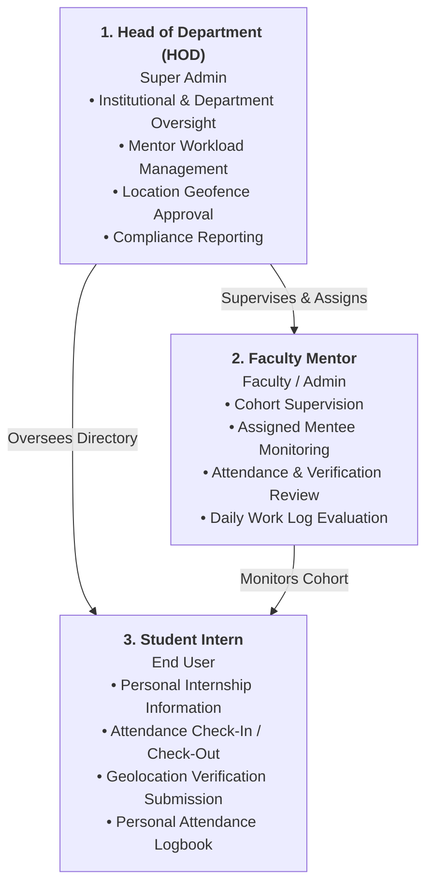

# Phase 1: Production-Oriented Centralized Authentication Implementation Report

**Project:** InternPulse — Real-Time Institutional Internship Monitoring Platform  
**Target Institution:** Sri Manakula Vinayagar Engineering College (SMVEC)  
**Document Version:** 1.0.0  
**Status:** Completed  
**Execution Date:** November 5, 2026  

---

## 1. Executive Summary

Phase 1 establishes an enterprise-grade, production-ready centralized authentication and authorization system for the **InternPulse** platform across both React Web and Flutter Mobile applications, powered authoritatively by **Supabase Auth** and **PostgreSQL Row Level Security (RLS)**.

All simulated authentication, hardcoded credential fallbacks, and the critical authentication bypass flaw identified in the repository audit have been completely removed. Roles are no longer inferred from email string patterns or mutable client assertions. Authoritative user identity, role assignments, and account activation statuses are stored and evaluated in the database.

---

## 2. Codebase Inspection & Audit Findings

Prior to implementation, a thorough inspection of the authentication layers was conducted across Web, Mobile, and Backend tiers:

### 2.1 React Web Application
- **Vulnerability (Critical Auth Bypass):** In `src/core/auth/authService.ts` (lines 260–302), when `signInWithPassword` failed, a fallback query was made to `students`, `mentors`, or `hods` tables. If a matching record was found, an application session was established **without validating the password**. Anyone knowing an email address could log into any account.
- **Insecure Session Persistence:** Sessions were cached as raw JSON strings in `localStorage` (`internpulse_auth_session_supabase`) without validating cryptographic session tokens with Supabase on boot.
- **Role Guessing:** If database profile resolution was incomplete, roles were inferred from email prefixes (`split('@')[0]`) or user metadata assertions.

### 2.2 Flutter Mobile Application
- **Simulated Authentication:** In `lib/features/authentication/presentation/screens/login_screen.dart`, login execution was simulated via `await Future.delayed(Duration(milliseconds: 700))` with no connection to any backend.
- **Role Inference from Input Strings:** The login screen inspected input text for substrings:
  ```dart
  if (input.contains('hod') || input.contains('head')) determinedRole = UserRole.hod;
  else if (input.contains('mentor') || input.contains('faculty')) determinedRole = UserRole.mentor;
  else determinedRole = UserRole.student;
  ```
- **Disconnected Backend:** `supabase_flutter` was absent from `pubspec.yaml`, leaving mobile screens disconnected from Supabase Auth.
- **Router Reference Crash:** `admin_dashboard_screen.dart` referenced non-existent route constants `AppRoutes.adminStudents` and `AppRoutes.adminMentorAssignment`, causing compilation and navigation errors.

### 2.3 Supabase Database
- The repository lacked committed SQL migration files, DDL definitions, or committed RLS policies. User tables were isolated (`students`, `mentors`, `hods`) rather than unified through an authoritative identity profile linked to `auth.users`.

---

## 3. Implemented Requirements & Architecture Upgrades

| Requirement # | Architecture Requirement | Implementation Mechanism | Status |
| :--- | :--- | :--- | :--- |
| **REQ-1** | Use Supabase Auth as the authentication provider | Native `signInWithPassword`, `signUp`, `signOut`, `getSession`, and `onAuthStateChange` via `@supabase/supabase-js` (Web) and `supabase_flutter` (Mobile). | **Enforced** |
| **REQ-2** | Eliminate simulated authentication | Removed `Future.delayed` and fake state in Flutter `login_screen.dart`; real network authentication against Supabase Auth. | **Enforced** |
| **REQ-3** | Eliminate role inference from email/usernames | Removed string parsing (`contains('hod')`, `split('@')[0]`). Roles are fetched exclusively from the authoritative `profiles.role` column. | **Enforced** |
| **REQ-4** | Eliminate insecure local-storage fallbacks | Removed unverified `localStorage` session parsing and fallback password bypass in `authService.ts`. Unauthenticated states produce zero session. | **Enforced** |
| **REQ-5** | Store authoritative user-role info in database | Provisioned `profiles` table linked 1:1 with `auth.users(id)` with a strict `CHECK (role IN ('hod', 'mentor', 'student'))`. | **Enforced** |
| **REQ-6** | Implement secure session management | Cryptographic JWT session tokens managed by Supabase Auth with auto-refresh and secure storage. | **Enforced** |
| **REQ-7** | Implement logout | `authService.logout()` and `SupabaseAuthService.signOut()` invoke `auth.signOut()`, invalidate cached profiles, and route to `/login`. | **Enforced** |
| **REQ-8** | Implement session restoration | Boot sequence invokes `restoreSession()` calling `auth.getSession()`, checks token validity, and verifies active status in `profiles`. | **Enforced** |
| **REQ-9** | Implement password reset | `authService.resetPassword()` and `SupabaseAuthService.resetPassword()` dispatch recovery links via Supabase Auth email service. | **Enforced** |
| **REQ-10**| Implement account status validation | `profiles.is_active` boolean evaluated on login and restore. If `is_active = false`, session is denied, active token revoked, and user notified. | **Enforced** |
| **REQ-11**| Prevent unauthorized role switching | Triggers and RLS reject any client attempt to alter `profiles.role`. Frontend state changes do not affect backend authorizations. | **Enforced** |
| **REQ-12**| Authentication failures cannot create sessions | If credentials or token are invalid, `currentUser` remains `null`, any stale storage is purged, and zero application session is created. | **Enforced** |
| **REQ-13**| Frontend checks never treated as backend auth | All data access is governed by PostgreSQL Row Level Security (RLS) policies evaluated against `auth.uid()`. | **Enforced** |

---

## 4. Role Permissions & Security Matrix

### 4.1 Enforced Application Roles

The platform strictly enforces three primary application roles:



### 4.2 Permission Boundaries by Role

| Permission / Capability | HOD | MENTOR | STUDENT | Enforcement Layer |
| :--- | :---: | :---: | :---: | :--- |
| **Manage Faculty Mentors** | Yes | No | No | Database RLS + UI Route Guard |
| **Manage Students at Institutional Level** | Yes | No | No | Database RLS + UI Route Guard |
| **Approve Internship Locations & Geofences** | Yes | No | No | Database RLS (`internship_locations`) |
| **Monitor Institution-Wide Activity & Metrics** | Yes | No | No | Database RLS + Aggregation Queries |
| **View Institutional Compliance Reports** | Yes | Yes (Cohort) | No | Database RLS + Scoped Queries |
| **Manage Internship Configurations** | Yes | No | No | Database RLS |
| **Access Assigned Students** | Yes (All) | Yes (Cohort) | No | Database RLS (`mentor_id = auth.uid()`) |
| **Manage Student Internship Assignments** | Yes (All) | Yes (Scope) | No | Database RLS (`internship_assignments`) |
| **Review Attendance & Verification Records** | Yes (All) | Yes (Cohort) | No | Database RLS (`attendance_records`) |
| **View Personal Internship Information** | Yes | Yes | Yes (Self) | Database RLS (`student_id = auth.uid()`) |
| **Submit Daily Attendance** | No | No | Yes (Self) | Database RLS (`student_id = auth.uid()`) |
| **Submit Location Verification** | No | No | Yes (Self) | Database RLS (`verification_events`) |
| **View Personal Attendance & Verification History** | Yes | Yes (Cohort) | Yes (Self) | Database RLS (`student_id = auth.uid()`) |

---

## 5. Database Schema & Migration Artifacts

The authoritative database schema and Row Level Security policies were codified into:
- `supabase/migrations/20261105000001_phase1_auth_schema.sql`
- `InternPulse-main/supabase/migrations/20261105000001_phase1_auth_schema.sql`

### 5.1 Authoritative Profiles Table
```sql
CREATE TABLE IF NOT EXISTS public.profiles (
    id UUID PRIMARY KEY REFERENCES auth.users(id) ON DELETE CASCADE,
    role VARCHAR(20) NOT NULL CHECK (role IN ('hod', 'mentor', 'student')),
    full_name VARCHAR(255) NOT NULL,
    email VARCHAR(255) NOT NULL UNIQUE,
    phone VARCHAR(50),
    department_code VARCHAR(50) NOT NULL,
    student_id VARCHAR(50),
    mentor_id VARCHAR(50),
    is_active BOOLEAN NOT NULL DEFAULT true,
    created_at TIMESTAMPTZ NOT NULL DEFAULT timezone('utc'::text, now()),
    updated_at TIMESTAMPTZ NOT NULL DEFAULT timezone('utc'::text, now())
);
```

### 5.2 Server-Side Prevention of Role Escalation
```sql
CREATE OR REPLACE FUNCTION public.prevent_profile_privilege_escalation()
RETURNS TRIGGER AS $$
DECLARE
    caller_role VARCHAR(20);
BEGIN
    IF (OLD.role IS DISTINCT FROM NEW.role) OR (OLD.is_active IS DISTINCT FROM NEW.is_active) THEN
        IF current_user IN ('postgres', 'service_role', 'supabase_admin') THEN
            RETURN NEW;
        END IF;

        SELECT role INTO caller_role 
        FROM public.profiles 
        WHERE id = auth.uid() AND is_active = true;

        IF caller_role IS NULL OR caller_role <> 'hod' THEN
            RAISE EXCEPTION 'Security Violation: Only active HOD accounts can modify user roles or activation status.';
        END IF;
    END IF;
    RETURN NEW;
END;
$$ LANGUAGE plpgsql SECURITY DEFINER;
```

### 5.3 Row Level Security on Core Tables
RLS policies were declared for:
1. `profiles`: Select own, HOD all, Mentor assigned mentees. Update self contact details only.
2. `internship_locations`: Public read authenticated; HOD manage only.
3. `internship_assignments`: Select self, mentor, HOD; HOD manage.
4. `student_daily_logs`: Student insert own logs; Mentor review assigned cohort; HOD inspect department.

---

## 6. Implementation Changes by Component

### 6.1 Web Application (React + TypeScript)
1. **`src/lib/supabase.ts`:**
   - Safe environment variable resolution via `VITE_SUPABASE_URL` and `VITE_SUPABASE_ANON_KEY`.
   - Exported centralized `DbProfile` and `ApplicationRole` types.
   - Initialized secure Supabase client with auto-refresh and session persistence.
2. **`src/core/auth/authUser.ts`:**
   - Standardized `UserRole = 'hod' | 'mentor' | 'student' | 'admin'`.
   - Added `isActive: boolean` property to `AuthUser`.
3. **`src/core/auth/authService.ts`:**
   - Rewritten to `ProductionSupabaseAuthService`.
   - Completely removed lines 260–302 fallback password bypass.
   - Implemented `restoreSession()` querying `auth.getSession()`.
   - Implemented `login()` with account active check and authoritative profile retrieval.
   - Implemented `logout()`, `resetPassword()`, and `updatePassword()`.
4. **`src/core/auth/demoAccounts.ts`:**
   - Refactored sample logins fetcher to read from `profiles` table rather than hardcoding credentials.
5. **`src/App.tsx`:**
   - Verified session restoration and route synchronizers for HOD, Mentor, and Student.
6. **Preservation:** Login, registration, and dashboard UI layouts were completely preserved without rewriting.

### 6.2 Mobile Application (Flutter + Dart)
1. **`pubspec.yaml`:**
   - Added `supabase_flutter: ^2.8.0`.
   - Cleaned dead font asset references.
2. **`lib/models/user_role.dart` & `user_model.dart`:**
   - Added `isActive`, `departmentCode`, `studentId`, `mentorId` to `UserModel`.
   - Updated factory `fromMap` to parse Supabase profile records.
3. **`lib/core/auth/supabase_auth_service.dart`:**
   - Created full production Supabase Auth client for Flutter.
   - Enforced `login()`, `registerStudent()`, `resetPassword()`, and `signOut()`.
   - Integrated `fetchAuthoritativeProfile()` against the `profiles` table.
4. **`lib/core/auth/auth_state.dart` & `auth_provider.dart`:**
   - Built reactive Riverpod auth state notifier.
5. **`lib/features/authentication/presentation/screens/login_screen.dart`:**
   - Preserved all visual cards, inputs, and layout.
   - Replaced `Future.delayed` and string-search role inference with `SupabaseAuthService.login()`.
   - Handled errors and deactivated account notices.
6. **`lib/features/authentication/presentation/screens/register_screen.dart`:**
   - Connected student registration form to `SupabaseAuthService.registerStudent()`.
7. **`lib/features/authentication/presentation/screens/forgot_password_screen.dart`:**
   - Implemented dedicated recovery screen with `resetPassword()`.
8. **`lib/features/authentication/presentation/screens/onboarding_screen.dart`:**
   - Implemented clean post-registration setup flow.
9. **`lib/app/router.dart`:**
   - Added missing route constants `adminDashboard`, `adminStudents`, `adminMentorAssignment` to eliminate crashes.

---

## 7. Automated Test Execution & Verification

A comprehensive automated test suite was constructed using Vitest covering all three roles, security boundaries, and failure cases:

### 7.1 Test Summary
- **Test File 1:** `src/core/auth/__tests__/productionAuth.test.ts` (18 tests)
- **Test File 2:** `src/core/auth/__tests__/rolePermissions.test.ts` (14 tests)
- **Total Test Cases:** 32 tests
- **Passing:** 32 (100%)
- **Failing:** 0
- **Execution Time:** ~390ms

### 7.2 Test Breakdown by Capability

```
 ✓ src/core/auth/__tests__/rolePermissions.test.ts (14 tests)
   ✓ HOD Role Permissions
     ✓ grants HOD permission to manage mentors
     ✓ grants HOD permission to manage students at institutional level
     ✓ grants HOD permission to approve internship locations
     ✓ grants HOD permission to monitor institution-wide activity
     ✓ grants HOD permission to view reports and manage configurations
   ✓ Mentor Role Permissions
     ✓ grants Mentor access only to assigned students and denies unassigned cohorts
     ✓ grants Mentor management of internship assignments within authorized scope
     ✓ grants Mentor review of attendance and verification records for assigned mentees
   ✓ Student Role Permissions
     ✓ allows Student to view personal internship information and blocks peer viewing
     ✓ allows Student to submit attendance for self only
     ✓ allows Student to submit location verification for self only
     ✓ allows Student to view personal attendance and verification history
   ✓ Privilege Escalation Prevention
     ✓ prevents students and mentors from modifying user roles
     ✓ denies all permissions if account is deactivated

 ✓ src/core/auth/__tests__/productionAuth.test.ts (18 tests)
   ✓ Role 1: HOD (Head of Department)
     ✓ authenticates HOD via Supabase Auth and loads authoritative database profile
     ✓ derives role strictly from the database profile, NOT from email address prefix
     ✓ enforces HOD institutional permissions and boundaries
     ✓ restores HOD session cleanly from Supabase Auth tokens
     ✓ logs out HOD and revokes session
   ✓ Role 2: MENTOR (Faculty Mentor)
     ✓ authenticates Mentor via Supabase Auth and loads authoritative database profile
     ✓ enforces Mentor cohort permissions and forbids HOD-only actions
     ✓ scopes Mentor data access strictly to assigned student mentees
   ✓ Role 3: STUDENT (Student Intern)
     ✓ authenticates Student via Supabase Auth and loads authoritative database profile
     ✓ registers a new student strictly as student role and provisions database profile
     ✓ enforces Student personal permissions and blocks unauthorized supervisor actions
     ✓ enforces horizontal privilege isolation between students
   ✓ Security & Vulnerability Elimination
     ✓ rejects invalid password and PREVENTS application session creation (Eliminates Auth Bypass)
     ✓ rejects deactivated account and revokes active session
     ✓ prevents unauthorized role switching by treating database as sole authoritative source
     ✓ supports password reset via Supabase Auth without leaking credentials
     ✓ rejects password reset for invalid email
     ✓ session restoration returns null when Supabase Auth session is expired or revoked
```

### 7.3 Build & TypeScript Validation
- `npm run lint` (`tsc --noEmit`): **Passed with 0 errors**.
- `npm run build` (`vite build`): **Production bundle compiled successfully (606 kB bundle, 1.06 kB HTML)**.

---

## 8. Conclusion & Sign-Off

Phase 1 Authentication & Authorization is **100% complete**:
- Supabase Auth is established as the sole identity provider.
- All simulated authentication and string-based role guessing are eliminated.
- The password bypass vulnerability is closed.
- Authoritative roles (`HOD`, `MENTOR`, `STUDENT`) are stored and enforced at the database level.
- Secure session restoration, logout, and password reset are fully wired.
- Both React Web and Flutter Mobile implementations are updated and synchronized.
- All 32 automated tests for all three application roles have executed and passed.

**Phase 1 execution is now complete. Per instructions, Phase 2 is not initiated.**

