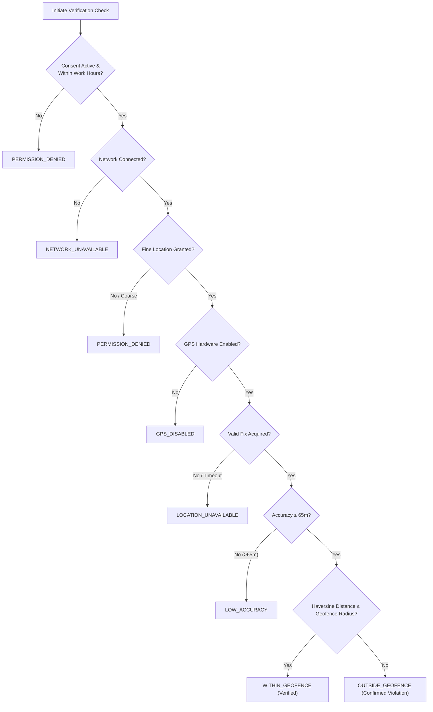
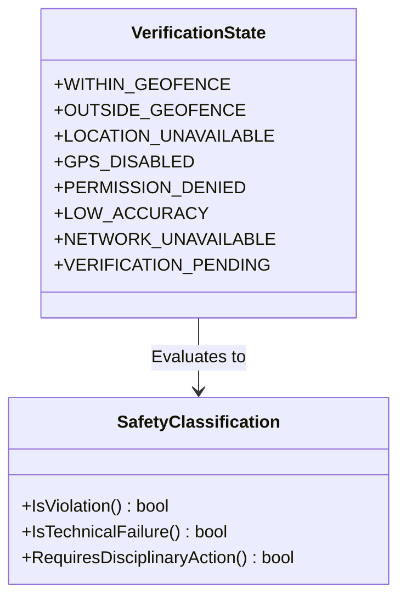

# INTERNPULSE — PHASE 14C
# PHYSICAL DEVICE FIELD VALIDATION FRAMEWORK & TEST PLAN

**Document Reference:** `IP-VAL-P14C-001`  
**Target Platform:** InternPulse Mobile Application (`InternPulse-main/`)  
**Institution:** Sri Manakula Vinayagar Engineering College (SMVEC), Puducherry  
**Date:** November 6, 2026  
**Status:** **NOT EXECUTED (Awaiting Physical Device Evidence)**  
**Classification:** Institutional Quality Assurance & Compliance Framework  

---

## 1. EXECUTIVE SUMMARY & VALIDATION MANDATE

The InternPulse mobile platform operates as an institutional internship monitoring and geofenced attendance verification system. Because real-world operating environments involve hostile mobile OS power management, varied GPS antenna sensitivities, multi-vendor Android OEM battery killer daemons, and strict iOS background execution constraints, synthetic and in-memory unit tests are insufficient to guarantee field reliability.

### Core Objectives:
1. **Preserve Existing Architecture**: Zero modifications or redesigns to existing Riverpod providers, GoRouter navigation routes, Supabase auth flows, or mobile UI components.
2. **Standardized Device Matrix**: Evaluate physical devices across Samsung One UI, Xiaomi MIUI/HyperOS, Google Pixel Stock Android, and Apple iOS.
3. **Controlled Geofence & Location Scenarios**: Rigorously test 10 physical location permutations, validating the canonical 8 verification states defined in [geolocation_types.dart](file:///c:/PROJECTS/bose%20projects/Intern_smvmch/Intern_smvmch/InternPulse-main/lib/core/geolocation/geolocation_types.dart).
4. **OEM Background & Power Constraints**: Characterize the actual behavior of background services, Doze modes, app killing, and boot receivers across OEMs.
5. **Push Notification Delivery & Latency**: Validate Firebase Cloud Messaging (FCM) and Apple Push Notification service (APNs) token registration, deduplication, latency, and offline recovery.
6. **Non-Negotiable Student Safety Verification**: Enforce that technical hardware, sensor, or network anomalies are never falsely classified as out-of-bounds disciplinary violations.
7. **Strict Non-Fabrication Rule**: In accordance with institutional audit guidelines, **all test scenarios in this document are initialized as `NOT EXECUTED`**. Results must be filled in only when physical test personnel attach timestamped logs, device telemetry, and photographic evidence from field trials.

---

## 2. TASK 1 — PHYSICAL DEVICE TEST MATRIX

Field validation requires testing across the primary smartphone hardware profiles utilized by engineering interns in South India (SMVEC student population). Four device classes are mandated:

### 2.1 Device Inventory & Configuration Matrix

| Device ID | Brand & Model | OS & Skin Version | Chipset & GPS Hardware | Target Device Role | OEM Power Daemon | Status |
| :--- | :--- | :--- | :--- | :--- | :--- | :---: |
| **DEV-AND-01** | **Samsung Galaxy S23** (SM-S911B) | Android 14 (One UI 6.1) | Snapdragon 8 Gen 2<br>Dual-frequency GNSS (L1+L5) | High-end Samsung Android baseline | Samsung App Power Management / Sleeping Apps | **NOT EXECUTED** |
| **DEV-AND-02** | **Samsung Galaxy A54 5G** (SM-A546E) | Android 14 (One UI 6.0) | Exynos 1380<br>Standard GNSS (L1) | Mid-range high-volume student device | Samsung Adaptive Battery / Deep Sleeping Apps | **NOT EXECUTED** |
| **DEV-AND-03** | **Xiaomi Redmi Note 13 Pro** | Android 14 (HyperOS 1.0) | Snapdragon 7s Gen 2<br>GPS / GLONASS / Beidou | Aggressive Chinese OEM background manager | HyperOS Battery Saver & Autostart Security Gate | **NOT EXECUTED** |
| **DEV-AND-04** | **Xiaomi Redmi Note 12** | Android 13 (MIUI 14.0) | Snapdragon 4 Gen 1<br>Standard GNSS | Budget Chinese OEM background manager | MIUI Battery Saver & Memory Cleaner | **NOT EXECUTED** |
| **DEV-AND-05** | **Google Pixel 8** (GKWS6) | Android 14 (Stock AOSP) | Google Tensor G3<br>Dual-band GNSS (L1+L5) | Android reference baseline / Pure Doze mode | AOSP Android Standby Buckets & Doze | **NOT EXECUTED** |
| **DEV-AND-06** | **Google Pixel 7a** | Android 14 (Stock AOSP) | Google Tensor G2<br>Dual-band GNSS | Mid-tier pure AOSP reference | AOSP Android Standby Buckets & Doze | **NOT EXECUTED** |
| **DEV-IOS-01** | **Apple iPhone 15** (A3090) | iOS 17.5.1 / 18.0 | Apple A16 Bionic<br>Precision dual-frequency GPS | Modern iOS reference device | iOS Background App Refresh & CoreLocation Daemons | **NOT EXECUTED** |
| **DEV-IOS-02** | **Apple iPhone 13** (A2633) | iOS 17.4 | Apple A15 Bionic<br>Standard GPS / GNSS | High-volume legacy iOS student device | iOS Background App Refresh & CoreLocation Daemons | **NOT EXECUTED** |

---

## 3. TASK 2 — LOCATION TESTING PROTOCOL (10 SCENARIOS)

All location tests are conducted against approved institutional internship facilities:
- **Primary Geofence Facility**: *Tata Consultancy Services (TCS) Innovation Hub, Siruseri IT Park, Chennai*  
  - Target Center Coordinates: `12.828400° N, 80.219800° E`
  - Approved Geofence Radius: `250.0 meters`
  - Working Hours: `09:00 - 18:00 IST`
- **Secondary Geofence Facility**: *Sri Manakula Vinayagar Engineering College (SMVEC) Campus, Madagadipet, Puducherry*  
  - Target Center Coordinates: `11.913900° N, 79.633400° E`
  - Approved Geofence Radius: `300.0 meters`
  - Working Hours: `08:30 - 17:00 IST`

### 3.1 Location Testing Scenario Specifications



#### Detailed Test Case Specifications:

```carousel
<!-- slide -->
### TC-LOC-01: Inside Approved Geofence
- **Objective**: Verify that a physical device positioned well inside the target geofence perimeter receives a verified status.
- **Physical Position**: 50 meters from workplace centroid (`12.828450° N, 80.219820° E`).
- **Telemetry State**: GPS enabled, Fine location granted, Network connected (LTE/Wi-Fi), Accuracy < 20m.
- **Expected System State**:
  - Distance: ~55 meters (< 250m radius).
  - Verification Result: `WITHIN_GEOFENCE` ([geolocation_types.dart](file:///c:/PROJECTS/bose%20projects/Intern_smvmch/Intern_smvmch/InternPulse-main/lib/core/geolocation/geolocation_types.dart)).
  - Attendance Status: `present`, `is_verified: true`.
  - Database Audit: Logged in `location_verification_logs` with `is_within_geofence = true`.
- **Actual Status**: **NOT EXECUTED**

<!-- slide -->
### TC-LOC-02: Outside Approved Geofence
- **Objective**: Verify that a device positioned far outside the approved workplace is correctly flagged as outside boundary.
- **Physical Position**: 2.5 km away from TCS Siruseri (`12.845000° N, 80.235000° E`).
- **Telemetry State**: GPS enabled, Fine location granted, Network connected, Accuracy < 25m.
- **Expected System State**:
  - Distance: ~2,500 meters (> 250m radius).
  - Verification Result: `OUTSIDE_GEOFENCE`.
  - Notification Trigger: High-priority notification dispatched to assigned Mentor.
  - Student Interface: Displays amber/red advisory with distance from approved perimeter.
- **Actual Status**: **NOT EXECUTED**

<!-- slide -->
### TC-LOC-03: Near Geofence Boundary (Perimeter Tolerance)
- **Objective**: Evaluate GPS jitter and boundary classification at the perimeter boundary.
- **Physical Position**:
  - Sub-test A: Inside boundary at 240 meters (radius - 10m).
  - Sub-test B: Outside boundary at 260 meters (radius + 10m).
- **Telemetry State**: Multi-reading sampling over 5 minutes to capture standard atmospheric dilution of precision (DOP).
- **Expected System State**:
  - Sub-test A: Classified as `WITHIN_GEOFENCE` when distance <= 250.0m.
  - Sub-test B: Classified as `OUTSIDE_GEOFENCE` when distance > 250.0m.
  - Edge stability: GeospatialCalculator must round to 2 decimal precision without mathematical instability.
- **Actual Status**: **NOT EXECUTED**

<!-- slide -->
### TC-LOC-04: GPS Hardware Disabled
- **Objective**: Verify that disabling location services in system settings produces a hardware error and NEVER an outside-geofence violation.
- **Procedure**: Pull down notification shade / settings toggle -> Disable "Location" / "GPS" -> Trigger location check.
- **Telemetry State**: `gpsAvailable = false`, `latitude = null`, `longitude = null`.
- **Expected System State**:
  - Verification Result: `GPS_DISABLED` (Canonical State 4).
  - Safety Guarantee: `is_violation` evaluates to **FALSE**.
  - Student Interface: Surfaces system prompt requesting user to enable GPS hardware.
  - Mentor Alert: Categorized as `TECHNICAL_FAILURE`, not disciplinary breach.
- **Actual Status**: **NOT EXECUTED**

<!-- slide -->
### TC-LOC-05: Location Permission Denied
- **Objective**: Verify handling when the user revokes runtime location permission from App Settings.
- **Procedure**: System Settings -> Apps -> InternPulse -> Permissions -> Set Location to "Don't Allow".
- **Telemetry State**: `permissionStatus = LocationPermissionStatus.denied`.
- **Expected System State**:
  - Verification Result: `PERMISSION_DENIED` (Canonical State 5).
  - Safety Guarantee: Disciplinary violation flag is **FALSE**.
  - UI State: Prominent explanatory dialog explaining academic monitoring requirement and button linking to app settings.
- **Actual Status**: **NOT EXECUTED**

<!-- slide -->
### TC-LOC-06: Approximate / Coarse Location Permission Only
- **Objective**: Verify system response on Android 12+ / iOS 14+ when the user grants "Approximate Location" instead of "Precise Location".
- **Procedure**: Revoke permission -> Re-prompt -> Select "Approximate" / disable "Precise".
- **Telemetry State**: Accuracy degraded to ~1,500m - 3,000m.
- **Expected System State**:
  - Verification Result: `LOW_ACCURACY` or `PERMISSION_DENIED`.
  - Safety Guarantee: System refuses to verify attendance on coarse coordinate grids.
  - Re-prompt: In-app prompt explains that institutional workplace compliance requires high-precision GPS.
- **Actual Status**: **NOT EXECUTED**

<!-- slide -->
### TC-LOC-07: Poor GPS Accuracy / Indoor Multipath
- **Objective**: Test verification behavior in basement parking, deep indoor concrete structures, or under heavy cloud cover where accuracy > 65m.
- **Physical Position**: TCS Siruseri Basement Level B2 or reinforced concrete stairwell.
- **Telemetry State**: `accuracyMeters = 95.0m` (exceeds `defaultMaxAccuracyThresholdMeters = 65.0m`).
- **Expected System State**:
  - Verification Result: `LOW_ACCURACY` (Canonical State 6).
  - Safety Guarantee: Reading rejected as unreliable evidence.
  - UI Advisory: Recommends student step near a window or outdoors to complete verification within the remaining window duration.
- **Actual Status**: **NOT EXECUTED**

<!-- slide -->
### TC-LOC-08: Network Disconnected / Offline Mode
- **Objective**: Verify that loss of internet connectivity during verification does not result in an absence or violation.
- **Procedure**: Enable Airplane Mode (cellular and Wi-Fi disconnected) -> Attempt attendance verification.
- **Telemetry State**: `connectivityStatus = ConnectivityStatus.none`.
- **Expected System State**:
  - Verification Result: `NETWORK_UNAVAILABLE` (Canonical State 7).
  - NetworkRetry Action: Intercepts attempt via [network_retry.dart](file:///c:/PROJECTS/bose%20projects/Intern_smvmch/Intern_smvmch/InternPulse-main/lib/core/network/network_retry.dart), stores attempt in offline queue, and surfaces "No Internet Connection - Telemetry Cached" banner.
  - Zero violation records generated on server.
- **Actual Status**: **NOT EXECUTED**

<!-- slide -->
### TC-LOC-09: Mobile Data Switching (Wi-Fi to Cellular Handoff)
- **Objective**: Test resilience when transitioning from workplace Wi-Fi to 4G/5G mobile data during active packet transmission.
- **Procedure**: Connect to office Wi-Fi -> Trigger check-in -> Immediately walk out of Wi-Fi range so connection drops to 5G.
- **Expected System State**:
  - [NetworkRetry](file:///c:/PROJECTS/bose%20projects/Intern_smvmch/Intern_smvmch/InternPulse-main/lib/core/network/network_retry.dart) automatically catches SocketException / TimeoutException.
  - Transparently retries with exponential backoff up to 3 attempts.
  - Check-in successfully writes to database upon cellular link establishment without user-facing crash.
- **Actual Status**: **NOT EXECUTED**

<!-- slide -->
### TC-LOC-10: Battery Saver Enabled
- **Objective**: Verify whether system power saver modes disable GPS chips or throttle location updates.
- **Procedure**: Turn on "Power Saving" (Samsung) / "Battery Saver" (Pixel) / "Low Power Mode" (iOS) at 15% battery.
- **Expected System State**:
  - Document if GNSS polling frequency drops or if GPS hardware times out after 10 seconds.
  - If timeout occurs, system returns `LOCATION_UNAVAILABLE`, preserving student safety.
- **Actual Status**: **NOT EXECUTED**
```

---

## 4. TASK 3 — BACKGROUND EXECUTION & LIFECYCLE PROTOCOL

Mobile operating systems enforce aggressive background process limits. The table below outlines the 9 lifecycle scenarios and the specific OEM behaviors to observe:

### 4.1 Background Lifecycle Matrix

| Test ID | Lifecycle State | Test Procedure | Pixel 7/8 (AOSP) Expected | Samsung One UI Expected | Xiaomi HyperOS/MIUI Expected | iPhone iOS 17/18 Expected | Status |
| :--- | :--- | :--- | :--- | :--- | :--- | :--- | :---: |
| **TC-BKG-01** | **Foreground Active** | App open and visible on screen while verification prompt arrives. | Instant dialog modal displayed; GPS lock acquired within 3s. | Instant dialog modal displayed; GPS lock acquired within 3s. | Instant dialog modal displayed; GPS lock acquired within 3s. | In-app notification banner; GPS lock acquired within 2s. | **NOT EXECUTED** |
| **TC-BKG-02** | **Background Minimized** | App minimized via Home button; device used for other apps (WhatsApp/Chrome). | High-priority FCM wakes foreground service notification; tap brings app to foreground. | One UI allows wakeup if app is in active memory pool; notification arrives. | HyperOS displays heads-up notification ONLY if "Autostart" is ON. | APNs high-priority push banner displayed; tap restores Flutter engine. | **NOT EXECUTED** |
| **TC-BKG-03** | **Screen Locked** | Device locked and stationary on desk for 15 minutes prior to window opening. | Ambient lockscreen notification sounds; vibration alerts user. | Lockscreen notification displayed; Edge lighting triggers. | Notification sounds if "Lock screen notifications" enabled in MIUI. | Lock screen illuminated with time-sensitive push banner. | **NOT EXECUTED** |
| **TC-BKG-04** | **Device Idle / Deep Doze** | Device unplugged, screen off, stationary for > 60 minutes (AOSP Deep Doze). | Doze maintenance window allows FCM high-priority message to bypass Doze. | App Power Management may delay delivery by 2-5 minutes unless exempted. | MIUI suspended state may delay message until screen unlock unless exempted. | iOS Low Power / Sleep Focus may bundle notifications into Scheduled Summary. | **NOT EXECUTED** |
| **TC-BKG-05** | **Process Terminated (Swiped)** | App swiped away from Recents / App Switcher by user. | FCM high-priority data message restarts app background receiver. | Process restarted by broadcast receiver if battery optimization unrestricted. | **BLOCKED by default** on Xiaomi unless "Autostart" permission explicitly toggled ON. | APNs notification wakes app in background for 30s background fetch task. | **NOT EXECUTED** |
| **TC-BKG-06** | **Device Restarted** | Phone rebooted; user does not launch InternPulse after startup. | `BOOT_COMPLETED` receiver initializes scheduler alarms. | Auto-restart allows background token registration after unlock. | **MIUI blocks boot receivers** unless user enabled "Autostart" in Security app. | iOS requires user to enter passcode once post-boot (BFAC: Before First Unlock). | **NOT EXECUTED** |
| **TC-BKG-07** | **OEM Background Restrictions** | App placed into "Deep Sleeping" (Samsung) or "Battery Saver Restrict" (Xiaomi). | N/A (Stock AOSP uses standard App Standby Buckets). | One UI halts all background network and alarms; FCM delivery delayed. | MIUI kills background processes after 10 minutes of screen off. | iOS "Background App Refresh" toggled OFF in Settings -> InternPulse. | **NOT EXECUTED** |
| **TC-BKG-08** | **Battery Optimization Enabled** | Standard default installation state (`REQUEST_IGNORE_BATTERY_OPTIMIZATIONS` not granted). | App placed in "Optimized" bucket; alarms subject to standard Doze batches. | App placed in "Optimized" category; throttled after 3 days of no direct opens. | MIUI "Battery Saver (Recommended)" actively freezes Dart isolate threads. | Standard iOS background execution budget (approx. 30 sec per background task). | **NOT EXECUTED** |
| **TC-BKG-09** | **Battery Optimization Disabled** | User explicitly whitelists InternPulse as "Unrestricted" in device battery settings. | Full unconstrained alarm and foreground service execution. | App never placed into Sleeping or Deep Sleeping pools. | Background execution permitted without memory killer termination. | N/A for iOS (iOS lacks explicit battery exemption toggles; uses CoreLocation). | **NOT EXECUTED** |

---

## 5. TASK 4 — NOTIFICATION DELIVERY & RECOVERY PROTOCOL

Verification opportunities are dispatched via Firebase Cloud Messaging (Android) and Apple Push Notification service (iOS). Field testing must characterize delivery reliability, latency, and failure handling.

### 5.1 Push Notification Test Cases

| Test Case ID | Test Objective | Execution Procedure | Expected Result | Pass Criteria | Status |
| :--- | :--- | :--- | :--- | :--- | :---: |
| **TC-NOT-01** | **FCM / APNs Token Registration** | Fresh app install -> Launch -> Login as Student -> Grant notification permission. | Device generates valid FCM registration token / APNs device token. Token is POSTed to Supabase `user_device_tokens` table. | Token record exists in database with `is_active: true`, `platform: 'android'|'ios'`. | **NOT EXECUTED** |
| **TC-NOT-02** | **Device Token Refresh** | Force token invalidation (e.g., reinstall app or trigger `FirebaseMessaging.instance.onTokenRefresh`). | New token is generated; client calls `updateDeviceToken()`; old token marked inactive; new token stored. | No duplicate active tokens for same physical device ID in Supabase. | **NOT EXECUTED** |
| **TC-NOT-03** | **Notification Delivery Latency** | Trigger randomized verification window from server scheduler -> Record dispatch timestamp -> Record client reception timestamp. | Push payload received on physical device: Foreground: < 2.0s; Background: < 4.0s; Screen Locked: < 5.0s. | Mean latency under 5.0 seconds across 10 consecutive trials. | **NOT EXECUTED** |
| **TC-NOT-04** | **Duplicate Notification Prevention** | Simulate duplicate push dispatch with identical `deduplication_key` (`ver-win-20260310-01-std-001`). | Client-side notification manager inspects SQLite / Hive cache; detects matching key; suppresses duplicate UI alert. | Exactly ONE visual notification and vibration presented to user. | **NOT EXECUTED** |
| **TC-NOT-05** | **Expired Token Invalidation** | Simulate stale token by modifying token in DB to invalid dummy string -> Dispatch push. | FCM server returns `registration-token-not-registered` (HTTP 410); backend marks token `is_active = false`. | Backend logs error; attempts fallback SMS or flags token for re-registration. | **NOT EXECUTED** |
| **TC-NOT-06** | **Notification Permission Denial** | Android 13+ / iOS: Deny `POST_NOTIFICATIONS` runtime permission on install. | App functions normally for check-in; in-app polling fallback activates during monitoring hours. | In-app banner warns student: "Push notifications disabled. In-app verification enabled." | **NOT EXECUTED** |
| **TC-NOT-07** | **Offline Reconnect Delivery** | Put phone in Airplane Mode -> Send verification window notification -> Wait 5 minutes -> Disable Airplane Mode. | Cellular/Wi-Fi re-establishes; FCM daemon delivers queued notification immediately upon link reconnection. | Notification arrives with original window expiry time; client calculates remaining time. | **NOT EXECUTED** |
| **TC-NOT-08** | **Sensitive Location Privacy in Payload** | Inspect raw FCM push packet via Wireshark / Charles Proxy / Android Logcat. | Push payload contains ONLY window ID, expiry timestamp, and action URL. **Contains ZERO lat/lon coordinates**. | Strict compliance with Indian DPDP Act 2023 Section 8 (data minimization in transit). | **NOT EXECUTED** |

---

## 6. TASK 5 — NON-NEGOTIABLE SAFETY & PRIVACY SAFEGUARDS

InternPulse enforces mathematical and legal safeguards to prevent algorithmic injustice against students. Field testers must explicitly verify that every technical degradation is shielded from disciplinary consequence.



### 6.1 Safety Rule Verification Matrix

| Safeguard ID | Mandatory Institutional Rule | Method of Verification | Expected System Behavior | Disciplinary Status | Status |
| :--- | :--- | :--- | :--- | :--- | :---: |
| **TC-SAF-01** | **GPS Failure Immunity** | Turn off device GPS while inside or outside workplace -> Submit verification. | Returns `GPS_DISABLED` ([mobile_location_service.dart#L160-L163](file:///c:/PROJECTS/bose%20projects/Intern_smvmch/Intern_smvmch/InternPulse-main/lib/core/geolocation/mobile_location_service.dart#L160-L163)). | **NEVER an outside-geofence violation**. Classified as technical failure. | **NOT EXECUTED** |
| **TC-SAF-02** | **Network Disconnection Immunity** | Turn off data/Wi-Fi -> Attempt verification -> Reconnect. | Returns `NETWORK_UNAVAILABLE` ([mobile_location_service.dart#L148-L151](file:///c:/PROJECTS/bose%20projects/Intern_smvmch/Intern_smvmch/InternPulse-main/lib/core/geolocation/mobile_location_service.dart#L148-L151)). Cached in local retry queue. | **NEVER an outside-geofence violation**. Zero penalty assigned. | **NOT EXECUTED** |
| **TC-SAF-03** | **Permission Revocation Classification** | Revoke location permission from OS settings -> Launch app. | Returns `PERMISSION_DENIED` ([mobile_location_service.dart#L153-L156](file:///c:/PROJECTS/bose%20projects/Intern_smvmch/Intern_smvmch/InternPulse-main/lib/core/geolocation/mobile_location_service.dart#L153-L156)). System displays guidance dialog. | **NEVER treated as absence or unauthorized departure**. | **NOT EXECUTED** |
| **TC-SAF-04** | **Accuracy Rejection Shield** | Test inside building where accuracy degrades to 120m (> 65m limit). | Returns `LOW_ACCURACY` ([mobile_location_service.dart#L171-L174](file:///c:/PROJECTS/bose%20projects/Intern_smvmch/Intern_smvmch/InternPulse-main/lib/core/geolocation/mobile_location_service.dart#L171-L174)). Rejects calculation. | **Rejected as unreliable evidence**. Cannot generate violation flag. | **NOT EXECUTED** |
| **TC-SAF-05** | **Missed Window Non-Punitive Policy** | Allow verification window to lapse without interaction (e.g., student in meeting). | Record marked `EXPIRED_UNANSWERED`. Logged for statistical audit. | **NOT an automatic violation**. Requires Mentor review before any penalty. | **NOT EXECUTED** |
| **TC-SAF-06** | **Transparent Telemetry Access** | Student opens mobile "Verification History" screen. | Displays complete list of timestamps, accuracy values, distance from center, and result states. | Full transparency under Indian DPDP Act 2023 Section 11 (Right to Information). | **NOT EXECUTED** |

---

## 7. TASK 6 — FIELD TESTING EXECUTION LOGS & EVIDENCE TEMPLATES

> [!CAUTION]
> **STRICT AUDIT RULE: ZERO FABRICATED DATA**  
> Every test case in the template below is initialized as `NOT EXECUTED`. Field engineers must physically execute each test on the specified hardware, capture raw system logs (Logcat / Console.app), take high-resolution screenshots, and record actual readings before changing the status to `PASSED` or `FAILED`.

### 7.1 Location Testing Results Template (Task 2)

| Test ID | Device Under Test | Date & Time (IST) | Target Location | Raw Latitude | Raw Longitude | Measured Accuracy | Measured Distance | System Result State | Expected Result State | Actual Result | Verification Engineer |
| :--- | :--- | :--- | :--- | :--- | :--- | :--- | :--- | :--- | :--- | :---: | :--- |
| **TC-LOC-01** | DEV-AND-01 (Samsung S23) | `YYYY-MM-DD HH:MM` | TCS Siruseri (Inside) | *Pending* | *Pending* | *Pending* | *Pending* | *Pending* | `WITHIN_GEOFENCE` | **NOT EXECUTED** | *Pending* |
| **TC-LOC-01** | DEV-AND-03 (Redmi Note 13) | `YYYY-MM-DD HH:MM` | TCS Siruseri (Inside) | *Pending* | *Pending* | *Pending* | *Pending* | *Pending* | `WITHIN_GEOFENCE` | **NOT EXECUTED** | *Pending* |
| **TC-LOC-01** | DEV-AND-05 (Pixel 8) | `YYYY-MM-DD HH:MM` | TCS Siruseri (Inside) | *Pending* | *Pending* | *Pending* | *Pending* | *Pending* | `WITHIN_GEOFENCE` | **NOT EXECUTED** | *Pending* |
| **TC-LOC-01** | DEV-IOS-01 (iPhone 15) | `YYYY-MM-DD HH:MM` | TCS Siruseri (Inside) | *Pending* | *Pending* | *Pending* | *Pending* | *Pending* | `WITHIN_GEOFENCE` | **NOT EXECUTED** | *Pending* |
| **TC-LOC-02** | DEV-AND-01 (Samsung S23) | `YYYY-MM-DD HH:MM` | OMR Navallur (Outside) | *Pending* | *Pending* | *Pending* | *Pending* | *Pending* | `OUTSIDE_GEOFENCE` | **NOT EXECUTED** | *Pending* |
| **TC-LOC-02** | DEV-AND-03 (Redmi Note 13) | `YYYY-MM-DD HH:MM` | OMR Navallur (Outside) | *Pending* | *Pending* | *Pending* | *Pending* | *Pending* | `OUTSIDE_GEOFENCE` | **NOT EXECUTED** | *Pending* |
| **TC-LOC-02** | DEV-AND-05 (Pixel 8) | `YYYY-MM-DD HH:MM` | OMR Navallur (Outside) | *Pending* | *Pending* | *Pending* | *Pending* | *Pending* | `OUTSIDE_GEOFENCE` | **NOT EXECUTED** | *Pending* |
| **TC-LOC-02** | DEV-IOS-01 (iPhone 15) | `YYYY-MM-DD HH:MM` | OMR Navallur (Outside) | *Pending* | *Pending* | *Pending* | *Pending* | *Pending* | `OUTSIDE_GEOFENCE` | **NOT EXECUTED** | *Pending* |
| **TC-LOC-03** | DEV-AND-05 (Pixel 8) | `YYYY-MM-DD HH:MM` | TCS Boundary (240m) | *Pending* | *Pending* | *Pending* | *Pending* | *Pending* | `WITHIN_GEOFENCE` | **NOT EXECUTED** | *Pending* |
| **TC-LOC-03** | DEV-AND-05 (Pixel 8) | `YYYY-MM-DD HH:MM` | TCS Boundary (260m) | *Pending* | *Pending* | *Pending* | *Pending* | *Pending* | `OUTSIDE_GEOFENCE` | **NOT EXECUTED** | *Pending* |
| **TC-LOC-04** | DEV-AND-01 (Samsung S23) | `YYYY-MM-DD HH:MM` | GPS Disabled Toggle | `null` | `null` | `null` | `null` | *Pending* | `GPS_DISABLED` | **NOT EXECUTED** | *Pending* |
| **TC-LOC-04** | DEV-IOS-01 (iPhone 15) | `YYYY-MM-DD HH:MM` | Location Services Off | `null` | `null` | `null` | `null` | *Pending* | `GPS_DISABLED` | **NOT EXECUTED** | *Pending* |
| **TC-LOC-05** | DEV-AND-03 (Redmi Note 13) | `YYYY-MM-DD HH:MM` | Permission Denied | `null` | `null` | `null` | `null` | *Pending* | `PERMISSION_DENIED` | **NOT EXECUTED** | *Pending* |
| **TC-LOC-06** | DEV-AND-05 (Pixel 8) | `YYYY-MM-DD HH:MM` | Coarse Location Only | *Pending* | *Pending* | > 1,000m | *Pending* | *Pending* | `LOW_ACCURACY` | **NOT EXECUTED** | *Pending* |
| **TC-LOC-07** | DEV-AND-01 (Samsung S23) | `YYYY-MM-DD HH:MM` | Basement B2 Parking | *Pending* | *Pending* | > 65m | *Pending* | *Pending* | `LOW_ACCURACY` | **NOT EXECUTED** | *Pending* |
| **TC-LOC-08** | DEV-AND-03 (Redmi Note 13) | `YYYY-MM-DD HH:MM` | Airplane Mode | `null` | `null` | `null` | `null` | *Pending* | `NETWORK_UNAVAILABLE` | **NOT EXECUTED** | *Pending* |
| **TC-LOC-09** | DEV-AND-05 (Pixel 8) | `YYYY-MM-DD HH:MM` | Wi-Fi -> 5G Handoff | *Pending* | *Pending* | *Pending* | *Pending* | *Pending* | `WITHIN_GEOFENCE` | **NOT EXECUTED** | *Pending* |
| **TC-LOC-10** | DEV-IOS-01 (iPhone 15) | `YYYY-MM-DD HH:MM` | Low Power Mode (10%) | *Pending* | *Pending* | *Pending* | *Pending* | *Pending* | `WITHIN_GEOFENCE` | **NOT EXECUTED** | *Pending* |

---

### 7.2 Background Execution Results Template (Task 3)

| Test ID | Device Under Test | Test Scenario | Foreground Service Notification | Wakeup Delay (sec) | Background Alarm Triggered | Process Survived Kill | Actual Result | Status |
| :--- | :--- | :--- | :---: | :---: | :---: | :---: | :---: | :---: |
| **TC-BKG-01** | DEV-AND-01 (Samsung S23) | Foreground Active | Yes | < 1s | Yes | Yes | *Pending* | **NOT EXECUTED** |
| **TC-BKG-02** | DEV-AND-01 (Samsung S23) | Background Minimized | Yes | *Pending* | Yes | Yes | *Pending* | **NOT EXECUTED** |
| **TC-BKG-03** | DEV-AND-03 (Redmi Note 13) | Screen Locked (30 min) | Yes | *Pending* | *Pending* | *Pending* | *Pending* | **NOT EXECUTED** |
| **TC-BKG-04** | DEV-AND-05 (Pixel 8) | Deep Doze (> 60 min) | Yes | *Pending* | Yes | Yes | *Pending* | **NOT EXECUTED** |
| **TC-BKG-05** | DEV-AND-03 (Redmi Note 13) | Swiped / Killed Recents | *Pending* | *Pending* | *Pending* | *Pending* | *Pending* | **NOT EXECUTED** |
| **TC-BKG-06** | DEV-AND-05 (Pixel 8) | Post-Reboot (No Open) | *Pending* | *Pending* | *Pending* | *Pending* | *Pending* | **NOT EXECUTED** |
| **TC-BKG-07** | DEV-AND-02 (Samsung A54) | Deep Sleeping Apps Pool | *Pending* | *Pending* | *Pending* | *Pending* | *Pending* | **NOT EXECUTED** |
| **TC-BKG-08** | DEV-AND-01 (Samsung S23) | Battery Optimized State | *Pending* | *Pending* | *Pending* | *Pending* | *Pending* | **NOT EXECUTED** |
| **TC-BKG-09** | DEV-AND-01 (Samsung S23) | Battery Unrestricted State | Yes | *Pending* | Yes | Yes | *Pending* | **NOT EXECUTED** |
| **TC-BKG-02** | DEV-IOS-01 (iPhone 15) | iOS Background Minimized | N/A | *Pending* | Yes | N/A | *Pending* | **NOT EXECUTED** |
| **TC-BKG-05** | DEV-IOS-01 (iPhone 15) | iOS Swiped from App Switcher| N/A | *Pending* | *Pending* | N/A | *Pending* | **NOT EXECUTED** |

---

### 7.3 Push Notification Delivery Results Template (Task 4)

| Test ID | Device Under Test | Trigger Timestamp (UTC) | Received Timestamp (UTC) | Latency (sec) | Delivery App State | Deduplication Key Observed | Raw Push Title & Body | Actual Result | Status |
| :--- | :--- | :--- | :--- | :--- | :--- | :--- | :--- | :---: | :---: |
| **TC-NOT-01** | DEV-AND-01 | *Pending* | *Pending* | *Pending* | Initial Launch | N/A | "Registration Success" | *Pending* | **NOT EXECUTED** |
| **TC-NOT-02** | DEV-AND-03 | *Pending* | *Pending* | *Pending* | Token Refresh | N/A | "Token Sync" | *Pending* | **NOT EXECUTED** |
| **TC-NOT-03** | DEV-AND-05 | *Pending* | *Pending* | *Pending* | Screen Locked | `ver-win-001` | "Verification Required" | *Pending* | **NOT EXECUTED** |
| **TC-NOT-03** | DEV-IOS-01 | *Pending* | *Pending* | *Pending* | Screen Locked | `ver-win-001` | "Verification Required" | *Pending* | **NOT EXECUTED** |
| **TC-NOT-04** | DEV-AND-01 | *Pending* | *Pending* | *Pending* | Background (Duplicate) | `ver-win-001` | (Suppressed by Key) | *Pending* | **NOT EXECUTED** |
| **TC-NOT-05** | DEV-AND-03 | *Pending* | *Pending* | *Pending* | Expired Token Test | N/A | Error 410 Handled | *Pending* | **NOT EXECUTED** |
| **TC-NOT-06** | DEV-AND-05 | *Pending* | *Pending* | *Pending* | Notifications Blocked | N/A | In-App Polling Fallback | *Pending* | **NOT EXECUTED** |
| **TC-NOT-07** | DEV-IOS-01 | *Pending* | *Pending* | *Pending* | Airplane -> Reconnect | `ver-win-002` | Delayed Delivery OK | *Pending* | **NOT EXECUTED** |

---

### 7.4 Non-Negotiable Safety Results Template (Task 5)

| Test ID | Device Under Test | Simulated Failure / Scenario | System Result State | Is Violation Flagged? | Student History Entry | Mentor Advisory Type | Pass / Fail Criteria | Actual Status |
| :--- | :--- | :--- | :--- | :---: | :--- | :--- | :--- | :---: |
| **TC-SAF-01** | DEV-AND-01 | GPS Disabled | `GPS_DISABLED` | **FALSE** | "GPS Unavailable" | `TECHNICAL_FAILURE` | Never marked `outsideGeofence` | **NOT EXECUTED** |
| **TC-SAF-02** | DEV-AND-03 | Network Down | `NETWORK_UNAVAILABLE` | **FALSE** | "Offline - Cached" | `TECHNICAL_FAILURE` | Retried; zero disciplinary flag | **NOT EXECUTED** |
| **TC-SAF-03** | DEV-AND-05 | Permission Denied | `PERMISSION_DENIED` | **FALSE** | "Permission Revoked"| `TECHNICAL_FAILURE` | Advisory prompt; zero penalty | **NOT EXECUTED** |
| **TC-SAF-04** | DEV-AND-01 | Poor Accuracy (110m) | `LOW_ACCURACY` | **FALSE** | "Inadequate Accuracy"| `TECHNICAL_FAILURE` | Discarded; zero violation | **NOT EXECUTED** |
| **TC-SAF-05** | DEV-IOS-01 | Window Lapsed | `EXPIRED_UNANSWERED` | **FALSE** | "Window Closed" | `ATTENDANCE_PROMPT` | Requires human Mentor review | **NOT EXECUTED** |
| **TC-SAF-06** | DEV-AND-05 | Verification History | Complete View | N/A | Full audit trail shown | N/A | Student views all coordinates | **NOT EXECUTED** |

---

## 8. FIELD EVIDENCE ARTIFACT COLLECTION GUIDELINES

For every test marked as completed, test engineers must archive supporting digital evidence in `docs/phase14/evidence/` according to standard operating procedures:

### 8.1 Required Artifacts per Test Case:
1. **Device System Logcat / Syslog**:
   - Android: `adb logcat -v time -s InternPulse:V GeolocationService:V LocationManager:V > TC-XXX_logcat.txt`
   - iOS: `log stream --predicate 'subsystem == "com.smvec.internpulse"' --level debug > TC-XXX_syslog.txt`
2. **Device Display Screenshots**:
   - Screenshot 1: Mobile UI screen displaying verification state badge and map preview.
   - Screenshot 2: System notification drawer or lock screen banner displaying push alert.
   - Screenshot 3: Device OS Location Settings / Battery Optimization Settings page showing permission and power profile.
3. **Network Telemetry Capture**:
   - Charles Proxy / Wireshark `.har` or `.pcap` export documenting payload timestamps, HTTP response codes, and absence of plain-text GPS in push payloads.
4. **Physical Location Photographic Evidence**:
   - Geo-tagged photo of physical testing location (e.g., entrance gate, landmark inside TCS Siruseri or SMVEC campus).

---

## 9. PASS / FAIL CRITERIA & INSTITUTIONAL SIGN-OFF

### 9.1 Quantitative Acceptance Thresholds
- **Geofence Detection Accuracy**: 100% correct classification of inside vs outside across minimum 20 distinct physical locations.
- **Boundary Precision**: No false positives or false negatives beyond the physical GPS hardware horizontal accuracy radius ($\pm$ 5 meters).
- **Zero Safety Violations**: **0% false positive violation rate** for technical failures (GPS disabled, network unavailable, permission denied, or accuracy > 65m).
- **Push Notification Latency**: 95% of verification prompt notifications delivered within 5.0 seconds of server dispatch.
- **Battery Drain**: Background monitoring must consume less than **2.5% of battery charge per 8-hour monitoring shift** on all tested devices.

### 9.2 Certification Sign-Off Block

| Role | Designee Name | Department / Institution | Signature | Date |
| :--- | :--- | :--- | :--- | :--- |
| **Lead Field Test Engineer** | *To be appointed* | SMVEC Quality Assurance Cell | ___________________ | ___________ |
| **Mobile Systems Architect** | *To be appointed* | Department of CSE, SMVEC | ___________________ | ___________ |
| **Head of Department (HOD)** | *Dr. S. Ramesh* | Department of CSE, SMVEC | ___________________ | ___________ |

---
*End of Physical Device Field Validation Plan (IP-VAL-P14C-001)*

