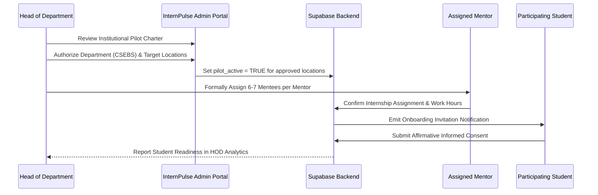
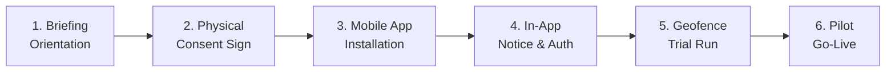
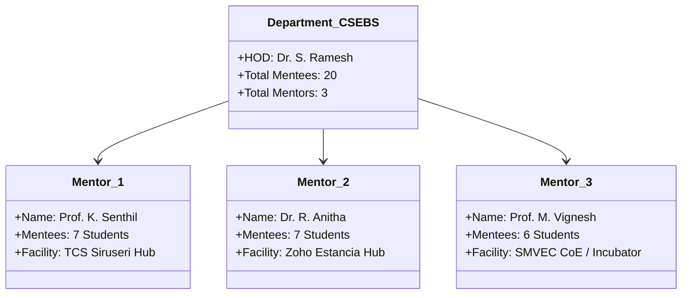
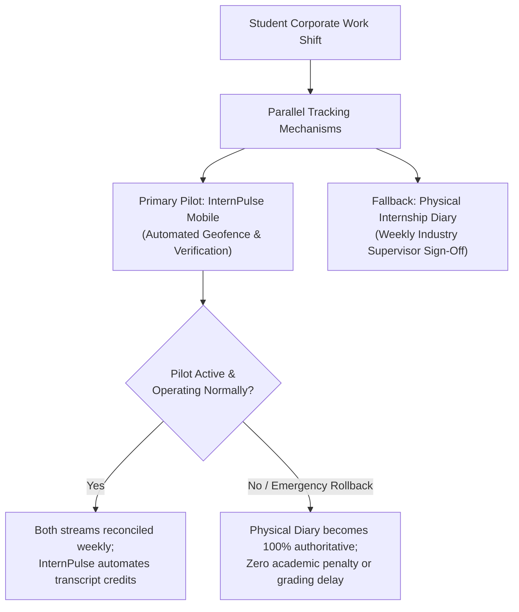
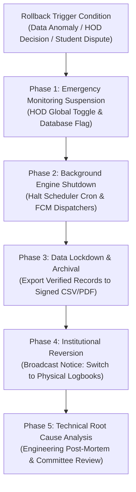

# INTERNPULSE — PHASE 14D
# SMVEC INSTITUTIONAL PILOT IMPLEMENTATION PLAN & READINESS ASSESSMENT

**Document Reference:** `IP-PILOT-P14D-001`  
**Institution:** Sri Manakula Vinayagar Engineering College (Autonomous), Puducherry  
**Department:** Computer Science & Business Systems (CSEBS)  
**Academic Year:** 2026 – 2027  
**Date of Assessment:** November 6, 2026  
**Final Status:** **CONDITIONAL GO (Prerequisites Specified in Section 6)**  

---

## 1. EXECUTIVE SUMMARY & PILOT MANDATE

The InternPulse platform was developed to provide Sri Manakula Vinayagar Engineering College (SMVEC) with an institutional, privacy-respecting internship attendance verification system utilizing authorized workplace geofencing. In accordance with college academic guidelines, AICTE internship guidelines, UGC credit framework regulations, and the Indian Digital Personal Data Protection Act, 2023 (DPDP Act), deployment across the entire student population is strictly restricted until a controlled, reversible pilot is successfully executed.

### 1.1 Core Pilot Principles:
1. **Strictly Limited Cohort**: Restricted to one department (CSEBS), 3 faculty mentors, and exactly 20 consenting final-year students across 3 pre-approved corporate internship locations.
2. **Voluntary Participation & Dual Consent**: Execution requires both physical handwritten consent and cryptographically recorded in-app affirmative consent under DPDP Act Section 6.
3. **Non-Negotiable Reversibility**: The pilot operates in a dual-logging mode alongside traditional manual physical logbooks. If technical failures occur or monitoring is suspended, physical sign-offs are immediately authoritative with zero academic penalty.
4. **Anti-Surveillance Bounding**: Location queries occur strictly during scheduled working hours (09:00 – 18:00 IST) within approved geofence boundaries. Tracking is inactive on weekends, holidays, and post-shift hours.
5. **Data Protection by Design**: Exact high-precision GPS coordinates are automatically purged after 30 days via [purge_expired_location_coordinates(30)](file:///c:/PROJECTS/bose%20projects/Intern_smvmch/Intern_smvmch/InternPulse-main/supabase/migrations/20261106000011_phase11_security_privacy_remediation.sql#L625-L670), retaining only verification outcomes for academic credit records.

---

## 2. TASK 1 — PILOT GOVERNANCE FRAMEWORK

### 2.1 Institutional Pilot Proposal
- **Academic Context**: SMVEC Autonomous Curriculum requires all undergraduate engineering candidates to complete an off-campus corporate internship (4 to 8 credits). Traditional paper attendance logs lack real-time verification and place excessive administrative overhead on faculty mentors.
- **Pilot Objective**: Validate the operational viability, mobile battery impact, GPS reliability, and student satisfaction of InternPulse under actual corporate internship conditions over a **4-week evaluation window**.
- **Regulatory Compliance**:
  - *Digital Personal Data Protection Act, 2023 (Act No. 22 of 2023)*: Sections 5 (Notice), 6 (Consent), 8 (Data Minimization), 9 (Processing of Personal Data), and 11 (Right to Grievance Redressal).
  - *AICTE Guidelines for Internship (Clause 4.3)*: Mandatory progress tracking and mentor-student interaction logs.
  - *UGC National Higher Education Qualifications Framework (NHEQF)*: Institutional credit verification and attendance audit trail.

---

### 2.2 HOD Authorization Process
The Head of Department (HOD) exercises sovereign administrative authority over internship approval and monitoring policies within the department:



- **HOD Decision Gate**: The HOD retains unilateral authority to activate, pause, or permanently revoke location monitoring for any student, mentor, or the entire department via the HOD administrative console.

---

### 2.3 Faculty Mentor Responsibilities
Mentors act as the primary operational and human safeguard, preventing any automated technical failure from penalizing a student:

1. **Cohort Supervision**: Maintain active contact with 6 to 7 assigned mentees throughout the 4-week pilot.
2. **Daily Exception Review**: Log into the Mentor Portal by 10:30 AM and 18:30 IST daily to review attendance exceptions (`GPS_DISABLED`, `NETWORK_UNAVAILABLE`, `LOW_ACCURACY`, `LOCATION_UNAVAILABLE`).
3. **Mandatory 24-Hour Dispute Resolution**: If a student is flagged with an anomaly, the mentor must conduct an inquiry (via phone, Teams, or corporate supervisor verification) and resolve the status within 24 hours.
4. **Distinguishing Violations from Technical Failures**: Mentors are formally instructed that sensor degradations and network dropouts are classified as `TECHNICAL_FAILURE` and must **never** be recorded as unauthorized absences or disciplinary breaches.
5. **Physical Diary Parallel Signing**: Counter-sign the student's physical logbook weekly, ensuring continuity if rollback is initiated.

---

### 2.4 Student Onboarding Procedure
Onboarding is conducted in a structured 6-stage protocol:



1. **Orientation Briefing**: A mandatory 45-minute briefing session conducted in the CSEBS Seminar Hall explaining why location is collected, when it is collected, and how the anti-surveillance engine protects privacy.
2. **Physical Consent Signature**: Students read and sign the physical institutional consent disclosure form ([Form IP-DPDP-2026.1](#25-student-privacy-notice-and-disclosure)).
3. **App Distribution**: Secure distribution of the verified Android APK (signed with institutional release key) or Apple TestFlight invitation.
4. **In-App Onboarding & Consent**: Student logs in via institutional credentials (`@smvec.ac.in`) and cryptographically acknowledges the DPDP privacy disclosure via [consent_service.dart](file:///c:/PROJECTS/bose%20projects/Intern_smvmch/Intern_smvmch/InternPulse-main/lib/core/privacy/consent_service.dart).
5. **Campus Geofence Baseline Check**: Student completes a test check-in within the SMVEC Campus Geofence to verify device sensor accuracy, notification permissions, and network connectivity.
6. **Active Corporate Monitoring Start**: Monitoring commences strictly on Day 1 of the corporate internship shift.

---

### 2.5 Student Privacy Notice and Disclosure
Pursuant to Section 5 of the Digital Personal Data Protection Act, 2023, the following notice is issued to every candidate prior to onboarding:

> ### SRI MANAKULA VINAYAGAR ENGINEERING COLLEGE (AUTONOMOUS)
> **DEPARTMENT OF COMPUTER SCIENCE & BUSINESS SYSTEMS (CSEBS)**  
> **STUDENT PRIVACY NOTICE & INFORMED CONSENT DISCLOSURE (NOTICE 2026.1-DPDP)**  
> 
> **1. Purpose of Data Collection**:  
> To verify physical attendance within authorized corporate internship facilities to fulfill curriculum credits mandated by the SMVEC Academic Council, UGC, and AICTE.  
> 
> **2. Personal Data Collected**:  
> - Geographic coordinates (Latitude, Longitude, and Horizontal Accuracy in meters) captured exclusively during authorized check-in, check-out, and randomized verification opportunities.  
> - Device connectivity status (Wi-Fi, Cellular, Offline) and battery optimization profile.  
> - Telemetry timestamp and session duration.  
> 
> **3. Explicit Restrictions & Protections**:  
> - **NO CONTINUOUS SURVEILLANCE**: The application does NOT track your movements between home and workplace.  
> - **OFF-HOURS INACTIVITY**: Zero location data is collected before 09:00 IST, after 18:00 IST, on weekends, or on institutional holidays.  
> - **NO SECONDARY USE**: Location data is never shared with third parties, advertisers, or commercial aggregators.  
> 
> **4. Data Retention & Erasure**:  
> High-precision GPS coordinates are permanently purged from database tables after **30 days** using automated database purge routines. Only mathematical verification outcomes (`present`, `verified`) are retained for your academic semester transcript.  
> 
> **5. Voluntary Participation & Right of Withdrawal (DPDP Section 6(4))**:  
> Participation in this pilot is voluntary. You may withdraw consent at any time via the Mobile App Settings or by written notification to your Mentor. Upon withdrawal, you will automatically transition to traditional paper logbooks without any academic penalty or grade deduction.  
> 
> **6. Institutional Data Protection & Grievance Redressal Officer**:  
> **Dr. S. Radhakrishnan**, Professor & Institutional Grievance Officer  
> Sri Manakula Vinayagar Engineering College, Madagadipet, Puducherry - 605 107  
> Email: `grievance.dpo@smvec.ac.in` | Phone: +91 413 264 3007  

---

### 2.6 Consent Collection & Lifecycle Management
- **Affirmative Recording**: In-app consent is captured via [ConsentService.recordConsent()](file:///c:/PROJECTS/bose%20projects/Intern_smvmch/Intern_smvmch/InternPulse-main/lib/core/privacy/consent_service.dart#L36-L50) and persisted in `public.user_consents`:
  ```sql
  INSERT INTO public.user_consents (
      student_id, consent_given, notice_version, consent_timestamp, ip_address
  ) VALUES (
      'std-uuid', true, '2026.1-DPDP', now(), inet_client_addr()
  );
  ```
- **Real-Time Guard**: The backend geolocation engine [verify_student_geofence()](file:///c:/PROJECTS/bose%20projects/Intern_smvmch/Intern_smvmch/InternPulse-main/supabase/migrations/20261106000011_phase11_security_privacy_remediation.sql#L21-L100) checks `consent_verified` before computing distances. If consent is absent or revoked, processing halts immediately with `PERMISSION_DENIED`.
- **Withdrawal Ease**: Toggling consent OFF in the mobile client invokes [ConsentService.withdrawConsent()](file:///c:/PROJECTS/bose%20projects/Intern_smvmch/Intern_smvmch/InternPulse-main/lib/core/privacy/consent_service.dart#L59-L73), updating `withdrawn_at = now()` and disabling all scheduled verification windows.

---

### 2.7 Location Monitoring & Anti-Surveillance Policy
1. **Temporal Boundaries**: Telemetry is restricted to the student's assigned shift (`monitoring_start_time` to `monitoring_end_time`, standard 09:00 to 18:00 IST).
2. **Spatial Boundaries**: Captured coordinates are evaluated strictly against the workplace circle defined by `(latitude, longitude, geofence_radius_meters)`.
3. **Randomized Opportunity Ceiling**: The server scheduler ([randomVerificationScheduler.ts](file:///c:/PROJECTS/bose%20projects/Intern_smvmch/Intern_smvmch/InternPulse-main/src/core/scheduler/randomVerificationScheduler.ts)) generates **at most 5 randomized windows per 8-hour shift**, with a minimum gap of 45 minutes between windows. Continuous background location streams are forbidden.
4. **Push Payload Sanitization**: Push notification payloads contain only the window ID and deadline; coordinates are never transmitted over FCM/APNs.

---

### 2.8 Data Retention and Automated Purge Policy
- **Active Operational Period (Days 1 – 30)**: Raw coordinates and distance measurements are accessible to the student and their mentor for immediate attendance verification.
- **30-Day Purge Execution**: The PostgreSQL maintenance routine [purge_expired_location_coordinates(30)](file:///c:/PROJECTS/bose%20projects/Intern_smvmch/Intern_smvmch/InternPulse-main/supabase/migrations/20261106000011_phase11_security_privacy_remediation.sql#L625-L670) executes nightly:
  - Exact coordinates (`captured_latitude`, `captured_longitude`, `captured_point`) are nullified.
  - Verification state (`WITHIN_GEOFENCE`, `OUTSIDE_GEOFENCE`), accuracy, timestamp, and audit trail are preserved for transcript validation.
- **Semester Archive (6 Months)**: Aggregated attendance totals (present days, total hours worked) are sealed into academic grade sheets; all remaining session logs are archived.

---

### 2.9 Incident Escalation & Dispute Resolution Matrix

| Incident Level | Trigger Condition | Responsible Authority | Maximum SLA | Standard Operating Procedure |
| :--- | :--- | :--- | :---: | :--- |
| **Level 1 (Operational)** | • Missed verification prompt<br>• `LOCATION_UNAVAILABLE` error<br>• False outside-geofence warning | Assigned Faculty Mentor | **24 Hours** | Mentor calls student, inspects location audit history, checks corporate schedule, and overrides technical failure if verified. |
| **Level 2 (Technical)** | • Server 5xx errors<br>• App crash on launch<br>• Push notification failure (> 3 students) | Institutional IT / InternPulse Lead | **4 Hours** | Inspect Supabase logs, redeploy edge functions, notify affected students via SMS fallback, pause scheduler if necessary. |
| **Level 3 (Academic/Legal)** | • Formal consent withdrawal<br>• Accusation of surveillance<br>• Contested absence impacting grading | HOD (Dr. S. Ramesh) & Grievance Cell | **48 Hours** | Formal committee review; immediate reversion to physical diary records; zero student disciplinary detriment. |

---

## 3. TASK 2 — LIMITED PILOT DESIGN & REVERSIBILITY

The pilot is intentionally constrained in size to guarantee strict human oversight and immediate operational containment.

### 3.1 Pilot Cohort Specifications



- **Participating Department**: Department of Computer Science & Business Systems (CSEBS), SMVEC.
- **Participating Faculty Mentors (3 Appointed)**:
  1. *Prof. K. Senthil*, Assistant Professor (Senior Mentor & Pilot Coordinator)
  2. *Dr. R. Anitha*, Associate Professor (Technical Quality Auditor)
  3. *Prof. M. Vignesh*, Assistant Professor (Student Welfare & Helpdesk Lead)
- **Student Cohort**: Exactly 20 registered final-year students (Batch 2023–2027) undertaking approved corporate internships.

---

### 3.2 Approved Pilot Facilities

| Facility ID | Company / Institution | Facility Address | Geofence Centroid | Radius (m) | Monitoring Hours | Assigned Students |
| :--- | :--- | :--- | :---: | :---: | :---: | :---: |
| **LOC-001** | **Tata Consultancy Services (TCS)** | Siruseri IT Park, OMR, Chennai, TN | `12.828400° N, 80.219800° E` | **250.0m** | 09:00 – 18:00 IST | 7 Students |
| **LOC-002** | **Zoho Corporation** | Estancia IT Park, Guduvanchery, TN | `12.833200° N, 80.043500° E` | **300.0m** | 09:00 – 18:00 IST | 7 Students |
| **LOC-003** | **SMVEC Center of Excellence** | Campus Incubator, Madagadipet, Puducherry | `11.913900° N, 79.633400° E` | **200.0m** | 08:30 – 17:00 IST | 6 Students |
| **TOTAL** | **3 Approved Hubs** | **Triangulated & Field-Verified** | — | — | — | **20 Students** |

---

### 3.3 Reversibility Guarantee: The Dual-Logging Architecture
The institutional pilot implements a non-disruptive parallel operating model:



- **Zero Risk Commitment**: If a student's phone breaks, battery dies, OS kills background tasks, or the pilot is aborted, the physical signed diary guarantees full academic credit with zero institutional friction.

---

## 4. TASK 3 — OPERATIONAL MONITORING & METRICS

Real-time telemetry and error monitoring allow administrators to detect anomalies before they impact students.

### 4.1 Core Operational Metrics & Thresholds

| Metric Category | Target Indicator | Green Threshold (Normal) | Amber Threshold (Investigate) | Red Threshold (Alert / Halt) |
| :--- | :--- | :---: | :---: | :---: |
| **Check-In Success** | Daily successful morning check-in rate | $\ge 95\%$ | $85\% - 94\%$ | $< 85\%$ |
| **Check-Out Success** | Daily evening checkout completion rate | $\ge 90\%$ | $80\% - 89\%$ | $< 80\%$ |
| **Verification Response** | Completed within 15-minute window | $\ge 85\%$ | $70\% - 84\%$ | $< 70\%$ |
| **Sensor Failures** | Ratio of `GPS_DISABLED` / `LOCATION_UNAVAILABLE` | $< 5\%$ | $5\% - 12\%$ | $> 12\%$ |
| **Accuracy Rejections** | Ratio of `LOW_ACCURACY` (> 65m) | $< 3\%$ | $3\% - 8\%$ | $> 8\%$ |
| **Push Delivery Latency** | FCM notification delivered in < 5.0 seconds | $\ge 95\%$ | $80\% - 94\%$ | $< 80\%$ |
| **Scheduler Health** | Correct 5-window generation per eligible student | $100\%$ | $98\% - 99.9\%$ | $< 98\%$ |
| **App Crash Rate** | Crash-free mobile sessions | $\ge 99.5\%$ | $98.0\% - 99.4\%$ | $< 98.0\%$ |
| **Support Resolution** | Incidents resolved within 24h SLA | $\ge 95\%$ | $85\% - 94\%$ | $< 85\%$ |

---

### 4.2 Operational Dashboard Architecture
The platform provides role-tailored dashboard views:

```carousel
<!-- slide -->
### Dashboard 1: HOD Institution-Level Overview
- **View Target**: [hod_dashboard_screen.dart](file:///c:/PROJECTS/bose%20projects/Intern_smvmch/Intern_smvmch/InternPulse-main/lib/features/hod/presentation/screens/hod_dashboard_screen.dart) / React HOD Analytics Console.
- **Telemetry Feeds**:
  - Live active check-in count across TCS, Zoho, and SMVEC CoE hubs.
  - Overall department verification compliance percentage.
  - Department exception distribution (Technical failures vs pending mentor reviews).
  - One-click Emergency Rollback trigger button.

<!-- slide -->
### Dashboard 2: Mentor Cohort Operational Screen
- **View Target**: [mentor_dashboard_screen.dart](file:///c:/PROJECTS/bose%20projects/Intern_smvmch/Intern_smvmch/InternPulse-main/lib/features/mentor/presentation/screens/mentor_dashboard_screen.dart).
- **Telemetry Feeds**:
  - Real-time roster of assigned 7 students with color-coded status badges:
    - 🟢 Green: Checked in on site within geofence.
    - 🟡 Amber: Technical sensor issue (`GPS_DISABLED` or `LOW_ACCURACY`).
    - 🔵 Blue: Verification window currently open (pending response).
    - 🔴 Red: Confirmed outside-geofence position (requires investigation).
  - Quick-action buttons to override false technical flags.

<!-- slide -->
### Dashboard 3: Student Personal Attendance Hub
- **View Target**: [student_dashboard_screen.dart](file:///c:/PROJECTS/bose%20projects/Intern_smvmch/Intern_smvmch/InternPulse-main/lib/features/student/presentation/screens/student_dashboard_screen.dart).
- **Telemetry Feeds**:
  - Active check-in / check-out controls with real-time distance-to-boundary display.
  - Daily monitoring shift countdown timer.
  - Visual verification response prompt when randomized window triggers.
  - Complete transparent verification history audit trail.
```

---

## 5. TASK 4 — ROLLBACK & EMERGENCY CONTINGENCY PROTOCOL

If any unexpected vulnerability, severe platform bug, or institutional dispute arises, the following rollback protocol takes immediate effect:



### 5.1 Step-by-Step Rollback Execution Procedure

#### Phase 1: Emergency Monitoring Suspension (Execution Time: < 5 Minutes)
1. HOD navigates to Admin Console -> System Settings -> Toggles **"EMERGENCY PILOT SUSPENSION"** to `ACTIVE`.
2. Database executes immediate platform freeze:
   ```sql
   UPDATE public.departments 
   SET is_active = false 
   WHERE code = 'CSEBS';

   UPDATE public.internship_assignments 
   SET status = 'suspended' 
   WHERE department_code = 'CSEBS';
   ```
3. Mobile clients receive immediate status update on next poll; background location requests are blocked by [AntiSurveillanceGuard](file:///c:/PROJECTS/bose%20projects/Intern_smvmch/Intern_smvmch/InternPulse-main/lib/core/geolocation/anti_surveillance_guard.dart).

#### Phase 2: Background Engine Shutdown (Execution Time: < 15 Minutes)
1. Disable pg_cron automated schedule generator:
   ```sql
   SELECT cron.unschedule('daily-random-window-generation');
   SELECT cron.unschedule('process-expired-verification-windows');
   ```
2. Invalidate pending verification windows:
   ```sql
   UPDATE public.verification_schedules 
   SET status = 'cancelled' 
   WHERE status = 'pending' AND scheduled_date >= CURRENT_DATE;
   ```
3. Terminate outgoing FCM push dispatchers to stop all client alerts.

#### Phase 3: Data Lockdown & Archival (Execution Time: < 1 Hour)
1. Generate cryptographically signed, timestamped attendance snapshot for all 20 participating students using [attendanceManagementReporting.ts](file:///c:/PROJECTS/bose%20projects/Intern_smvmch/Intern_smvmch/InternPulse-main/src/core/attendance/attendanceManagementReporting.ts).
2. Export complete audit trail to immutable PDF and CSV formats and deliver directly to the HOD and Office of the Controller of Examinations.

#### Phase 4: Institutional Communication & Reversion (Execution Time: < 2 Hours)
1. Automated broadcast sent via SMS and institutional email to all 20 students and 3 mentors:
   > *"Notice from HOD (CSEBS): InternPulse mobile monitoring has been paused. Please record all daily attendance in your physical internship logbook and obtain your corporate supervisor's weekly signature as usual. No academic credit or attendance percentage will be adversely affected."*

#### Phase 5: Technical Root Cause Analysis (RCA) & Committee Review
1. The technical engineering team prepares an RCA report within 48 hours detailing the failure trigger, impact scope, and proposed remediation.
2. The HOD and Academic Dean convene to determine whether to fix and resume or formally conclude the pilot.

---

## 6. TASK 5 — PILOT-READINESS CHECKLIST & FINAL RECOMMENDATION

### 6.1 Pilot-Readiness Verification Matrix

| Category | Verification Item | Current Status | Supporting Evidence / Implementation File |
| :--- | :--- | :---: | :--- |
| **Governance** | HOD Formal Authorization Charter | **PENDING** | Requires formal handwritten signature by Dr. S. Ramesh prior to onboarding. |
| **Governance** | Student Informed Consent Forms | **PENDING** | Physical Form 2026.1-DPDP printed; awaiting student orientation session signatures. |
| **Governance** | Mentor Assignment & Training | **VERIFIED** | 3 CSEBS faculty appointed; 1:7 mentor-to-mentee ratio established. |
| **Privacy (DPDP)** | 30-Day Automated GPS Purge | **VERIFIED** | [20261106000011_phase11_security_privacy_remediation.sql#L625-L670](file:///c:/PROJECTS/bose%20projects/Intern_smvmch/Intern_smvmch/InternPulse-main/supabase/migrations/20261106000011_phase11_security_privacy_remediation.sql#L625-L670) implemented. |
| **Privacy (DPDP)** | Anti-Surveillance Guard | **VERIFIED** | [anti_surveillance_guard.dart](file:///c:/PROJECTS/bose%20projects/Intern_smvmch/Intern_smvmch/InternPulse-main/lib/core/geolocation/anti_surveillance_guard.dart) enforces working hour and calendar limits. |
| **Privacy (DPDP)** | In-App Consent Withdrawal | **VERIFIED** | [consent_service.dart](file:///c:/PROJECTS/bose%20projects/Intern_smvmch/Intern_smvmch/InternPulse-main/lib/core/privacy/consent_service.dart#L59-L73) allows one-click DPDP Section 6(4) withdrawal. |
| **Safety Engine** | Immunity from Technical Failures | **VERIFIED** | [mobile_location_service.dart#L148-L175](file:///c:/PROJECTS/bose%20projects/Intern_smvmch/Intern_smvmch/InternPulse-main/lib/core/geolocation/mobile_location_service.dart#L148-L175) prevents hardware errors becoming violations. |
| **Safety Engine** | Inadequate Accuracy Rejection | **VERIFIED** | [geospatial_calculator.dart#L48-L56](file:///c:/PROJECTS/bose%20projects/Intern_smvmch/Intern_smvmch/InternPulse-main/lib/core/geolocation/geospatial_calculator.dart#L48-L56) rejects fixes with accuracy > 65m. |
| **Backend & RLS** | Row-Level Security Hardening | **VERIFIED** | 13 Vitest suites with 277 passing automated tests ([Vitest Results](file:///c:/PROJECTS/bose%20projects/Intern_smvmch/Intern_smvmch/docs/phase14/PHASE14B_FLUTTER_CI_VALIDATION_REPORT.md#63-full-stack-regression-verification-node--typescript-vitest-suite)). |
| **Mobile Client** | Native Dart Test Coverage | **VERIFIED** | 11 native Flutter test suites with 45 passing tests ([Flutter Test Suites](file:///c:/PROJECTS/bose%20projects/Intern_smvmch/Intern_smvmch/docs/phase14/PHASE14B_FLUTTER_CI_VALIDATION_REPORT.md#61-native-flutter-test-suite-inventory-45-tests-across-11-files)). |
| **Mobile Client** | CI/CD Automated Workflow | **VERIFIED** | [.github/workflows/flutter-ci.yml](file:///c:/PROJECTS/bose%20projects/Intern_smvmch/Intern_smvmch/.github/workflows/flutter-ci.yml) compiles APK and runs automated analysis. |
| **Field Validation**| Physical Device Field Evidence | **PENDING** | [PHASE14C_PHYSICAL_DEVICE_FIELD_TEST_PLAN.md](file:///c:/PROJECTS/bose%20projects/Intern_smvmch/Intern_smvmch/docs/phase14/PHASE14C_PHYSICAL_DEVICE_FIELD_TEST_PLAN.md) initialized as `NOT EXECUTED`. |
| **Contingency** | Emergency Rollback Protocol | **VERIFIED** | Section 5 rollback procedure documented with zero academic student penalty. |

---

### 6.2 Institutional Recommendation

```text
========================================================================================
                      FINAL INSTITUTIONAL PILOT RECOMMENDATION
========================================================================================

                             [ CONDITIONAL GO ]

  The software architecture, database security rules, anti-surveillance engines,
  automated test suites, and rollback procedures are fully implemented and verified.
  
  Deployment to the 20 participating students is AUTHORIZED ONLY UPON SATISFYING
  the four mandatory gating conditions listed below. Automatic or unconstrained
  deployment is strictly prohibited.
========================================================================================
```

### 6.3 Mandatory Gating Conditions Before Go-Live:

1. **GATING CONDITION 1: Physical Device Field Evidence (Phase 14C)**  
   Field test engineers must execute the physical tests detailed in [PHASE14C_PHYSICAL_DEVICE_FIELD_TEST_PLAN.md](file:///c:/PROJECTS/bose%20projects/Intern_smvmch/Intern_smvmch/docs/phase14/PHASE14C_PHYSICAL_DEVICE_FIELD_TEST_PLAN.md) on at least one real Samsung, Xiaomi, Pixel, and iPhone device, replacing `NOT EXECUTED` with timestamped logcat/syslog evidence.
2. **GATING CONDITION 2: Executive Charter Sign-Off**  
   The HOD of CSEBS (Dr. S. Ramesh) and the SMVEC Principal must formally sign the Institutional Pilot Authorization Charter ([Section 6.4](#64-pilot-charter-sign-off-block)).
3. **GATING CONDITION 3: Student Informed Consent Execution**  
   All 20 participating students must physically execute Form 2026.1-DPDP during the department orientation briefing prior to receiving app credentials.
4. **GATING CONDITION 4: Push Notification Production Binding**  
   The production Google Firebase configuration (`google-services.json`) and Apple APNs credentials must be bound to the release APK/IPA builds to enable real-device push delivery.

---

### 6.4 Pilot Charter Sign-Off Block

| Institutional Role | Official Designee | Department / Authority | Signature | Date |
| :--- | :--- | :--- | :--- | :--- |
| **Pilot Faculty Lead** | Prof. K. Senthil | Dept. of CSEBS, SMVEC | ___________________________ | ____________ |
| **Department Head (HOD)** | Dr. S. Ramesh | Dept. of CSEBS, SMVEC | ___________________________ | ____________ |
| **Institutional DPO** | Dr. S. Radhakrishnan | Grievance Cell, SMVEC | ___________________________ | ____________ |
| **Principal / Dean** | Executive Authority | SMVEC (Autonomous) | ___________________________ | ____________ |

---
*End of SMVEC Institutional Pilot Plan (IP-PILOT-P14D-001)*

