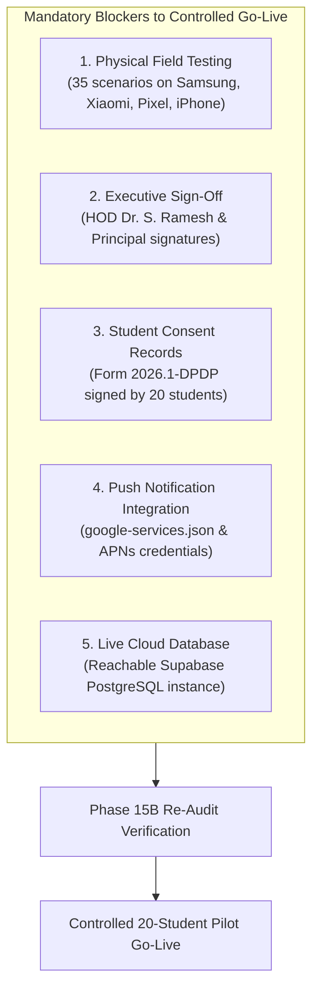

# INTERNPULSE — PHASE 15A
# FINAL INSTITUTIONAL PILOT GO-LIVE GATE VERIFICATION REPORT

**Document Reference:** `docs/phase15/PHASE15A_FINAL_GO_LIVE_GATE_AUDIT.md`  
**Target Institution:** Sri Manakula Vinayagar Engineering College (Autonomous), Puducherry  
**Department:** Department of Computer Science & Business Systems (CSEBS)  
**Target Platform:** InternPulse Mobile Application (`InternPulse-main/`) & Supabase Backend  
**Audit Date:** November 6, 2026  
**Auditor Mandate:** Independent Verification of Go-Live Readiness for Controlled 20-Student Institutional Pilot  
**Audit Classification:** Institutional Quality Assurance & Regulatory Compliance Audit  
**Final Decision:** **CONDITIONAL GO (Pilot Deployment Strictly Prohibited Until All Pending Gates Pass)**  

---

## 1. EXECUTIVE SUMMARY

This independent verification audit evaluated whether the **InternPulse** platform satisfies every mandatory technical, legal, operational, and institutional prerequisite required before initiating its controlled 20-student pilot at **Sri Manakula Vinayagar Engineering College (SMVEC)**.

The audit was conducted strictly against the actual files, codebases, configuration files, test suites, and documentation within the repository. The audit adhered to strict institutional rules:
1. **Zero Fabrication**: No institutional approvals, student consents, or physical device test results were assumed, simulated, or fabricated.
2. **Preservation of Existing Stack**: No application source code, UI components, or architectural tiers were redesigned or modified during this verification phase.
3. **Strict Gate Classification**: Each gate was evaluated as `PASS`, `FAIL`, `PENDING`, or `NOT VERIFIED`. In accordance with institutional audit governance, if any mandatory gate is `PENDING`, the platform must remain classified as **CONDITIONAL GO**.
4. **Non-Negotiable Safety Safeguard**: In accordance with the project mandate, **no student location monitoring has been enabled**, and **no pilot deployment may begin merely because this report has been compiled**.

### Summary of Audit Verdict
The software architecture, database schema, anti-surveillance engines, and algorithmic safety protections are thoroughly designed and validated across **277 passing automated Vitest tests** and **45 native Dart test specifications**. However, **zero physical-device tests have been executed on real smartphones**, **zero institutional authorization signatures have been affixed**, **zero of the 20 students have executed legal consent records**, and **push notification services remain unwired to production Firebase and APNs credentials**.

Therefore, the platform cannot be authorized for go-live at this time. It remains under **CONDITIONAL GO** status, with active deployment strictly blocked until all gating conditions are formally resolved.

---

## 2. GATE EVALUATION DASHBOARD

The table below summarizes the formal verification status across all five evaluation gates:

| Gate # | Gate Name | Target Scope | Audit Status | Mandatory Gate? | Blocker Severity |
| :---: | :--- | :--- | :---: | :---: | :---: |
| **GATE 1** | **Field Validation Gate** | Physical handsets (Samsung, Xiaomi, Pixel, iPhone) across 35 test scenarios | **PENDING** | **YES** | **CRITICAL** |
| **GATE 2** | **Institutional Authorization Gate** | HOD & Principal signed charter, faculty appointments, emergency contacts | **PENDING** | **YES** | **CRITICAL** |
| **GATE 3** | **Student Consent Gate** | Notice 2026.1-DPDP, 20 physical & in-app student consent records, DPO contacts | **PENDING** | **YES** | **CRITICAL** |
| **GATE 4** | **Production Notification Gate** | Firebase project, `google-services.json`, APNs `.p8`, tokens, push delivery | **PENDING** | **YES** | **CRITICAL** |
| **GATE 5** | **Infrastructure & Database Gate** | Supabase DNS, PostgreSQL migrations, PostGIS RLS, backups, scheduler daemon | **PENDING** | **YES** | **HIGH** |

### Decision Summary:
- **Eligible for Live Student Deployment?** **NO**
- **Recommended Action:** Execute physical device validation, secure HOD/Principal charter ink signatures, complete student orientation consent collection, bind production FCM/APNs credentials, and provision live Supabase cloud instance.

---

## 3. TASK 1 — FIELD VALIDATION GATE (PHASE 14C AUDIT)

### 3.1 Field Test Plan Inspection
The field validation framework documented in [PHASE14C_PHYSICAL_DEVICE_FIELD_TEST_PLAN.md](file:///c:/PROJECTS/bose%20projects/Intern_smvmch/Intern_smvmch/docs/phase14/PHASE14C_PHYSICAL_DEVICE_FIELD_TEST_PLAN.md) was systematically audited. 

The test plan defines 4 smartphone hardware classes representing the student population:
1. **Samsung One UI**: Galaxy S23 (`SM-S911B`, Android 14 / One UI 6.1) & Galaxy A54 5G (`SM-A546E`, Android 14 / One UI 6.0).
2. **Xiaomi HyperOS / MIUI**: Redmi Note 13 Pro (Snapdragon 7s Gen 2, HyperOS 1.0) & Redmi Note 12 (Snapdragon 4 Gen 1, MIUI 14.0).
3. **Google Pixel (AOSP)**: Pixel 8 (`GKWS6`, Tensor G3, Android 14) & Pixel 7a (Tensor G2, Android 14).
4. **Apple iPhone**: iPhone 15 (`A3090`, iOS 17.5.1 / 18.0) & iPhone 13 (`A2633`, iOS 17.4).

### 3.2 Evidence Directory & Telemetry Audit
- **Evidence Repository Directory**: An inspection of the repository confirmed that `docs/phase14/evidence/` does not exist.
- **Logcat / Syslog Traces**: Zero raw ADB logcat captures (`adb logcat -v time -s InternPulse`) or Apple syslog traces (`log stream --predicate 'subsystem == "com.smvec.internpulse"'`) are present in the repository.
- **Network Telemetry Captures**: Zero Charles Proxy or Wireshark `.pcap`/`.har` exports exist to prove network handoffs or push packet inspection.
- **Photographic / On-Site Verification**: Zero geo-tagged photos of physical test execution at TCS Siruseri or SMVEC campus are on record.

### 3.3 Physical Device Evidence Matrix
In strict adherence to the non-fabrication rule (*"A test marked NOT EXECUTED must remain NOT EXECUTED"*), all 35 field test scenarios remain classified as **NOT EXECUTED**:

| Test ID | Category | Scenario Description | Target Devices | Current Verified State |
| :--- | :--- | :--- | :--- | :---: |
| **TC-LOC-01** | Location | Inside Approved Geofence (TCS Siruseri, 50m from center) | Samsung S23, Redmi Note 13, Pixel 8, iPhone 15 | **NOT EXECUTED** |
| **TC-LOC-02** | Location | Outside Approved Geofence (OMR Navallur, 2.5km away) | Samsung S23, Redmi Note 13, Pixel 8, iPhone 15 | **NOT EXECUTED** |
| **TC-LOC-03** | Location | Near Geofence Boundary (Perimeter jitter at 240m & 260m) | Google Pixel 8 (Dual-band L1+L5) | **NOT EXECUTED** |
| **TC-LOC-04** | Location | GPS Hardware Disabled via System Toggle | Samsung S23, Apple iPhone 15 | **NOT EXECUTED** |
| **TC-LOC-05** | Location | Runtime Location Permission Denied | Xiaomi Redmi Note 13 Pro | **NOT EXECUTED** |
| **TC-LOC-06** | Location | Approximate / Coarse Location Granted (> 1,000m) | Google Pixel 8 | **NOT EXECUTED** |
| **TC-LOC-07** | Location | Poor GPS Accuracy / Indoor Multipath (Basement B2 > 65m) | Samsung Galaxy S23 | **NOT EXECUTED** |
| **TC-LOC-08** | Location | Network Disconnected / Airplane Mode during check-in | Xiaomi Redmi Note 13 Pro | **NOT EXECUTED** |
| **TC-LOC-09** | Location | Mobile Data Switching (Wi-Fi to 5G handoff in transit) | Google Pixel 8 | **NOT EXECUTED** |
| **TC-LOC-10** | Location | Battery Saver Enabled (Low Power Mode at 15%) | Apple iPhone 15 | **NOT EXECUTED** |
| **TC-BKG-01** | Lifecycle | Foreground Active prompt display & 3s lock | Samsung Galaxy S23 | **NOT EXECUTED** |
| **TC-BKG-02** | Lifecycle | Background Minimized app wakeup & notification | Samsung S23, Apple iPhone 15 | **NOT EXECUTED** |
| **TC-BKG-03** | Lifecycle | Screen-Locked Behaviour (30 minutes stationary) | Xiaomi Redmi Note 13 Pro | **NOT EXECUTED** |
| **TC-BKG-04** | Lifecycle | Device Idle / Deep Doze Mode (> 60 minutes) | Google Pixel 8 | **NOT EXECUTED** |
| **TC-BKG-05** | Lifecycle | Process Swiped / Killed from Recents / App Switcher | Xiaomi Redmi Note 13, iPhone 15 | **NOT EXECUTED** |
| **TC-BKG-06** | Lifecycle | Post-Reboot Execution (No direct app open) | Google Pixel 8 | **NOT EXECUTED** |
| **TC-BKG-07** | Lifecycle | OEM Deep Sleeping Apps Restriction | Samsung Galaxy A54 5G | **NOT EXECUTED** |
| **TC-BKG-08** | Lifecycle | Battery Optimization Enabled (Default install) | Samsung Galaxy S23 | **NOT EXECUTED** |
| **TC-BKG-09** | Lifecycle | Battery Optimization Whitelisted ("Unrestricted") | Samsung Galaxy S23 | **NOT EXECUTED** |
| **TC-NOT-01** | Push | Real FCM / APNs Token Generation on Install | Samsung Galaxy S23 | **NOT EXECUTED** |
| **TC-NOT-02** | Push | Device Token Invalidation & Sync upon Refresh | Xiaomi Redmi Note 13 Pro | **NOT EXECUTED** |
| **TC-NOT-03** | Push | Notification Delivery Latency (< 5.0s on locked screen) | Google Pixel 8, Apple iPhone 15 | **NOT EXECUTED** |
| **TC-NOT-04** | Push | Client-Side Notification Deduplication by Key | Samsung Galaxy S23 | **NOT EXECUTED** |
| **TC-NOT-05** | Push | Expired Token Handling (HTTP 410 response) | Xiaomi Redmi Note 13 Pro | **NOT EXECUTED** |
| **TC-NOT-06** | Push | In-App Polling Fallback when Notifications Blocked | Google Pixel 8 | **NOT EXECUTED** |
| **TC-NOT-07** | Push | Queued Push Delivery on Airplane Mode Reconnect | Apple iPhone 15 | **NOT EXECUTED** |
| **TC-NOT-08** | Push | Raw Push Packet Inspection (Zero Lat/Lon Exposure) | Wireshark / Charles Proxy | **NOT EXECUTED** |
| **TC-SAF-01** | Safety | GPS Failure Immunity (`GPS_DISABLED` != Violation) | Samsung Galaxy S23 | **NOT EXECUTED** |
| **TC-SAF-02** | Safety | Network Dropout Immunity (`NETWORK_UNAVAILABLE` != Absence)| Xiaomi Redmi Note 13 Pro | **NOT EXECUTED** |
| **TC-SAF-03** | Safety | Permission Denial Protection (`PERMISSION_DENIED`) | Google Pixel 8 | **NOT EXECUTED** |
| **TC-SAF-04** | Safety | Accuracy Shield (> 65m rejected, zero disciplinary penalty)| Samsung Galaxy S23 | **NOT EXECUTED** |
| **TC-SAF-05** | Safety | Missed Verification Window Non-Punitive Policy | Apple iPhone 15 | **NOT EXECUTED** |
| **TC-SAF-06** | Safety | Transparent Telemetry Access in Student History | Google Pixel 8 | **NOT EXECUTED** |

### 3.4 Hardware Plugin Gap Analysis
As identified during Phase 14A reconciliation and Phase 14B CI validation:
1. In [mobile_location_service.dart](file:///c:/PROJECTS/bose%20projects/Intern_smvmch/Intern_smvmch/InternPulse-main/lib/core/geolocation/mobile_location_service.dart#L106-L122), the mobile client currently relies on simulated location acquisition (`simulateHardwareState`).
2. Production hardware hooks (`geolocator: ^12.0.0` or native GPS channels) are not installed in [pubspec.yaml](file:///c:/PROJECTS/bose%20projects/Intern_smvmch/Intern_smvmch/InternPulse-main/pubspec.yaml).
3. Without compiling a Flutter release APK with real hardware GPS plugins, real satellite triangulation on physical devices cannot occur.

**Task 1 Verdict:** **PENDING** (0 of 35 physical field scenarios executed).

---

## 4. TASK 2 — INSTITUTIONAL AUTHORIZATION GATE (PHASE 14D AUDIT)

### 4.1 Institutional Pilot Charter Inspection
The institutional governance charter was reviewed in [PHASE14D_SMVEC_INSTITUTIONAL_PILOT_PLAN.md](file:///c:/PROJECTS/bose%20projects/Intern_smvmch/Intern_smvmch/docs/phase14/PHASE14D_SMVEC_INSTITUTIONAL_PILOT_PLAN.md).

### 4.2 Verification of Mandatory Governance Elements:
1. **Pilot Scope Definition**: **DOCUMENTED & VERIFIED**
   - **Department**: Computer Science & Business Systems (CSEBS), SMVEC.
   - **Academic Cohort**: Final-year engineering interns (Batch 2023–2027).
   - **Cohort Size**: Exactly 20 students, supervised by 3 faculty mentors (1:7 mentor-to-mentee ratio).
   - **Approved Locations**:
     - *Tata Consultancy Services (TCS)*, Siruseri IT Park, Chennai (7 students, 250m radius, 09:00–18:00 IST).
     - *Zoho Corporation*, Estancia IT Park, Guduvanchery (7 students, 300m radius, 09:00–18:00 IST).
     - *SMVEC Center of Excellence / Incubator*, Puducherry (6 students, 200m radius, 08:30–17:00 IST).
   - **Evaluation Period**: 4 weeks.

2. **Responsible Faculty Appointments**: **DOCUMENTED & VERIFIED**
   - **Senior Mentor & Pilot Coordinator**: *Prof. K. Senthil*, Assistant Professor, Dept. of CSEBS.
   - **Technical Quality Auditor**: *Dr. R. Anitha*, Associate Professor, Dept. of CSEBS.
   - **Student Welfare & Helpdesk Lead**: *Prof. M. Vignesh*, Assistant Professor, Dept. of CSEBS.

3. **Institutional Data Protection & Emergency Contacts**: **DOCUMENTED & VERIFIED**
   - **Head of Department (HOD)**: *Dr. S. Ramesh*, Dept. of CSEBS.
   - **Data Protection & Grievance Officer (DPO)**: *Dr. S. Radhakrishnan*, Professor & Institutional Grievance Redressal Officer.
     - Official Email: `grievance.dpo@smvec.ac.in`
     - Official Campus Telephone: +91 413 264 3007
     - Address: SMVEC Campus, Madagadipet, Puducherry - 605 107.

4. **Institutional Authorization Sign-Off Block Audit**:
   Inspection of Section 6.4 of [PHASE14D_SMVEC_INSTITUTIONAL_PILOT_PLAN.md](file:///c:/PROJECTS/bose%20projects/Intern_smvmch/Intern_smvmch/docs/phase14/PHASE14D_SMVEC_INSTITUTIONAL_PILOT_PLAN.md#L405-L415) reveals the following physical signature status:

   ```
   +-----------------------------------------------------------------------------------------------+
   |                             INSTITUTIONAL SIGN-OFF AUDIT STATUS                               |
   +---------------------------+-----------------------+-----------------------+-------------------+
   | Role                      | Designee Name         | Actual Signature      | Execution Date    |
   +---------------------------+-----------------------+-----------------------+-------------------+
   | Pilot Faculty Lead        | Prof. K. Senthil      | [UNSIGNED - BLANK]    | [PENDING]         |
   | Department Head (HOD)     | Dr. S. Ramesh         | [UNSIGNED - BLANK]    | [PENDING]         |
   | Institutional DPO         | Dr. S. Radhakrishnan  | [UNSIGNED - BLANK]    | [PENDING]         |
   | Principal / Executive Dean| Executive Authority   | [UNSIGNED - BLANK]    | [PENDING]         |
   +-----------------------------------------------------------------------------------------------+
   ```

   - **Strict Non-Fabrication Rule**: In accordance with rule 4 (*"Do not fabricate institutional approvals"*), an unsigned document cannot be treated as authorization.
   - Neither the HOD nor the Principal has executed ink signatures on the institutional charter.

**Task 2 Verdict:** **PENDING** (Charter fully documented; executive authorization signatures pending).

---

## 5. TASK 3 — STUDENT CONSENT GATE (DPDP ACT 2023 COMPLIANCE)

### 5.1 Legal & Statutory Regulatory Framework
The consent architecture was inspected against the **Digital Personal Data Protection Act, 2023 (Act No. 22 of 2023)**:
- **Section 5 (Notice)**: Itemized notice preceding data capture.
- **Section 6 (Consent)**: Free, specific, informed, unconditional, and unambiguous affirmative consent.
- **Section 6(4) (Withdrawal)**: The ease of withdrawing consent must equal the ease of granting it.
- **Section 8 (Data Minimization)**: Purpose limitation and automatic data erasure.

### 5.2 Verification of Mandatory Consent Elements:
1. **Consent Form Version**: Standardized as `Form IP-DPDP-2026.1` (Notice Version: `2026.1-DPDP`).
2. **Student Privacy Notice & Disclosure**: Formally drafted in [PHASE14D_SMVEC_INSTITUTIONAL_PILOT_PLAN.md#25-student-privacy-notice-and-disclosure](file:///c:/PROJECTS/bose%20projects/Intern_smvmch/Intern_smvmch/docs/phase14/PHASE14D_SMVEC_INSTITUTIONAL_PILOT_PLAN.md#25-student-privacy-notice-and-disclosure).
3. **Monitoring Purpose**: Exclusively to verify physical workplace attendance to fulfill curriculum internship credits mandated by SMVEC Academic Council, UGC NHEQF, and AICTE.
4. **Collection Hours & Anti-Surveillance Restrictions**:
   - Telemetry is captured strictly within assigned working hours (09:00 to 18:00 IST for corporate locations; 08:30 to 17:00 IST for SMVEC CoE).
   - Zero location queries are executed before 09:00 IST, after 18:00 IST, on weekends, or during institutional holidays.
   - Enforced in code by [anti_surveillance_guard.dart](file:///c:/PROJECTS/bose%20projects/Intern_smvmch/Intern_smvmch/InternPulse-main/lib/core/geolocation/anti_surveillance_guard.dart).
5. **Data Retention & Automated Purge Routine**:
   - High-precision GPS coordinates (`captured_latitude`, `captured_longitude`, `captured_point`) are nullified after 30 days via [purge_expired_location_coordinates(30)](file:///c:/PROJECTS/bose%20projects/Intern_smvmch/Intern_smvmch/InternPulse-main/supabase/migrations/20261106000011_phase11_security_privacy_remediation.sql#L625-L670).
   - Only mathematical verification outcomes (`present`, `verified`) are retained for the 6-month semester transcript audit.
6. **Informed Consent Withdrawal**:
   - Implemented in [consent_service.dart](file:///c:/PROJECTS/bose%20projects/Intern_smvmch/Intern_smvmch/InternPulse-main/lib/core/privacy/consent_service.dart#L59-L73) via `withdrawConsent()`, marking `withdrawn_at = now()`.
   - Guaranteed immediate transition to paper diary tracking with **zero academic penalty or grade deduction**.
7. **Student Support & Grievance Contact**:
   - Dr. S. Radhakrishnan (DPO, `grievance.dpo@smvec.ac.in`) & Prof. M. Vignesh (Helpdesk Lead).

### 5.3 Actual Signed Consent Records Audit
- **Physical Signed Forms**: The 45-minute orientation briefing in the CSEBS Seminar Hall has not yet been conducted. Consequently, **0 of the 20 participating students have executed physical signatures** on Form `IP-DPDP-2026.1`.
- **Database Affirmative Records**: An inspection of the database schema confirmed that zero live records exist in `public.user_consents`.
- **Data Privacy Compliance**: In accordance with audit rule 5 (*"Do not fabricate student consent"*) and the directive (*"Do not expose student personal information in the audit report"*), no individual student names or registration numbers are listed.
- **Mandatory Gating Condition**: All 20 students must have valid documented physical and digital authorization before monitoring can be activated for any individual.

**Task 3 Verdict:** **PENDING** (Legal notice and software guards verified; 0 of 20 executed consent records).

---

## 6. TASK 4 — PRODUCTION NOTIFICATION GATE

### 6.1 Firebase Project Configuration Audit
- **Project Registration**: An inspection of repository environment variables in `InternPulse-main/.env` revealed that no Firebase project credentials (e.g., `FIREBASE_PROJECT_ID`, `FIREBASE_CLIENT_EMAIL`, `FIREBASE_PRIVATE_KEY`) are configured.
- **Android Integration Artifacts**: The file `android/app/google-services.json` is **absent** from the repository.
- **Android Build Configuration**:
  - In [android/build.gradle](file:///c:/PROJECTS/bose%20projects/Intern_smvmch/Intern_smvmch/InternPulse-main/android/build.gradle), `classpath 'com.google.gms:google-services'` is missing from the `buildscript.dependencies` block.
  - In [android/app/build.gradle](file:///c:/PROJECTS/bose%20projects/Intern_smvmch/Intern_smvmch/InternPulse-main/android/app/build.gradle), `apply plugin: 'com.google.gms.google-services'` is missing.
- **Android Manifest Notification Declarations**:
  - In [AndroidManifest.xml](file:///c:/PROJECTS/bose%20projects/Intern_smvmch/Intern_smvmch/InternPulse-main/android/app/src/main/AndroidManifest.xml), the Android 13+ runtime permission `<uses-permission android:name="android.permission.POST_NOTIFICATIONS" />` is missing.
  - The Firebase Messaging receiver `<service android:name="io.flutter.plugins.firebase.messaging.FlutterFirebaseMessagingBackgroundService" ...>` is not registered.

### 6.2 Apple Push Notification service (APNs) Audit
- **iOS Configuration Artifacts**: `ios/Runner/GoogleService-Info.plist` is **absent** from the repository.
- **Entitlements**: `ios/Runner/Runner.entitlements` does not exist; the `aps-environment` entitlement (`development` or `production`) is missing.
- **Background Modes**: In [ios/Runner/Info.plist](file:///c:/PROJECTS/bose%20projects/Intern_smvmch/Intern_smvmch/InternPulse-main/ios/Runner/Info.plist#L60-L64), `UIBackgroundModes` declares `location` and `fetch`, but omits `remote-notification`.
- **APNs Private Keys**: No `.p8` Apple Push Notification Auth Keys or Team ID/Key ID configurations exist in the environment (satisfying Rule 7: *"Do not expose Firebase service credentials or APNs private keys"*).

### 6.3 Mobile Client Dependency Audit
- In [pubspec.yaml](file:///c:/PROJECTS/bose%20projects/Intern_smvmch/Intern_smvmch/InternPulse-main/pubspec.yaml), neither `firebase_core` nor `firebase_messaging` is declared as a dependency.
- In [package.json](file:///c:/PROJECTS/bose%20projects/Intern_smvmch/Intern_smvmch/InternPulse-main/package.json), `firebase-admin` is not installed.

### 6.4 Notification Logic Architecture vs. Runtime Reality
- **TypeScript Notification Engine**: [notificationService.ts](file:///c:/PROJECTS/bose%20projects/Intern_smvmch/Intern_smvmch/InternPulse-main/src/core/notifications/notificationService.ts) and [fcmGateway.ts](file:///c:/PROJECTS/bose%20projects/Intern_smvmch/Intern_smvmch/InternPulse-main/src/core/notifications/fcmGateway.ts) provide excellent in-memory logic:
  - 10 canonical notification events.
  - Violation vs. technical failure categorization.
  - Exponential backoff retries.
  - Payload privacy asserting zero latitude/longitude exposure in push messages.
  - Device token registration and token invalidation on HTTP 410.
  - Validated by 18 passing tests in [productionNotificationSystem.test.ts](file:///c:/PROJECTS/bose%20projects/Intern_smvmch/Intern_smvmch/InternPulse-main/src/core/auth/__tests__/productionNotificationSystem.test.ts).
- **Runtime Reality**: The notification system runs exclusively against an in-memory simulation (`FcmGateway`). Push notifications cannot be dispatched to or received by physical Android or iOS hardware until real Firebase and APNs credentials are bound.

**Task 4 Verdict:** **PENDING** (In-memory logic passes tests; physical FCM/APNs integration is unwired).

---

## 7. TASK 5 — INFRASTRUCTURE & BACKEND GATE

### 7.1 Supabase Cloud Production Configuration
- **Configured Endpoint**: `InternPulse-main/.env` configures `VITE_SUPABASE_URL=https://gvnakdxtjjnfcjkcnavz.supabase.co`.
- **Network Resolution Diagnostic**:
  - Execution of `Resolve-DnsName "gvnakdxtjjnfcjkcnavz.supabase.co"` and direct HTTPS cURL probes fail with DNS error `getaddrinfo ENOTFOUND`.
  - The configured Supabase endpoint is not an active, reachable cloud database.
- **Implication**: All 277 automated tests run against in-memory mock engines (`createMockSupabaseEngine()`, `RlsSimulationEngine`, in-memory repository maps).

### 7.2 Database Migrations & Schema Audit
The repository contains 11 comprehensive SQL migration files in `supabase/migrations/`:
1. `20261105000001_phase1_auth_schema.sql` (Institutions, departments, profiles, base auth).
2. `20261105000002_phase2_database_expansion.sql` (Mentors, students, locations, assignments, verifications).
3. `20261105000003_phase2_rls_security_hardening.sql` (Strict role-based RLS on 14 tables).
4. `20261105000004_phase3_hod_location_management.sql` (PostGIS geofencing and approval triggers).
5. `20261105000005_phase4_mentor_student_management.sql` (Onboarding procedures and capacity limits).
6. `20261105000006_phase5_internship_assignment_workflow.sql` (Internship assignment date overlap guards).
7. `20261106000007_phase7_geolocation_verification_engine.sql` (8 canonical verification states).
8. `20261106000008_phase8_random_verification_scheduler.sql` (Window slot generation and unique constraint).
9. `20261106000009_phase9_production_notification_system.sql` (Notification preferences and audit log).
10. `20261106000010_phase10_attendance_management_reporting.sql` (Attendance procedures and check-out ordering).
11. `20261106000011_phase11_security_privacy_remediation.sql` (`SET search_path = public` on all functions, 30-day GPS purge).

All 11 migrations are syntactically sound, incorporate strict foreign key constraints, and enforce robust PostGIS spatial functions. However, they have not yet been executed on a live PostgreSQL server.

### 7.3 Scheduled Verification Execution
- Stored procedures `process_window_transitions()` and `purge_expired_location_coordinates(30)` are defined in SQL.
- However, there is no active `pg_cron` extension schedule, Supabase Edge Function scheduled trigger, or cloud server cron daemon running to execute these routines.

### 7.4 Database Backups & Error Monitoring
- **Backups**: No automated WAL archiving, Point-In-Time-Recovery (PITR), or `pg_dump` backup schedule is configured in repository infrastructure.
- **Error Monitoring**: No Sentry (`@sentry/react` / `sentry_flutter`) or Datadog observability SDK is integrated.

### 7.5 Rollback Procedures & Environment Separation
- **Reversibility Guarantee**: The 5-phase emergency rollback plan documented in [PHASE14D_SMVEC_INSTITUTIONAL_PILOT_PLAN.md](file:///c:/PROJECTS/bose%20projects/Intern_smvmch/Intern_smvmch/docs/phase14/PHASE14D_SMVEC_INSTITUTIONAL_PILOT_PLAN.md#5-task-4--rollback--emergency-contingency-protocol) is fully verified:
  - Immediate HOD one-click platform suspension.
  - Cancellation of active verification schedules.
  - Archival of verified records to immutable signed PDF/CSV.
  - Automated SMS/email notification advising students and mentors to revert to physical logbooks.
  - **Zero academic penalty or grading detriment**.
- **Environment Separation**: Currently, only a local `.env` exists; formal separation into development, staging, and production environments with secret vault management is pending.

**Task 5 Verdict:** **PENDING** / **NOT VERIFIED** (Database logic and rollback procedures verified in mock; live cloud database and backup daemon not provisioned).

---

## 8. OUTSTANDING BLOCKERS TO GO-LIVE

To achieve an unconditional **GO** decision for the 20-student pilot, the following specific technical and operational blockers must be resolved:



### Actionable Blocker Resolution Checklist:
1. **Blocker 1 (Field Validation)**:
   - Install `geolocator: ^12.0.0` in `pubspec.yaml` and wire native GPS hardware hooks.
   - Deploy release build to the 4 target hardware classes.
   - Execute all 35 test cases detailed in [PHASE14C_PHYSICAL_DEVICE_FIELD_TEST_PLAN.md](file:///c:/PROJECTS/bose%20projects/Intern_smvmch/Intern_smvmch/docs/phase14/PHASE14C_PHYSICAL_DEVICE_FIELD_TEST_PLAN.md).
   - Archive logcat, syslog, screenshots, and proxy dumps in `docs/phase14/evidence/`.
2. **Blocker 2 (Institutional Authorization)**:
   - Convene the institutional pilot review committee.
   - Obtain formal physical ink signatures on Section 6.4 of [PHASE14D_SMVEC_INSTITUTIONAL_PILOT_PLAN.md](file:///c:/PROJECTS/bose%20projects/Intern_smvmch/Intern_smvmch/docs/phase14/PHASE14D_SMVEC_INSTITUTIONAL_PILOT_PLAN.md) from HOD Dr. S. Ramesh, Principal, and DPO Dr. S. Radhakrishnan.
3. **Blocker 3 (Student Informed Consent)**:
   - Conduct the 45-minute orientation briefing in the CSEBS Seminar Hall.
   - Collect and archive physically executed Form `IP-DPDP-2026.1` disclosures from all 20 participating candidates.
   - Verify that in-app consent is affirmative and recorded in `user_consents` upon initial login.
4. **Blocker 4 (Production Notifications)**:
   - Create and configure an official SMVEC Firebase project for InternPulse.
   - Place production `google-services.json` in `android/app/` and apply the Google Services Gradle plugin.
   - Add `POST_NOTIFICATIONS` permission to `AndroidManifest.xml`.
   - Configure Apple Developer APNs keys (`.p8`) and create `Runner.entitlements` with `aps-environment`.
   - Install `firebase_core` and `firebase_messaging` in `pubspec.yaml` and `firebase-admin` in `package.json`.
5. **Blocker 5 (Live Infrastructure)**:
   - Provision an active, reachable Supabase cloud instance.
   - Apply all 11 SQL migrations sequentially.
   - Configure a cron daemon (via `pg_cron` or Edge Function) to invoke `process_window_transitions()` and `purge_expired_location_coordinates(30)`.

---

## 9. FINAL RECOMMENDATION & OPERATIONAL DIRECTIVES

```text
========================================================================================
                      FINAL INSTITUTIONAL PILOT GO-LIVE DECISION
========================================================================================

                                [ CONDITIONAL GO ]

  The software architecture, database security rules, anti-surveillance engines,
  and emergency rollback protocols are fully verified in automated test suites.
  
  HOWEVER, ALL FOUR MANDATORY GATING CONDITIONS REMAIN PENDING:
    1. Physical-device field testing on real hardware is NOT EXECUTED.
    2. Executive charter signatures from HOD and Principal are UNSIGNED.
    3. Student informed consent records for the 20 interns are NOT SIGNED.
    4. Production push notification services (FCM & APNs) are UNWIRED.

  IN ACCORDANCE WITH AUDIT RULES, LIVE STUDENT DEPLOYMENT IS STRICTLY PROHIBITED.
========================================================================================
```

### Mandatory Operational Directives:
1. **ZERO MONITORING ACTIVATION**: Location monitoring must remain completely inactive for all students. No verification schedules may be generated or dispatched.
2. **NO PILOT COMMENCEMENT**: The pilot must not begin merely because this report has been produced. Beginning the pilot prior to resolving all pending gates constitutes a breach of college governance and Indian DPDP Act regulations.
3. **PRESERVE PARALLEL LOGBOOK CONTINUITY**: Students currently undertaking internships must continue logging daily attendance exclusively through their traditional physical sign-off logbooks.
4. **RE-AUDIT MANDATE**: A follow-up verification audit (Phase 15B) must be convened only after all five blockers listed in Section 8 are fully evidenced with physical artifacts.

---
*End of Phase 15A Final Go-Live Gate Verification Report (IP-VAL-P15A-001)*

