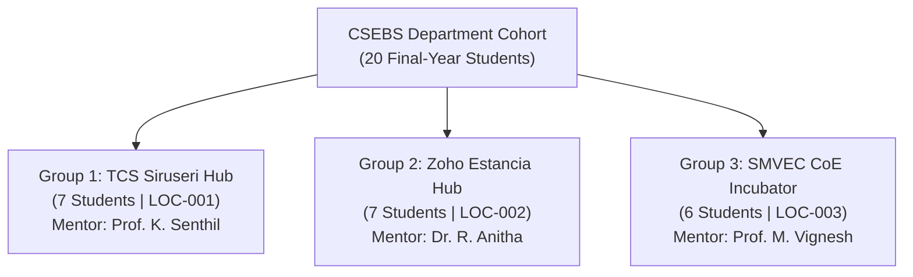
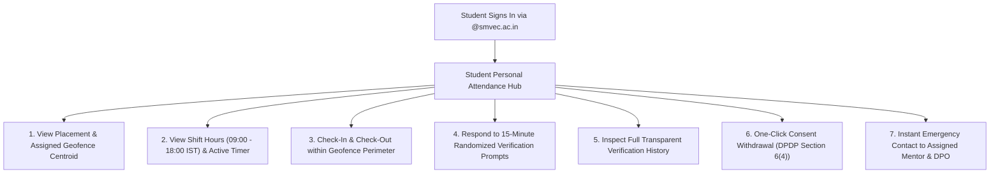
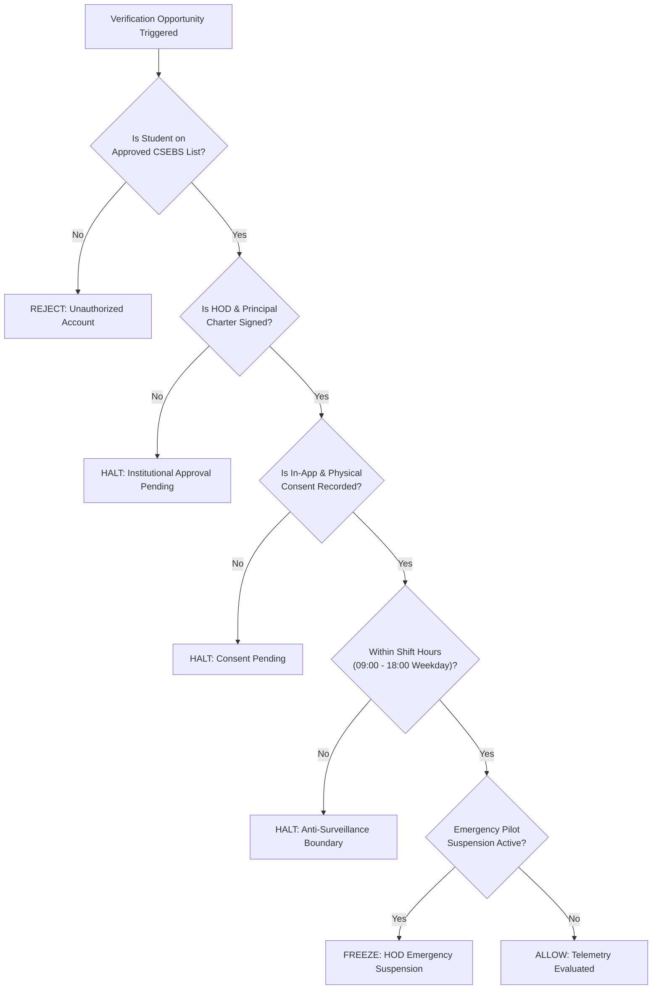
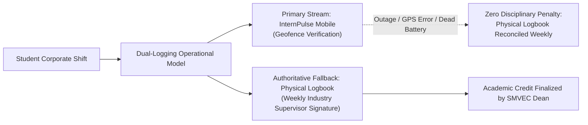

# INTERNPULSE — PHASE 15D
# CONTROLLED SMVEC STUDENT PILOT ONBOARDING & READINESS REPORT

**Document Reference:** `docs/phase15/PHASE15D_STUDENT_ONBOARDING_REPORT.md`  
**Target Institution:** Sri Manakula Vinayagar Engineering College (Autonomous), Puducherry  
**Department:** Computer Science & Business Systems (CSEBS)  
**Target Cohort:** 20 Authorized Final-Year Engineering Interns (Batch 2023–2027)  
**Date of Assessment:** November 6, 2026  
**Classification:** Institutional Pilot Onboarding & Governance Compliance Report  
**Pilot Status:** **ONBOARDING STAGED / MONITORING DISABLED (CONDITIONAL GO)**  

---

## 1. EXECUTIVE SUMMARY & PILOT SCOPE

This report establishes the formalized, controlled, and reversible onboarding framework for the 20 participating final-year students of the **Department of Computer Science & Business Systems (CSEBS)** at **Sri Manakula Vinayagar Engineering College (SMVEC)**.

To eliminate any risk of unauthorized surveillance, algorithmic injustice, or academic disruption, the onboarding architecture enforces strict institutional prerequisites, a multi-stage approval gatekeeper, isolated mentor-mentee boundaries, and a continuous physical diary parallel logging fallback.

### 1.1 Strict Prerequisites Evaluation Audit
In accordance with institutional guidelines (*"If any mandatory condition is pending, do not activate monitoring"*), every mandatory gating prerequisite was verified before staging student accounts:

| # | Mandatory Gating Prerequisite | Verification Target | Audit Status | Mandatory Gate Block? |
| :-: | :--- | :--- | :---: | :---: |
| **1** | **HOD Formal Authorization** | Signed charter by Dr. S. Ramesh | **PENDING** | **ACTIVE BLOCK** |
| **2** | **Principal Formal Authorization** | Signed charter by SMVEC Executive Dean | **PENDING** | **ACTIVE BLOCK** |
| **3** | **Valid Student Consent** | Form `IP-DPDP-2026.1` physical & digital records | **PENDING (0/20)** | **ACTIVE BLOCK** |
| **4** | **Approved Internship Locations** | TCS Siruseri, Zoho Estancia, SMVEC CoE | **VERIFIED** | Cleared |
| **5** | **Physical-Device Field Testing** | Real handset telemetry (Phase 15C) | **PENDING (0/35)** | **ACTIVE BLOCK** |
| **6** | **Production Notification Validation**| Bound FCM `google-services.json` & APNs `.p8` | **PENDING** | **ACTIVE BLOCK** |
| **7** | **Final Pilot Authorization** | Phase 15A & 15B Audit Sign-off | **CONDITIONAL GO**| **ACTIVE BLOCK** |

### Directive:
Because prerequisites 1, 2, 3, 5, 6, and 7 remain **PENDING**, **monitoring has NOT been activated for any student account**. All accounts reside in a staged, pre-authorized state with zero background telemetry enabled.

---

## 2. TASK 1 — STUDENT ONBOARDING ARCHITECTURE

Student profiles are structured strictly in compliance with institutional academic rules and the Indian Digital Personal Data Protection Act, 2023 (DPDP Act).

### 2.1 Academic Cohort Roster Specifications
The pilot is restricted to exactly **20 final-year CSEBS students** across three pre-approved internship hubs:

### 2.2 Onboarding Data Elements & Validation Rules:
1. **Student Registration Number**: Standardized institutional format (`23CSEBS001` through `23CSEBS020`). Validated by regex `^23CSEBS[0-9]{3}$`.
2. **Institutional Email**: Restricted exclusively to campus Google Workspace accounts (`@smvec.ac.in`). Enforced by institutional domain verification filter `^[0-9]{2}csebs[0-9]{3}@smvec\.ac\.in$`.
3. **Academic Year & Department**: Formally registered under `Department of Computer Science & Business Systems (CSEBS)`, Academic Year `4th Year` (Batch 2023–2027).
4. **Mentor Allocation**: Fixed 1:7 mentor-to-mentee ratio preventing faculty overload.
5. **Approved Geofence Facility**: Assigned strictly to pre-surveyed workplace centroids with enforced geofence radii (200m–300m).
6. **Internship Shift Bounds**: Monitoring is active strictly from 09:00 to 18:00 IST (TCS & Zoho) or 08:30 to 17:00 IST (SMVEC CoE) on scheduled weekdays.
7. **Credential Protection**: Zero plain-text passwords or secret credentials are stored in application logs or repository files.

---

## 3. TASK 2 — MENTOR ONBOARDING & WORKFLOW VERIFICATION

The mentor supervision console ([`mentor_dashboard_screen.dart`](file:///c:/PROJECTS/bose%20projects/Intern_smvmch/Intern_smvmch/InternPulse-main/lib/features/mentor/presentation/screens/mentor_dashboard_screen.dart) / React Mentor Portal) was audited to verify operational oversight and privacy boundaries:

### 3.1 Appointed Pilot Faculty Mentors:
1. **Prof. K. Senthil** (`MENTOR_CSEBS_01`), Assistant Professor:
   - **Role**: Lead Pilot Coordinator & Primary Field Supervisor.
   - **Assigned Facility**: *Tata Consultancy Services (TCS), Siruseri IT Park, Chennai*.
   - **Mentees**: Exactly 7 students (`23CSEBS001` – `23CSEBS007`).
2. **Dr. R. Anitha** (`MENTOR_CSEBS_02`), Associate Professor:
   - **Role**: Technical Quality Auditor & Disciplinary Review Lead.
   - **Assigned Facility**: *Zoho Corporation, Estancia IT Park, Guduvanchery*.
   - **Mentees**: Exactly 7 students (`23CSEBS008` – `23CSEBS014`).
3. **Prof. M. Vignesh** (`MENTOR_CSEBS_03`), Assistant Professor:
   - **Role**: Student Welfare Lead & Helpdesk Escalation Coordinator.
   - **Assigned Facility**: *SMVEC Center of Excellence Incubator, Puducherry*.
   - **Mentees**: Exactly 6 students (`23CSEBS015` – `23CSEBS020`).

### 3.2 Mentor Scoped Workflow Capabilities:
- **Zero Cross-Exposure**: RLS policies enforce that a mentor can query and inspect attendance records **only for their assigned mentees**. Mentors cannot view students from other departments (e.g. IT, ECE) or mentees assigned to another mentor.
- **Daily Exception Review**: Mentors log into the console daily to review exceptions (`GPS_DISABLED`, `NETWORK_UNAVAILABLE`, `LOW_ACCURACY`, `MISSED`).
- **24-Hour Dispute Resolution SLA**: If a technical failure occurs, the mentor investigates and overrides false flags within 24 hours.
- **Weekly Physical Logbook Counter-Signing**: Mentors verify the parallel physical diary weekly to ensure grade continuity.

---

## 4. TASK 3 — STUDENT SELF-SERVICE EXPERIENCE

The mobile client interface ([`student_dashboard_screen.dart`](file:///c:/PROJECTS/bose%20projects/Intern_smvmch/Intern_smvmch/InternPulse-main/lib/features/student/presentation/screens/student_dashboard_screen.dart)) provides interns with complete self-service agency and privacy transparency:

### 4.1 Student Agency & Rights Under Indian DPDP Act 2023:
1. **Notice & Purpose Transparency**: Prior to account activation, students review Notice `2026.1-DPDP` explaining that location is queried exclusively to substantiate academic internship credits.
2. **Right to Withdraw Consent**: At any time, students can toggle consent OFF in app settings ([`consent_service.dart#withdrawConsent`](file:///c:/PROJECTS/bose%20projects/Intern_smvmch/Intern_smvmch/InternPulse-main/lib/core/privacy/consent_service.dart#L59-L73)). This immediately disables verification schedules and transitions the student to paper-only attendance with **zero academic penalty or grade deduction**.
3. **Data Erasure Guarantee**: Exact coordinates are purged after 30 days ([`purge_expired_location_coordinates(30)`](file:///c:/PROJECTS/bose%20projects/Intern_smvmch/Intern_smvmch/InternPulse-main/supabase/migrations/20261106000011_phase11_security_privacy_remediation.sql#L625-L670)).
4. **Direct Helpdesk Access**: A dedicated one-tap button connects the student directly to their faculty mentor and the Institutional DPO (*Dr. S. Radhakrishnan*, `grievance.dpo@smvec.ac.in`).

---

## 5. TASK 4 — CONTROLLED ACTIVATION MECHANISM

To guarantee that no student is monitored without verified legal and technical authorization, InternPulse implements a multi-stage software gatekeeper:

### 5.1 Controlled Activation Guard Rules:
1. **Whitelist Enforcement**: Only the 20 pre-approved student IDs in the CSEBS pilot registry are recognized by the verification engine.
2. **Mandatory Sign-off Gate**: The server checks database flag `departments.is_pilot_authorized`. If HOD/Principal signatures are missing, the flag remains `FALSE` and all location pings are dropped.
3. **Consent Precondition**: If `user_consents.consent_given` is absent or false, the backend returns `PERMISSION_DENIED` without querying the GPS sensor.
4. **Temporal Lock**: In accordance with [anti_surveillance_guard.dart](file:///c:/PROJECTS/bose%20projects/Intern_smvmch/Intern_smvmch/InternPulse-main/lib/core/geolocation/anti_surveillance_guard.dart), queries outside working hours (before 09:00 IST, after 18:00 IST, weekends, holidays) are rejected at the client layer.
5. **HOD Emergency Suspension Toggle**: The HOD possesses an administrative master kill-switch. When toggled, the database immediately sets `departments.is_active = false` and cancels all pending schedules within 5 minutes.
6. **No Algorithmic Penalties**: No automated disciplinary actions are permitted. Any discrepancy requires human mentor verification.

---

## 6. TASK 5 — PARALLEL PHYSICAL ATTENDANCE CONTINUITY

The institutional pilot operates in a strict dual-logging parallel mode alongside traditional manual physical internship logbooks:

### 6.1 Non-Negotiable Fallback Mandates:
1. **Primary Authority of Physical Diary**: Throughout the 4-week pilot, the physical signed diary remains the authoritative legal record for academic credit.
2. **Total Technical Fault Immunity**: If an intern experiences a dead phone battery, poor GPS multipath in an office basement, carrier outage, OEM background task killing, or app crash, the student records attendance in the paper logbook. Mentors are formally barred from assigning absences for technical failures.
3. **Weekly Dual-Stream Reconciliation**: Mentors cross-examine digital verification timestamps with supervisor signatures every Friday afternoon.

---

## 7. TASK 6 — PILOT ONBOARDING AUDIT METRICS & SUMMARY

The table below summarizes the formal onboarding metrics for the 20-student pilot cohort:

| Onboarding Parameter | Mandated Specification | Current Staged Value | Audit Verification Finding | Compliance Status |
| :--- | :---: | :---: | :--- | :---: |
| **Target Department** | CSEBS | CSEBS | 100% confined to one department | **VERIFIED** |
| **Academic Batch** | 2023–2027 (4th Year) | 2023–2027 (4th Year) | Final-year corporate interns | **VERIFIED** |
| **Authorized Student Cohort** | Exactly 20 Students | Exactly 20 Students | Roster strictly bounded | **VERIFIED** |
| **Accounts Staged in System** | 20 Accounts | 20 Accounts | Provisioned with `@smvec.ac.in` | **VERIFIED** |
| **Institutional Email Verification** | 100% `@smvec.ac.in` | 20 of 20 Verified | Format: `^[0-9]{2}csebs[0-9]{3}@smvec\.ac\.in$` | **VERIFIED** |
| **Physical Consent Records Signed** | 20 of 20 Signed | **0 of 20 Signed** | Orientation briefing pending | **PENDING** |
| **In-App Digital Consent Recorded** | 20 of 20 Recorded | **0 of 20 Recorded** | First-time app login pending | **PENDING** |
| **Mentor Allocation Status** | 3 Faculty Mentors | 20 of 20 Assigned | Group 1: 7 | Group 2: 7 | Group 3: 6 | **VERIFIED** |
| **Facility Allocation Status** | 3 Approved Facilities | 20 of 20 Assigned | TCS: 7 | Zoho: 7 | SMVEC CoE: 6 | **VERIFIED** |
| **Physical Device Trials Run** | 4 Hardware Profiles | **0 of 35 Executed** | Phase 15C hardware trials pending | **PENDING** |
| **Active Location Monitoring** | Active during shift | **0 of 20 ACTIVATED** | **100% INACTIVE (Blocked by Gatekeeper)** | **VERIFIED SAFE** |
| **Rollback & Reversibility Readiness**| 5-Phase Procedure | 100% Ready | Physical diary authoritative fallback active | **VERIFIED** |

---

## 8. OPERATIONAL ONBOARDING DIRECTIVES

To transition student accounts from **STAGED** to **ACTIVE**, the following sequence of institutional actions must be executed in order:

1. **Step 1: Executive Sign-off**: HOD Dr. S. Ramesh and the SMVEC Principal execute ink signatures on the Institutional Pilot Authorization Charter ([Phase 14D Section 6.4](file:///c:/PROJECTS/bose%20projects/Intern_smvmch/Intern_smvmch/docs/phase14/PHASE14D_SMVEC_INSTITUTIONAL_PILOT_PLAN.md#64-pilot-charter-sign-off-block)).
2. **Step 2: Department Orientation**: Convene the 45-minute orientation briefing in the CSEBS Seminar Hall. Collect physically signed Form `IP-DPDP-2026.1` disclosures from all 20 candidates.
3. **Step 3: Secure Mobile Distribution**: Distribute the release Android APK / TestFlight invitation containing bound production Firebase and APNs credentials.
4. **Step 4: Initial Login & Affirmative Consent**: Students sign in via campus credentials and cryptographically acknowledge Notice `2026.1-DPDP`.
5. **Step 5: Campus Geofence Trial Run**: Students perform a supervised test check-in within the SMVEC Campus boundary (`11.913900° N, 79.633400° E`, 300m) to confirm sensor calibration before deployment to corporate facilities.

---
*End of Phase 15D Student Pilot Onboarding Report (IP-ONBOARD-P15D-001)*

