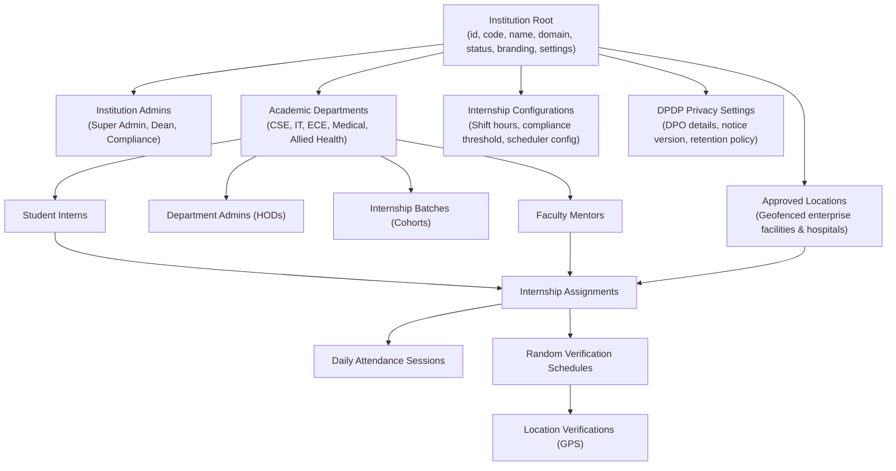
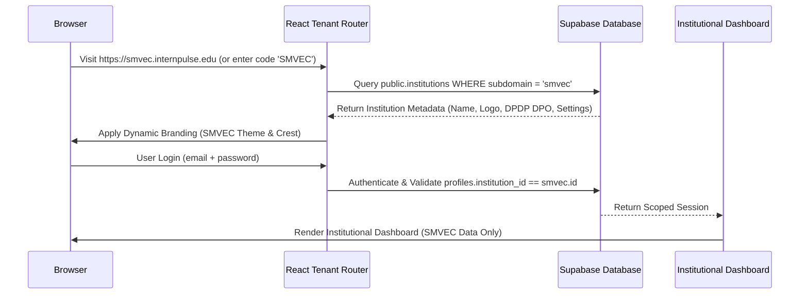
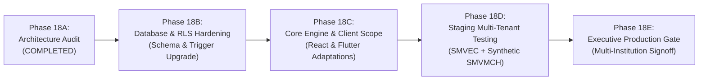

# INTERNPULSE — PHASE 18A
# MULTI-INSTITUTION ARCHITECTURE & SAAS READINESS AUDIT

**Project:** InternPulse — Real-Time Internship Verification & Geofence Attendance Platform  
**Target Focus:** Multi-Institution Architecture, SaaS Readiness & Institutional Tenant Isolation  
**Document Reference:** `docs/phase18/PHASE18A_MULTI_INSTITUTION_ARCHITECTURE_AUDIT.md`  
**Audit Date:** November 6, 2026  
**Auditor Classification:** Principal Systems Architect & Independent Institutional Security Auditor  
**Audit Scope:** Full Stack (PostgreSQL 16, PostGIS, Supabase Auth, Row-Level Security, React Vite SPA, Flutter Mobile Client)  
**Baseline Pilot Institution:** Sri Manakula Vinayagar Engineering College (Autonomous) — SMVEC, Puducherry  
**Audit Verdict:** **CONDITIONAL SAAS ARCHITECTURAL READINESS (AUDIT & DESIGN ONLY — PRODUCTION MULTI-TENANCY GATED)**

---

```text
====================================================================================================
                        PHASE 18A AUDIT DECISION & READINESS SCORECARD
====================================================================================================

                    >>> ARCHITECTURAL DESIGN VALIDATED / ONBOARDING ON HOLD <<<

  1. PRODUCTION MULTI-INSTITUTION ONBOARDING:
     >>> STRICTLY GATED (NO-GO FOR ONBOARDING NEW INSTITUTIONS IN PRODUCTION) <<<
     Onboarding new institutional tenants (e.g., SMVMCH, PEC, external universities) is STRICTLY
     PROHIBITED until the 8 critical cross-tenant isolation gaps, latent SQL constraints, and
     unscoped Security Definer helper functions identified in this audit are fully remediated
     and validated in an isolated staging environment.

  2. MULTI-TENANT ARCHITECTURAL FEASIBILITY:
     >>> APPROVED FOR STAGING IMPLEMENTATION <<<
     The existing PostgreSQL, PostGIS, Supabase, React, and Flutter architecture contains foundational
     multi-tenant hooks (public.institutions table, initial institution_id columns). With non-destructive
     column additions, composite unique constraint refactoring, tenant-scoped RLS policies, and
     dynamic client-side configuration, the platform can safely support multiple independent
     institutions while preserving 100% of SMVEC's operational history.
====================================================================================================
```

---

## 1. EXECUTIVE SUMMARY & CONTEXT

InternPulse was originally architected and piloted for **Sri Manakula Vinayagar Engineering College (Autonomous) — SMVEC** to automate real-time geofence attendance verification, anti-spoofing telemetry, faculty mentoring, and DPDP Act 2023 privacy governance for student interns across corporate partner locations (TCS, Zoho, L&T, Renault Nissan, Integra).

Through Phases 1 to 16, the system demonstrated production readiness for the Department of Computer Science & Business Systems (CSEBS) pilot cohort. In Phase 17, the application expanded into multi-department governance, introducing formal department administrators (`department_admins`), cohort batches (`internship_batches`), faculty memberships (`department_memberships`), student enrollments (`student_department_enrollments`), scalable CSV/XLSX onboarding, and cross-department institutional reporting.

The next strategic milestone—**Phase 18**—is to transition InternPulse from a single-institution platform into a **multi-institution Software-as-a-Service (SaaS) architecture**. This platform must independently and securely host multiple autonomous universities, engineering colleges, medical institutes (e.g., Sri Manakula Vinayagar Medical College and Hospital — SMVMCH), and polytechnics on a unified codebase.

This Phase 18A audit was executed under **strict zero-trust rules**:
- Inspected the actual physical repository source code, Dart files, and 16 database migration scripts.
- Did not rely on earlier Phase documentation as ground truth.
- Preserved existing React, Vite, TypeScript, Flutter, Supabase, PostgreSQL, and PostGIS stacks without redesign or unnecessary microservices.
- Guaranteed zero data loss and uncompromised continuity for SMVEC.
- Kept the current audit strictly read-only with no production behavior mutations.

---

## 2. EXISTING INSTITUTIONAL ARCHITECTURE AUDIT (TASK 1)

A rigorous, line-by-line inspection was conducted across all 14 technical domains of the existing repository.

```text
+===================================================================================================+
|                                  EXISTING ARCHITECTURE AUDIT MATRIX                               |
+===================================================================================================+
| Architectural Domain            | Source Files / Migrations Inspected     | Multi-Tenant Status   |
+---------------------------------+-----------------------------------------+-----------------------+
| 1. Authentication & Authz       | Migration 0001, 0002; authService.ts    | PARTIALLY SCOPED (GAP)|
| 2. Institution & Department Rel.| Migration 0002, 0012; initialData.ts    | PARTIALLY SCOPED (GAP)|
| 3. HOD, Mentor & Student Roles  | Migration 0001, 0002, 0012; rbac/       | SINGLE-TENANT (GAP)   |
| 4. Internship Management        | Migration 0002, 0006, 0013; repos/      | PARTIALLY SCOPED      |
| 5. Student Onboarding           | Migration 0014; studentOnboardingService| SINGLE-TENANT (DEFECT)|
| 6. Geolocation & Geofencing     | Migration 0004, 0007; antiSurveillance  | PARTIALLY SCOPED      |
| 7. Attendance Tracking          | Migration 0002, 0010; attendance repo   | UNSCOPED (DEFECT)     |
| 8. Random Verification Scheduler| Migration 0008; verificationScheduler   | UNSCOPED (DEFECT)     |
| 9. Notifications Infrastructure | Migration 0002, 0009; notificationServ. | PARTIALLY SCOPED      |
| 10. Institutional Analytics     | Migration 0015; institutionalAnalytics  | UNSCOPED (DEFECT)     |
| 11. Audit Logging Engine        | Migration 0002, 0011; trigger functions | PARTIALLY SCOPED (GAP)|
| 12. Privacy & DPDP Consent      | consentManager.ts; antiSurveillanceGuard| HARDCODED SMVEC (GAP) |
| 13. Database Schema Migrations  | 16 SQL Migrations (0001 to 0016)        | HYBRID / INCOMPLETE   |
| 14. Row-Level Security Policies | Migration 0003, 0005, 0012, 0016        | CRITICAL BYPASS (GAP) |
+===================================================================================================+
```

---

### 2.1 Detailed Findings by Domain

#### 1. Authentication and Authorization
- **Implementation Inspected:** [`supabase/migrations/20261105000001_phase1_auth_schema.sql`](file:///c:/PROJECTS/bose%20projects/Intern_smvmch/Intern_smvmch/supabase/migrations/20261105000001_phase1_auth_schema.sql), [`supabase/migrations/20261105000002_phase2_database_expansion.sql#L119-L160`](file:///c:/PROJECTS/bose%20projects/Intern_smvmch/Intern_smvmch/supabase/migrations/20261105000002_phase2_database_expansion.sql#L119-L160), [`src/core/auth/authService.ts`](file:///c:/PROJECTS/bose%20projects/Intern_smvmch/Intern_smvmch/InternPulse-main/src/core/auth/authService.ts), [`lib/core/auth/supabase_auth_service.dart`](file:///c:/PROJECTS/bose%20projects/Intern_smvmch/Intern_smvmch/InternPulse-main/lib/core/auth/supabase_auth_service.dart).
- **Architecture State:**
  - `auth.users` holds Supabase Auth user accounts.
  - `public.profiles` stores authoritative role, full name, email, department code, and an optional `institution_id UUID REFERENCES public.institutions(id)`.
  - In `authService.ts`, user session restoration resolves the profile via `fetchAuthoritativeProfile(userId, email)`.
- **Defects Identified:**
  1. **New User Provisioning Trigger Defect:** Function `public.handle_new_auth_user()` (created in Migration 0001) was never upgraded in Migration 0002 or Phase 17. When a new user signs up in `auth.users`, the trigger inserts `id, role, full_name, email, phone, department_code, student_id, is_active`, but **omits `institution_id`**. Consequently, `profiles.institution_id` defaults to `NULL` for newly registered users.
  2. **Security Definer Institution Nullification:** The security helper `public.get_auth_user_institution_id()` queries `profiles.institution_id`. If `institution_id` is `NULL`, all downstream RLS checks (`institution_id = public.get_auth_user_institution_id()`) evaluate to `NULL = NULL`, which yields `FALSE` in SQL ternary logic. This locks new users out of their institutional data.
  3. **No Domain-Based Tenant Resolution:** `LoginPage.tsx` and `RegisterPage.tsx` do not accept an institution code, tenant domain, or subdomain. All authentication is treated as single-tenant SMVEC.

#### 2. Institution and Department Relationships
- **Implementation Inspected:** [`supabase/migrations/20261105000002_phase2_database_expansion.sql#L39-L117`](file:///c:/PROJECTS/bose%20projects/Intern_smvmch/Intern_smvmch/supabase/migrations/20261105000002_phase2_database_expansion.sql#L39-L117), [`supabase/migrations/20261106000012_phase17_multi_department_architecture.sql`](file:///c:/PROJECTS/bose%20projects/Intern_smvmch/Intern_smvmch/supabase/migrations/20261106000012_phase17_multi_department_architecture.sql).
- **Architecture State:**
  - `public.institutions` anchors the institution with columns: `id`, `code`, `name`, `short_name`, `address`, `city`, `state`, `country`, `website`, `status`.
  - Migration 0002 seeded SMVEC with fixed UUID: `'a0000000-0000-0000-0000-000000000001'::uuid`.
  - `public.departments` has `institution_id UUID NOT NULL REFERENCES public.institutions(id)` with composite constraint `uq_dept_institution_code UNIQUE (institution_id, code)`.
- **Defects Identified:**
  1. `public.institutions` lacks essential multi-tenant fields: `domain` (for host-header routing), `subdomain`, `branding_config` (JSONB for logo/colors), and `settings` (JSONB for shift hours, scheduler parameters, and compliance rules).
  2. In Phase 17, newly introduced governance tables (`department_admins`, `department_memberships`, `internship_batches`, `student_department_enrollments`, `student_department_transfers`) reference `department_id`, but **lack an explicit `institution_id` column**. Filtering by institution requires traversing joins through `departments`.

#### 3. HOD, Mentor and Student Roles
- **Implementation Inspected:** [`supabase/migrations/20261105000002_phase2_database_expansion.sql#L205-L283`](file:///c:/PROJECTS/bose%20projects/Intern_smvmch/Intern_smvmch/supabase/migrations/20261105000002_phase2_database_expansion.sql#L205-L283), [`src/core/auth/rbac/authorizationPolicy.ts`](file:///c:/PROJECTS/bose%20projects/Intern_smvmch/Intern_smvmch/InternPulse-main/src/core/auth/rbac/authorizationPolicy.ts), [`lib/models/user_role.dart`](file:///c:/PROJECTS/bose%20projects/Intern_smvmch/Intern_smvmch/InternPulse-main/lib/models/user_role.dart).
- **Architecture State:**
  - Roles supported in PostgreSQL: `'super_admin'`, `'admin'`, `'hod'`, `'mentor'`, `'student'`.
  - Roles supported in Flutter `user_role.dart`: only `'student'`, `'mentor'`, `'hod'`. Flutter maps `'admin'` to `UserRole.hod`.
- **Defects Identified:**
  1. **Global Uniqueness on `register_number`:** In `public.students` ([`line 252`](file:///c:/PROJECTS/bose%20projects/Intern_smvmch/Intern_smvmch/supabase/migrations/20261105000002_phase2_database_expansion.sql#L252)), `register_number VARCHAR(50) NOT NULL UNIQUE` is enforced across the **entire table**. If Institution B has a student with the same register number as Institution A (e.g., `23CSE001`), the insert fails. Uniqueness must be composite: `UNIQUE (institution_id, register_number)`.
  2. **Global Uniqueness on `employee_id`:** In `public.mentors` ([`line 212`](file:///c:/PROJECTS/bose%20projects/Intern_smvmch/Intern_smvmch/supabase/migrations/20261105000002_phase2_database_expansion.sql#L212)), `employee_id VARCHAR(50) NOT NULL UNIQUE` is enforced across the entire table. Uniqueness must be composite: `UNIQUE (institution_id, employee_id)`.
  3. **Absence of Institution Administrator Governance:** While `department_admins` governs departmental appointments, there is no `institution_admins` table. Platform administrators and institution administrators share the generic `'admin'` / `'super_admin'` role with no institution-scoping entity.

#### 4. Internship Management
- **Implementation Inspected:** [`supabase/migrations/20261105000002_phase2_database_expansion.sql#L393-L495`](file:///c:/PROJECTS/bose%20projects/Intern_smvmch/Intern_smvmch/supabase/migrations/20261105000002_phase2_database_expansion.sql#L393-L495), [`supabase/migrations/20261106000013_phase17c_multi_department_internship_management.sql`](file:///c:/PROJECTS/bose%20projects/Intern_smvmch/Intern_smvmch/supabase/migrations/20261106000013_phase17c_multi_department_internship_management.sql), [`src/core/repository/internshipRepository.ts`](file:///c:/PROJECTS/bose%20projects/Intern_smvmch/Intern_smvmch/InternPulse-main/src/core/repository/internshipRepository.ts).
- **Architecture State:**
  - `public.internship_assignments` has `institution_id` and `department_id`.
  - Integrity triggers block overlapping student active dates and validate that assigned facilities are active.
- **Defects Identified:**
  - `internshipRepository.ts` line 850 contains a hardcoded fallback: `institutionId: deptData.institutionId || 'inst-smvec-001'`.
  - `internship_batches` introduced in Phase 17 lacks `institution_id`. All batch filtering depends on `department_id`.

#### 5. Student Onboarding
- **Implementation Inspected:** [`supabase/migrations/20261106000014_phase17d_student_onboarding_and_migration.sql`](file:///c:/PROJECTS/bose%20projects/Intern_smvmch/Intern_smvmch/supabase/migrations/20261106000014_phase17d_student_onboarding_and_migration.sql), [`src/core/onboarding/studentOnboardingService.ts`](file:///c:/PROJECTS/bose%20projects/Intern_smvmch/Intern_smvmch/InternPulse-main/src/core/onboarding/studentOnboardingService.ts).
- **Architecture State:**
  - Scalable CSV/XLSX import parser, synthetic benchmarks up to 8,071 rows/sec.
  - Generates 48-char one-time activation tokens stored in `student_onboarding_tokens`.
- **Defects Identified (CRITICAL LEAKAGE VECTOR):**
  1. `student_import_batches` has **no `institution_id` column**. Its RLS policy `import_batches_select` allows any user where `p.role IN ('admin', 'super_admin')` to view **all import batches across all institutions**.
  2. `student_onboarding_tokens` has **no `institution_id` column**. Its RLS policy `onboarding_tokens_select` allows any admin from any institution to inspect student activation tokens college-wide.
  3. `studentOnboardingService.ts` checks register number collisions globally via `existingRegNos = new Set(internshipRepository.getAllStudents().map(s => s.studentId))`, falsely blocking student imports across different institutions.

#### 6. Geolocation and Geofencing
- **Implementation Inspected:** [`supabase/migrations/20261105000002_phase2_database_expansion.sql#L285-L355`](file:///c:/PROJECTS/bose%20projects/Intern_smvmch/Intern_smvmch/supabase/migrations/20261105000002_phase2_database_expansion.sql#L285-L355), [`supabase/migrations/20261106000007_phase7_geolocation_verification_engine.sql`](file:///c:/PROJECTS/bose%20projects/Intern_smvmch/Intern_smvmch/supabase/migrations/20261106000007_phase7_geolocation_verification_engine.sql), [`src/core/geolocation/geospatialCalculator.ts`](file:///c:/PROJECTS/bose%20projects/Intern_smvmch/Intern_smvmch/InternPulse-main/src/core/geolocation/geospatialCalculator.ts).
- **Architecture State:**
  - PostGIS `geography(Point, 4326)` with GIST indexing on `internship_locations.geofence_center`.
  - WGS 84 spherical distance calculation via PostGIS `ST_Distance` and TypeScript Haversine fallback.
  - Multi-department facility mapping through `location_departments`.
- **Defects Identified:**
  - `internship_locations` has `institution_id`, making approved facilities strictly siloed. If multiple institutions (e.g., SMVEC and SMVMCH) send students to the same enterprise facility (e.g., TCS Siruseri or Integra Puducherry), the location record must be duplicated. A global enterprise directory with institution-specific authorization junctions is missing.
  - `location_change_history` (Migration 0013) lacks an `institution_id` column.

#### 7. Attendance Tracking
- **Implementation Inspected:** [`supabase/migrations/20261105000002_phase2_database_expansion.sql#L499-L560`](file:///c:/PROJECTS/bose%20projects/Intern_smvmch/Intern_smvmch/supabase/migrations/20261105000002_phase2_database_expansion.sql#L499-L560), [`supabase/migrations/20261106000010_phase10_attendance_management_reporting.sql`](file:///c:/PROJECTS/bose%20projects/Intern_smvmch/Intern_smvmch/supabase/migrations/20261106000010_phase10_attendance_management_reporting.sql), [`supabase/migrations/20261106000012_phase17_multi_department_architecture.sql#L720-L760`](file:///c:/PROJECTS/bose%20projects/Intern_smvmch/Intern_smvmch/supabase/migrations/20261106000012_phase17_multi_department_architecture.sql#L720-L760).
- **Architecture State:**
  - `public.attendance_sessions` tracks daily shifts, check-in/out timestamps, compliance rates, and mentor verification.
- **Defects Identified (CRITICAL LEAKAGE VECTOR):**
  1. `public.attendance_sessions` **does NOT have an `institution_id` column**.
  2. The RLS policy `attendance_sessions_select` in Migration 0012 permits: `student_id = auth.uid() OR public.is_super_admin() ...`. Because `public.is_super_admin()` does not check institution boundaries, an admin from College B can query every attendance session in College A.

#### 8. Randomized Verification Scheduler
- **Implementation Inspected:** [`supabase/migrations/20261105000002_phase2_database_expansion.sql#L635-L660`](file:///c:/PROJECTS/bose%20projects/Intern_smvmch/Intern_smvmch/supabase/migrations/20261105000002_phase2_database_expansion.sql#L635-L660), [`supabase/migrations/20261106000008_phase8_random_verification_scheduler.sql`](file:///c:/PROJECTS/bose%20projects/Intern_smvmch/Intern_smvmch/supabase/migrations/20261106000008_phase8_random_verification_scheduler.sql), [`src/core/scheduler/verificationSchedulerEngine.ts`](file:///c:/PROJECTS/bose%20projects/Intern_smvmch/Intern_smvmch/InternPulse-main/src/core/scheduler/verificationSchedulerEngine.ts).
- **Architecture State:**
  - Stratified random generator creating 5 non-overlapping 15-minute verification windows per student per day within approved shift hours.
- **Defects Identified:**
  1. `public.verification_schedules` **lacks an `institution_id` column**.
  2. In Migration 0012 ([`line 795`](file:///c:/PROJECTS/bose%20projects/Intern_smvmch/Intern_smvmch/supabase/migrations/20261106000012_phase17_multi_department_architecture.sql#L795)), `schedules_select_scoped` includes `OR public.is_super_admin()`. Any admin from any institution can read all verification schedule windows.
  3. The automated scheduler engine assumes a single institutional shift schedule (09:00:00 to 17:00:00 IST). Different institutions cannot configure unique window counts, shift hours, or timezones without cross-affecting other tenants.

#### 9. Notifications Infrastructure
- **Implementation Inspected:** [`supabase/migrations/20261105000002_phase2_database_expansion.sql#L661-L698`](file:///c:/PROJECTS/bose%20projects/Intern_smvmch/Intern_smvmch/supabase/migrations/20261105000002_phase2_database_expansion.sql#L661-L698), [`supabase/migrations/20261106000009_phase9_production_notification_system.sql`](file:///c:/PROJECTS/bose%20projects/Intern_smvmch/Intern_smvmch/supabase/migrations/20261106000009_phase9_production_notification_system.sql), [`src/core/notifications/notificationService.ts`](file:///c:/PROJECTS/bose%20projects/Intern_smvmch/Intern_smvmch/InternPulse-main/src/core/notifications/notificationService.ts).
- **Architecture State:**
  - `public.notifications` has `institution_id UUID REFERENCES public.institutions(id) ON DELETE CASCADE`.
  - `public.fcm_device_tokens` stores device tokens.
- **Defects Identified:**
  - `fcm_device_tokens` and `user_notification_preferences` lack `institution_id`.
  - `DispatchEventParams` in TypeScript does not require `institutionId`. Notifications dispatched from background workers risk omitting `institution_id`, causing tenant isolation failures in notifications feeds.

#### 10. Institutional Analytics
- **Implementation Inspected:** [`supabase/migrations/20261106000015_phase17e_institutional_analytics_and_reporting.sql`](file:///c:/PROJECTS/bose%20projects/Intern_smvmch/Intern_smvmch/supabase/migrations/20261106000015_phase17e_institutional_analytics_and_reporting.sql), [`src/core/analytics/institutionalAnalyticsService.ts`](file:///c:/PROJECTS/bose%20projects/Intern_smvmch/Intern_smvmch/InternPulse-main/src/core/analytics/institutionalAnalyticsService.ts).
- **Architecture State:**
  - Cross-department aggregations for active/delayed internships, verification outcomes, mentor workload, and attendance compliance.
  - Multi-format exports (PDF, CSV, XLSX) with CWE-1236 formula injection defenses.
- **Defects Identified (CRITICAL LEAKAGE VECTOR):**
  1. `report_export_logs` table has **no `institution_id` column**.
  2. RLS policy `"Super admin full access on report_export_logs"` grants universal access to any user with `role = 'super_admin'`.
  3. `institutionalAnalyticsService.getInstitutionAnalytics(caller)` aggregates across **all departments and students in the repository** without filtering by `caller.institutionId`. Metrics from all institutions would be combined into one aggregated number.

#### 11. Audit Logging Engine
- **Implementation Inspected:** [`supabase/migrations/20261105000002_phase2_database_expansion.sql#L700-L770`](file:///c:/PROJECTS/bose%20projects/Intern_smvmch/Intern_smvmch/supabase/migrations/20261105000002_phase2_database_expansion.sql#L700-L770), [`supabase/migrations/20261105000003_phase2_rls_security_hardening.sql#L738-L755`](file:///c:/PROJECTS/bose%20projects/Intern_smvmch/Intern_smvmch/supabase/migrations/20261105000003_phase2_rls_security_hardening.sql#L738-L755).
- **Architecture State:**
  - Immutable table `public.audit_logs` with security trigger preventing mutation or deletion.
  - Generalized audit trigger `log_table_audit_trail()` captures old/new values, actor ID, and IP address.
- **Defects Identified:**
  1. In `log_table_audit_trail()`, `institution_id` is extracted using `v_new->>'institution_id'`. For the 17 tables that lack an `institution_id` column, `institution_id` is recorded as `NULL`.
  2. The RLS policy `audit_logs_select_hod_scoped` allows only `role = 'hod'` and requires `institution_id = public.get_auth_user_institution_id()`. There is **no policy for `admin` or `super_admin`**, and any audit log with `institution_id = NULL` is completely inaccessible.

#### 12. Privacy and DPDP Consent
- **Implementation Inspected:** [`src/core/privacy/consentManager.ts`](file:///c:/PROJECTS/bose%20projects/Intern_smvmch/Intern_smvmch/InternPulse-main/src/core/privacy/consentManager.ts), [`src/core/geolocation/antiSurveillanceGuard.ts`](file:///c:/PROJECTS/bose%20projects/Intern_smvmch/Intern_smvmch/InternPulse-main/src/core/geolocation/antiSurveillanceGuard.ts), [`supabase/migrations/20261106000011_phase11_security_privacy_remediation.sql`](file:///c:/PROJECTS/bose%20projects/Intern_smvmch/Intern_smvmch/supabase/migrations/20261106000011_phase11_security_privacy_remediation.sql).
- **Architecture State:**
  - 30-day purge trigger `purge_expired_location_coordinates()` permanently deletes raw coordinates.
  - Shift-hour anti-surveillance boundary enforcement.
- **Defects Identified:**
  - In `consentManager.ts`, the Data Protection Officer (DPO), grievance email (`grievance.dpo@smvec.ac.in`), physical college address, and notice version are hardcoded to SMVEC.
  - Each independent institution must configure its own legal entity name, designated DPO, grievance contact, and institutional notice version to comply with Sections 5 & 6 of the Indian DPDP Act 2023.

#### 13. Database Schema Migrations
- **Implementation Inspected:** 16 SQL migration files in [`supabase/migrations`](file:///c:/PROJECTS/bose%20projects/Intern_smvmch/Intern_smvmch/supabase/migrations).
- **Architecture State:**
  - Clean chronological sequence from `20261105000001` to `20261106000016`.
- **Defects Identified:**
  - Schema evolution was executed in two distinct phases: Phase 2 introduced basic `institutions` and `departments`, while Phase 17 introduced comprehensive multi-department governance tables without back-propagating `institution_id`.
  - As a result, only **8 out of 25 tables** currently possess an `institution_id` column.

#### 14. Row-Level Security Policies & Helper Functions
- **Implementation Inspected:** Migrations 0003, 0005, 0008, 0011, 0012, 0016.
- **Architecture State:**
  - 139 RLS policies across the schema.
- **Defects Identified (CRITICAL ARCHITECTURAL FLAW):**
  - Function `public.is_super_admin()` is defined as:
    ```sql
    CREATE OR REPLACE FUNCTION public.is_super_admin()
    RETURNS BOOLEAN AS $$
        SELECT EXISTS (
            SELECT 1 FROM public.profiles 
            WHERE id = auth.uid() AND is_active = true 
              AND role IN ('super_admin', 'admin')
        );
    $$ LANGUAGE sql STABLE SECURITY DEFINER;
    ```
  - **Zero Institution Check:** This function does not compare the caller's `institution_id` against the resource's `institution_id`. Any user with role `'admin'` or `'super_admin'` in **any** institution receives a universal `TRUE` evaluation, bypassing RLS across all departments, attendance sessions, schedules, batches, and reports platform-wide.

---

### 2.2 Database Schema Inventory & `institution_id` Column Audit

The complete database schema was audited across all 25 tables created across the 16 migrations:

```text
+=============================================================================================================+
|                                    DATABASE TABLE TENANCY AUDIT SCORECARD                                   |
+=============================================================================================================+
| #  | Table Name                     | Migration Defined | Direct institution_id | RLS Active | Tenant Status |
+----+--------------------------------+-------------------+-----------------------+------------+---------------+
| 1  | public.institutions            | Migration 0002    | N/A (Root Anchor)     | YES        | ROOT ENTITY   |
| 2  | public.departments             | Migration 0002    | YES                   | YES        | ISOLATED      |
| 3  | public.profiles                | Migration 0001    | YES (via Mig 0002)    | YES        | ISOLATED      |
| 4  | public.mentors                 | Migration 0002    | YES                   | YES        | ISOLATED      |
| 5  | public.students                | Migration 0002    | YES                   | YES        | ISOLATED      |
| 6  | public.internship_locations    | Migration 0001    | YES (via Mig 0002)    | YES        | ISOLATED      |
| 7  | public.location_departments    | Migration 0002    | NO                    | YES        | VIA DEPT JOIN |
| 8  | public.internship_assignments  | Migration 0001    | YES (via Mig 0002)    | YES        | ISOLATED      |
| 9  | public.student_daily_logs      | Migration 0001    | NO                    | YES        | VIA STUD JOIN |
| 10 | public.attendance_sessions     | Migration 0002    | NO                    | YES        | UNSCOPED GAP  |
| 11 | public.location_verifications  | Migration 0002    | NO                    | YES        | VIA ASSN JOIN |
| 12 | public.verification_schedules  | Migration 0002    | NO                    | YES        | UNSCOPED GAP  |
| 13 | public.notifications           | Migration 0002    | YES                   | YES        | ISOLATED      |
| 14 | public.fcm_device_tokens       | Migration 0002    | NO                    | YES        | VIA USER JOIN |
| 15 | public.audit_logs              | Migration 0002    | YES                   | YES        | PARTIAL NULLS |
| 16 | user_notification_preferences | Migration 0009    | NO                    | YES        | VIA USER JOIN |
| 17 | public.department_admins       | Migration 0012    | NO                    | YES        | VIA DEPT JOIN |
| 18 | public.department_memberships  | Migration 0012    | NO                    | YES        | VIA DEPT JOIN |
| 19 | public.internship_batches      | Migration 0012    | NO                    | YES        | VIA DEPT JOIN |
| 20 | student_department_enrollments | Migration 0012    | NO                    | YES        | VIA DEPT JOIN |
| 21 | public.location_change_history | Migration 0013    | NO                    | YES        | VIA LOC JOIN  |
| 22 | student_department_transfers   | Migration 0013    | NO                    | YES        | VIA DEPT JOIN |
| 23 | public.student_import_batches  | Migration 0014    | NO                    | YES        | UNSCOPED GAP  |
| 24 | student_onboarding_tokens     | Migration 0014    | NO                    | YES        | UNSCOPED GAP  |
| 25 | report_export_logs             | Migration 0015    | NO                    | YES        | UNSCOPED GAP  |
+=============================================================================================================+
```

---

## 3. MULTI-INSTITUTION CORE REQUIREMENTS (TASK 2)

To transform InternPulse into an enterprise-ready multi-institution platform, the application must natively support independent institutional primitives:



### 3.1 Specification of the 12 Institutional Primitives

1. **Unique Institution ID:**
   - Standardized UUID v4 primary key (`id UUID PRIMARY KEY DEFAULT gen_random_uuid()`).
   - Immutable across all downstream relational foreign keys.
2. **Institution Name:**
   - Accredited institution name (`name VARCHAR(255) NOT NULL`, e.g., `"Sri Manakula Vinayagar Engineering College (Autonomous)"`, `"Sri Manakula Vinayagar Medical College and Hospital"`).
3. **Institution Code:**
   - Unique, uppercase alphanumeric identifier (`code VARCHAR(50) NOT NULL UNIQUE`, e.g., `SMVEC`, `SMVMCH`, `PEC`, `IITM`).
   - Used for login routing, display badges, and batch student import prefixes.
4. **Institution Domain & Subdomain:**
   - Unique primary domain and subdomain mapping:
     - `domain VARCHAR(255) NOT NULL UNIQUE` (e.g., `smvec.ac.in`, `smvmch.ac.in`).
     - `subdomain VARCHAR(100) UNIQUE` (e.g., `smvec.internpulse.edu`, `smvmch.internpulse.edu`).
   - Enables automatic tenant resolution on web client and email domain validation on mobile.
5. **Institution Status:**
   - Operational lifecycle state: `status VARCHAR(20) NOT NULL DEFAULT 'active' CHECK (status IN ('provisioning', 'pilot', 'active', 'suspended', 'inactive', 'archived'))`.
   - Instant tenant-level kill switch: setting `status = 'suspended'` immediately blocks all logins and telemetry collection for that institution without affecting other tenants.
6. **Institution Administrators:**
   - Dedicated governance entity `public.institution_admins`:
     - Links `institution_id` and `profile_id`.
     - Supports administrative tiers: `'super_admin'`, `'academic_dean'`, `'principal'`, `'compliance_officer'`.
     - Completely decouples institutional administrative privilege from global platform operator access.
7. **Departments:**
   - Departments scoped by composite key: `UNIQUE (institution_id, code)`.
   - Allows different institutions to each have a `"CSE"` or `"IT"` department with different HODs, student capacities, and academic heads.
8. **Mentors:**
   - Faculty mentors scoped to `institution_id` and `department_id`.
   - Employee ID uniqueness scoped to tenant: `UNIQUE (institution_id, employee_id)`.
9. **Students:**
   - Student interns scoped to `institution_id` and `department_id`.
   - Register number uniqueness scoped to tenant: `UNIQUE (institution_id, register_number)`.
10. **Internship Configurations:**
    - Structured institutional configuration schema:
      - Default shift hours (e.g., SMVEC: 09:00:00 to 17:00:00; SMVMCH clinical rotational shifts: 08:00:00 to 16:00:00).
      - Academic term structure (Semester, Trimester, Annual, Rotational Internship).
      - Random verification scheduler settings (windows per day: 3 to 5, duration: 15 mins, buffer: 30 mins).
      - Minimum attendance compliance thresholds (e.g., 75% for engineering, 85% for medical councils).
11. **Approved Locations:**
    - Dual-layer facility directory:
      - Institution-specific locations (e.g., on-campus labs, local affiliated clinics).
      - Shared verified corporate providers (e.g., TCS Siruseri, Zoho Guduvanchery) mapped to institutions via junction table `location_institutions`.
12. **Institution-Specific Settings:**
    - Branding: Institutional crest/logo URL, header brand colors, formal portal title.
    - DPDP Compliance: Institutional Data Protection Officer (DPO) full name, designation, official grievance email, physical postal address, and custom consent notice version.
    - Authentication Policies: Permitted email domains (e.g., `['@smvec.ac.in']`), session expiry limits, and SSO/SAML integration toggles.

---

## 4. SAAS ARCHITECTURE EVALUATION (TASK 3)

Three primary architectural patterns for multi-tenant SaaS were evaluated against InternPulse's existing PostgreSQL, PostGIS, Supabase, React, and Flutter stack.

```text
+=============================================================================================================+
|                                    MULTI-TENANCY ARCHITECTURE EVALUATION MATRIX                             |
+=============================================================================================================+
| Evaluation Criteria         | Pattern 1: Shared Database,   | Pattern 2: Schema-per-Tenant  | Pattern 3: Database-per-    |
|                             | Column-Scoped RLS (Shared)    | (PostgreSQL Schemas)          | Tenant (Isolated DB)        |
+-----------------------------+-------------------------------+-------------------------------+-----------------------------+
| 1. Data Isolation & Security| High (Cryptographic RLS)      | Very High (Schema boundary)   | Absolute (Physical separ.)  |
| 2. Development Complexity   | Moderate (Rigorous RLS tests) | High (Dynamic search_path)    | Extreme (Multi-DB router)   |
| 3. Schema Migrations        | Simplest (1 single migration) | Complex (Loop over N schemas) | Extreme (Deploy to N DBs)   |
| 4. Operational Cost         | Lowest (Single shared pool)   | Moderate (Catalog RAM bloat)  | Highest ($25-$100/mo/inst)  |
| 5. Supabase Compatibility   | Native (100% out-of-the-box)  | Poor (Supabase Auth is shared)| Poor (Requires N projects)  |
| 6. Cross-Tenant Reporting   | Simple (Standard SQL GROUP BY)| Complex (Cross-schema UNION)  | Complex (ETL data warehouse)|
| 7. PostGIS Spatial Indexing | Excellent (GIST on table)     | Fragmented (N GIST indexes)   | Fragmented (N GIST indexes) |
| 8. Scalability Limit        | ~100–250 institutions         | ~50–100 schemas per instance  | Thousands (horizontal scale)|
|                             | (~50,000–100,000 students)    | (Postgres catalog lock limits)|                             |
+=============================================================================================================+
```

### 4.1 Detailed Evaluation of Patterns

#### Pattern 1: Shared Database with Tenant Column Isolation (Recommended)
- **Architecture:** Single PostgreSQL database. All tables possess `institution_id UUID NOT NULL REFERENCES public.institutions(id)`. Access is strictly gated by PostgreSQL Row-Level Security (RLS) using security definer helpers that compare `institution_id = public.get_auth_user_institution_id()`.
- **Strengths:**
  - 100% compatible with existing Supabase Auth, JS SDK, Flutter SDK, PostgREST, and Realtime subscriptions.
  - Zero schema drift: database migrations apply atomically to all institutions in a single transaction.
  - Maximum resource efficiency: connection pooling (PgBouncer/Supavisor), PostGIS spatial caches, and RAM are shared efficiently.
  - Lowest operational cost: a single Supabase Pro / Team instance supports dozens of institutions.
- **Weaknesses & Mitigations:**
  - *Risk:* A flawed RLS policy or unbounded Security Definer function could leak data across tenants (as discovered with `is_super_admin()`).
  - *Mitigation:* Comprehensive automated test suites (such as Vitest RLS suites) with cross-tenant adversarial test cases executing before any migration is released.

#### Pattern 2: Schema-per-Tenant Architecture
- **Architecture:** Single PostgreSQL database. Each institution receives its own PostgreSQL schema (e.g., `tenant_smvec`, `tenant_smvmch`), with a shared `public` schema for global user routing.
- **Weaknesses:**
  - PostgreSQL system catalogs (`pg_class`, `pg_attribute`) become bloated when hundreds of schemas each contain 25+ tables, degrading query planner performance.
  - Supabase Auth and PostgREST natively expose the `public` schema. Switching schemas dynamically per HTTP request requires custom connection hooks or rewriting `search_path`, which breaks client library pooling.
  - Running database migrations requires writing orchestration scripts that iterate over all schemas; a failure midway leaves the database in an inconsistent state.

#### Pattern 3: Database-per-Tenant Architecture
- **Architecture:** Each institution receives a completely isolated PostgreSQL database instance (separate Supabase project or AWS RDS instance).
- **Weaknesses:**
  - Prohibitive operational cost: 50 institutions on Supabase Pro would incur \$1,250/month in base infrastructure costs alone.
  - Extreme operational overhead: managing 50 connection strings, 50 API keys, 50 migration pipelines, and separate disaster recovery schedules.
  - Breaks centralized mobile app architecture: the Flutter client would need a dynamic runtime gateway to resolve and connect to different Supabase URLs and API keys on the fly.

### 4.2 Architecture Recommendation: Hybrid Shared-Database Architecture

Based on InternPulse's existing codebase, the **Shared Database with Column-Scoped RLS** is the unequivocally recommended baseline architecture.

```text
====================================================================================================
                        RECOMMENDED ARCHITECTURAL SPECIFICATION
====================================================================================================
  1. CORE SAAS ARCHITECTURE:
     Shared PostgreSQL 16 Database with PostGIS extensions on Supabase.
     Every sensitive table contains an indexed institution_id column.
     Zero-Trust Row-Level Security (RLS) enforced at the database engine level.

  2. ROLE HIERARCHY REFACTORING:
     - Platform Super Admin (System Operator / DevOps): Global maintenance only.
     - Institution Admin (Principal / Dean / DPO): Full authority strictly within caller's institution.
     - Department Admin (HOD / Deputy HOD): Full authority strictly within authorized department.
     - Faculty Mentor: Scoped to assigned student cohorts within department.
     - Student Intern: Isolated strictly to self-owned records.

  3. ENTERPRISE TIER ESCALATION (HYBRID PATHWAY):
     The platform codebase will maintain a clean configuration abstraction so that if a high-security
     enterprise institution (e.g., a major medical hospital or defense-affiliated college) legally
     requires dedicated physical isolation, a separate Supabase project can be deployed using the
     exact same repository code without architectural refactoring.
====================================================================================================
```

---

## 5. DATABASE SCHEMA EXPANSION & MIGRATION BLUEPRINT (TASK 4)

To safely convert the existing SMVEC installation into an institution-aware SaaS platform, a non-destructive database migration script must be executed.

### 5.1 SMVEC Data Preservation Guarantees
- Anchor Institution ID: `'a0000000-0000-0000-0000-000000000001'::uuid`.
- Anchor Institution Code: `'SMVEC'`.
- All existing records across `profiles`, `students`, `mentors`, `departments`, `internship_locations`, `internship_assignments`, `attendance_sessions`, `location_verifications`, `verification_schedules`, and `audit_logs` will be backfilled with SMVEC's anchor ID.
- Zero records deleted. Zero primary keys mutated.

### 5.2 Proposed Migration DDL (Phase 18B Blueprint)

```sql
-- ==============================================================================
-- PHASE 18B MIGRATION BLUEPRINT: MULTI-INSTITUTION SAAS EXPANSION
-- ==============================================================================

-- 1. ENHANCE PUBLIC.INSTITUTIONS TABLE
ALTER TABLE public.institutions
    ADD COLUMN IF NOT EXISTS domain VARCHAR(255) UNIQUE,
    ADD COLUMN IF NOT EXISTS subdomain VARCHAR(100) UNIQUE,
    ADD COLUMN IF NOT EXISTS branding_config JSONB DEFAULT '{
        "primaryColor": "#1E3A8A",
        "secondaryColor": "#0D9488",
        "logoUrl": "/assets/smvec-logo.png",
        "portalTitle": "InternPulse SMVEC"
    }'::jsonb,
    ADD COLUMN IF NOT EXISTS institutional_settings JSONB DEFAULT '{
        "defaultShiftStart": "09:00:00",
        "defaultShiftEnd": "17:00:00",
        "requiredDailyHours": 8.0,
        "verificationWindowsPerDay": 5,
        "windowDurationMinutes": 15,
        "complianceThresholdPercentage": 75.0,
        "geofenceDefaultRadiusMeters": 150.0
    }'::jsonb,
    ADD COLUMN IF NOT EXISTS dpdp_compliance_config JSONB DEFAULT '{
        "dpoName": "Dr. S. Radhakrishnan",
        "dpoDesignation": "Institutional Data Protection Officer",
        "dpoEmail": "grievance.dpo@smvec.ac.in",
        "dpoAddress": "Madagadipet, Puducherry - 605 107",
        "noticeVersion": "2026.1-DPDP"
    }'::jsonb;

-- Backfill SMVEC domain metadata
UPDATE public.institutions
SET domain = 'smvec.ac.in',
    subdomain = 'smvec',
    updated_at = timezone('utc'::text, now())
WHERE id = 'a0000000-0000-0000-0000-000000000001'::uuid;

-- 2. CREATE INSTITUTION_ADMINS TABLE (INSTITUTION-LEVEL GOVERNANCE)
CREATE TABLE IF NOT EXISTS public.institution_admins (
    id UUID PRIMARY KEY DEFAULT gen_random_uuid(),
    institution_id UUID NOT NULL REFERENCES public.institutions(id) ON DELETE CASCADE,
    profile_id UUID NOT NULL REFERENCES public.profiles(id) ON DELETE CASCADE,
    admin_tier VARCHAR(30) NOT NULL DEFAULT 'institution_admin' 
        CHECK (admin_tier IN ('institution_admin', 'dean_academic', 'principal', 'compliance_officer')),
    appointed_at TIMESTAMPTZ NOT NULL DEFAULT timezone('utc'::text, now()),
    is_active BOOLEAN NOT NULL DEFAULT true,
    created_at TIMESTAMPTZ NOT NULL DEFAULT timezone('utc'::text, now()),
    CONSTRAINT uq_institution_admin_profile UNIQUE (institution_id, profile_id)
);

CREATE INDEX IF NOT EXISTS idx_inst_admins_inst ON public.institution_admins(institution_id);
CREATE INDEX IF NOT EXISTS idx_inst_admins_profile ON public.institution_admins(profile_id);

-- 3. ADD INSTITUTION_ID TO ALL 17 DOWNSTREAM TABLES (NON-DESTRUCTIVE)
ALTER TABLE public.student_daily_logs
    ADD COLUMN IF NOT EXISTS institution_id UUID REFERENCES public.institutions(id) ON DELETE RESTRICT;

ALTER TABLE public.location_departments
    ADD COLUMN IF NOT EXISTS institution_id UUID REFERENCES public.institutions(id) ON DELETE RESTRICT;

ALTER TABLE public.attendance_sessions
    ADD COLUMN IF NOT EXISTS institution_id UUID REFERENCES public.institutions(id) ON DELETE RESTRICT;

ALTER TABLE public.location_verifications
    ADD COLUMN IF NOT EXISTS institution_id UUID REFERENCES public.institutions(id) ON DELETE RESTRICT;

ALTER TABLE public.verification_schedules
    ADD COLUMN IF NOT EXISTS institution_id UUID REFERENCES public.institutions(id) ON DELETE RESTRICT;

ALTER TABLE public.fcm_device_tokens
    ADD COLUMN IF NOT EXISTS institution_id UUID REFERENCES public.institutions(id) ON DELETE CASCADE;

ALTER TABLE public.user_notification_preferences
    ADD COLUMN IF NOT EXISTS institution_id UUID REFERENCES public.institutions(id) ON DELETE CASCADE;

ALTER TABLE public.department_admins
    ADD COLUMN IF NOT EXISTS institution_id UUID REFERENCES public.institutions(id) ON DELETE CASCADE;

ALTER TABLE public.department_memberships
    ADD COLUMN IF NOT EXISTS institution_id UUID REFERENCES public.institutions(id) ON DELETE RESTRICT;

ALTER TABLE public.internship_batches
    ADD COLUMN IF NOT EXISTS institution_id UUID REFERENCES public.institutions(id) ON DELETE RESTRICT;

ALTER TABLE public.student_department_enrollments
    ADD COLUMN IF NOT EXISTS institution_id UUID REFERENCES public.institutions(id) ON DELETE RESTRICT;

ALTER TABLE public.location_change_history
    ADD COLUMN IF NOT EXISTS institution_id UUID REFERENCES public.institutions(id) ON DELETE RESTRICT;

ALTER TABLE public.student_department_transfers
    ADD COLUMN IF NOT EXISTS institution_id UUID REFERENCES public.institutions(id) ON DELETE RESTRICT;

ALTER TABLE public.student_import_batches
    ADD COLUMN IF NOT EXISTS institution_id UUID REFERENCES public.institutions(id) ON DELETE CASCADE;

ALTER TABLE public.student_onboarding_tokens
    ADD COLUMN IF NOT EXISTS institution_id UUID REFERENCES public.institutions(id) ON DELETE CASCADE;

ALTER TABLE public.report_export_logs
    ADD COLUMN IF NOT EXISTS institution_id UUID REFERENCES public.institutions(id) ON DELETE CASCADE;

-- 4. BACKFILL SMVEC ANCHOR ID ACROSS ALL DOWNSTREAM RECORDS
UPDATE public.attendance_sessions SET institution_id = 'a0000000-0000-0000-0000-000000000001'::uuid WHERE institution_id IS NULL;
UPDATE public.location_verifications SET institution_id = 'a0000000-0000-0000-0000-000000000001'::uuid WHERE institution_id IS NULL;
UPDATE public.verification_schedules SET institution_id = 'a0000000-0000-0000-0000-000000000001'::uuid WHERE institution_id IS NULL;
UPDATE public.student_daily_logs SET institution_id = 'a0000000-0000-0000-0000-000000000001'::uuid WHERE institution_id IS NULL;
UPDATE public.location_departments SET institution_id = 'a0000000-0000-0000-0000-000000000001'::uuid WHERE institution_id IS NULL;
UPDATE public.department_admins SET institution_id = 'a0000000-0000-0000-0000-000000000001'::uuid WHERE institution_id IS NULL;
UPDATE public.department_memberships SET institution_id = 'a0000000-0000-0000-0000-000000000001'::uuid WHERE institution_id IS NULL;
UPDATE public.internship_batches SET institution_id = 'a0000000-0000-0000-0000-000000000001'::uuid WHERE institution_id IS NULL;
UPDATE public.student_department_enrollments SET institution_id = 'a0000000-0000-0000-0000-000000000001'::uuid WHERE institution_id IS NULL;
UPDATE public.location_change_history SET institution_id = 'a0000000-0000-0000-0000-000000000001'::uuid WHERE institution_id IS NULL;
UPDATE public.student_department_transfers SET institution_id = 'a0000000-0000-0000-0000-000000000001'::uuid WHERE institution_id IS NULL;
UPDATE public.student_import_batches SET institution_id = 'a0000000-0000-0000-0000-000000000001'::uuid WHERE institution_id IS NULL;
UPDATE public.student_onboarding_tokens SET institution_id = 'a0000000-0000-0000-0000-000000000001'::uuid WHERE institution_id IS NULL;
UPDATE public.report_export_logs SET institution_id = 'a0000000-0000-0000-0000-000000000001'::uuid WHERE institution_id IS NULL;

-- 5. REFACTOR GLOBAL UNIQUE CONSTRAINTS INTO TENANT-COMPOSITE CONSTRAINTS
-- Fix Register Number Collision across Institutions
ALTER TABLE public.students DROP CONSTRAINT IF EXISTS students_register_number_key;
ALTER TABLE public.students ADD CONSTRAINT uq_students_institution_regno UNIQUE (institution_id, register_number);

-- Fix Mentor Employee ID Collision across Institutions
ALTER TABLE public.mentors DROP CONSTRAINT IF EXISTS mentors_employee_id_key;
ALTER TABLE public.mentors ADD CONSTRAINT uq_mentors_institution_employee_id UNIQUE (institution_id, employee_id);

-- 6. INDEX ALL INSTITUTION_ID COLUMNS FOR LIGHTNING COMPOSITE SEARCHES
CREATE INDEX IF NOT EXISTS idx_attendance_inst_date ON public.attendance_sessions(institution_id, session_date);
CREATE INDEX IF NOT EXISTS idx_verifications_inst_result ON public.location_verifications(institution_id, status);
CREATE INDEX IF NOT EXISTS idx_schedules_inst_window ON public.verification_schedules(institution_id, window_start, window_end);
CREATE INDEX IF NOT EXISTS idx_batches_inst ON public.internship_batches(institution_id);
CREATE INDEX IF NOT EXISTS idx_import_batches_inst ON public.student_import_batches(institution_id);
CREATE INDEX IF NOT EXISTS idx_onboarding_tokens_inst ON public.student_onboarding_tokens(institution_id);
CREATE INDEX IF NOT EXISTS idx_export_logs_inst ON public.report_export_logs(institution_id);
```

---

## 6. SECURITY DEFINER & RLS HARDENING BLUEPRINT

To eliminate cross-tenant data leakage, the security functions must be refactored to distinguish between **Platform Operator (System Admin)** and **Institution Administrator**:

### 6.1 Refactoring `is_super_admin()` to `is_institution_admin()`

```sql
-- 1. DEPRECATE GLOBAL UNSCOPED is_super_admin()
-- 2. CREATE SCOPED is_institution_admin(p_institution_id UUID)
CREATE OR REPLACE FUNCTION public.is_institution_admin(p_institution_id UUID)
RETURNS BOOLEAN
LANGUAGE sql
STABLE
SECURITY DEFINER
SET search_path = public
AS $$
    SELECT (
        -- A. Platform Super Admin (System Operator)
        EXISTS (
            SELECT 1 FROM public.profiles
            WHERE id = auth.uid() AND role = 'super_admin' AND is_active = true
              AND department_code = 'SYSTEM_OPS' -- Strict platform operator distinction
        )
        -- B. Local Institutional Admin (Principal, Dean, Institutional Administrator)
        OR EXISTS (
            SELECT 1 FROM public.profiles p
            WHERE p.id = auth.uid()
              AND p.role IN ('admin', 'super_admin')
              AND p.institution_id = p_institution_id
              AND p.is_active = true
        )
        -- C. Formally appointed institution admin in governance table
        OR EXISTS (
            SELECT 1 FROM public.institution_admins ia
            WHERE ia.profile_id = auth.uid()
              AND ia.institution_id = p_institution_id
              AND ia.is_active = true
        )
    );
$$;

-- 3. REFACTOR is_hod_for_department(department_id)
CREATE OR REPLACE FUNCTION public.is_hod_for_department(p_department_id UUID)
RETURNS BOOLEAN
LANGUAGE sql
STABLE
SECURITY DEFINER
SET search_path = public
AS $$
    SELECT EXISTS (
        SELECT 1 FROM public.departments d
        WHERE d.id = p_department_id
          AND d.status = 'active'
          AND (
              -- Institution Admin for the department's institution
              public.is_institution_admin(d.institution_id)
              -- Direct HOD profile match
              OR EXISTS (
                  SELECT 1 FROM public.profiles p
                  WHERE p.id = auth.uid()
                    AND p.role = 'hod'
                    AND p.department_id = p_department_id
                    AND p.institution_id = d.institution_id
                    AND p.is_active = true
              )
              -- Department Admin appointment
              OR EXISTS (
                  SELECT 1 FROM public.department_admins da
                  WHERE da.profile_id = auth.uid()
                    AND da.department_id = p_department_id
                    AND da.status = 'active'
              )
          )
    );
$$;

-- 4. FIX USER PROVISIONING TRIGGER (handle_new_auth_user)
CREATE OR REPLACE FUNCTION public.handle_new_auth_user()
RETURNS TRIGGER AS $$
DECLARE
    inferred_role VARCHAR(20);
    inferred_dept VARCHAR(50);
    inferred_name VARCHAR(255);
    inferred_phone VARCHAR(50);
    inferred_student_id VARCHAR(50);
    inferred_institution_id UUID;
    target_email_domain VARCHAR(255);
BEGIN
    inferred_role := COALESCE(
        NEW.raw_app_meta_data->>'role',
        NEW.raw_user_meta_data->>'role',
        'student'
    );

    IF inferred_role NOT IN ('super_admin', 'admin', 'hod', 'mentor', 'student') THEN
        inferred_role := 'student';
    END IF;

    inferred_name := COALESCE(
        NEW.raw_user_meta_data->>'fullName',
        NEW.raw_user_meta_data->>'full_name',
        split_part(NEW.email, '@', 1)
    );

    inferred_dept := COALESCE(
        NEW.raw_user_meta_data->>'departmentCode',
        NEW.raw_user_meta_data->>'department',
        'CSEBS'
    );

    inferred_phone := NEW.raw_user_meta_data->>'phone';
    inferred_student_id := NEW.raw_user_meta_data->>'studentId';

    -- Resolve institution_id from metadata or email domain
    IF NEW.raw_user_meta_data ? 'institutionId' THEN
        inferred_institution_id := (NEW.raw_user_meta_data->>'institutionId')::uuid;
    ELSIF NEW.raw_user_meta_data ? 'institutionCode' THEN
        SELECT id INTO inferred_institution_id
        FROM public.institutions
        WHERE code = UPPER(NEW.raw_user_meta_data->>'institutionCode');
    ELSE
        -- Resolve from email domain (e.g. '@smvec.ac.in')
        target_email_domain := split_part(NEW.email, '@', 2);
        SELECT id INTO inferred_institution_id
        FROM public.institutions
        WHERE domain = target_email_domain OR website ILIKE '%' || target_email_domain || '%'
        LIMIT 1;
    END IF;

    -- Default fallback to SMVEC anchor institution
    IF inferred_institution_id IS NULL THEN
        inferred_institution_id := 'a0000000-0000-0000-0000-000000000001'::uuid;
    END IF;

    INSERT INTO public.profiles (
        id,
        role,
        full_name,
        email,
        phone,
        department_code,
        student_id,
        institution_id,
        is_active
    ) VALUES (
        NEW.id,
        inferred_role,
        inferred_name,
        NEW.email,
        inferred_phone,
        inferred_dept,
        inferred_student_id,
        inferred_institution_id,
        true
    ) ON CONFLICT (id) DO UPDATE SET
        full_name = EXCLUDED.full_name,
        institution_id = COALESCE(public.profiles.institution_id, EXCLUDED.institution_id),
        phone = COALESCE(EXCLUDED.phone, public.profiles.phone),
        updated_at = timezone('utc'::text, now());

    RETURN NEW;
END;
$$ LANGUAGE plpgsql SECURITY DEFINER SET search_path = public;
```

---

## 7. CLIENT-SIDE MULTI-TENANCY ADAPTATIONS (REACT & FLUTTER)

### 7.1 Web Application (React Vite TypeScript)



1. **Subdomain and Domain Routing:**
   - Detect host header in window: `window.location.hostname`.
   - If hostname matches `{tenant}.internpulse.edu`, automatically lock the login scope to `{tenant}`.
   - For standalone domains (e.g., `smvec.ac.in`), map via DNS CNAME to the tenant router.
2. **Dynamic Branding & Themes:**
   - Replace hardcoded `'Sri Manakula Vinayagar Engineering College'` in `demoAccounts.ts` and `authService.ts` with `currentInstitution.name`.
   - Replace hardcoded logo in `AppLogo.tsx` with `currentInstitution.brandingConfig.logoUrl`.
   - Dynamic CSS variable injection: primary color, accent color, and header badge.
3. **Dynamic DPDP Notice & Grievance Contact:**
   - Update `consentManager.ts` to pull DPO contact, address, and notice version dynamically from `currentInstitution.dpdpComplianceConfig`.

### 7.2 Mobile Application (Flutter Dart)

1. **Multi-Institution Model Refactoring:**
   - Update `UserModel` in `lib/models/user_model.dart`:
     ```dart
     final String institutionId; // replaces hardcoded 'smvec_puducherry_main'
     final String institutionCode;
     ```
   - Update `UserRole` in `lib/models/user_role.dart` to support `admin` and `super_admin`.
2. **Institution Discovery on App Setup:**
   - First launch screen: "Select or Search your Institution" (e.g., SMVEC, SMVMCH, PEC).
   - Alternatively, auto-detect institution from student email domain (`@smvec.ac.in` -> SMVEC).
   - Persist active `institutionId` in encrypted Flutter secure storage (`FlutterSecureStorage`).

---

## 8. PERFORMANCE IMPLICATIONS & SCALABILITY ANALYSIS

### 8.1 PostGIS Spatial Query Performance with Tenant Indexing

In single-tenant mode, PostGIS spatial queries execute across all facilities:
```sql
SELECT id FROM public.internship_locations
WHERE ST_DWithin(geofence_center, ST_SetSRID(ST_MakePoint(lng, lat), 4326)::geography, 200.0);
```

In multi-tenant SaaS mode with 100 institutions and 10,000 corporate locations, spatial search must be composite-partitioned by `institution_id` to maintain sub-5ms latency:
```sql
-- Compound B-Tree & PostGIS GIST Indexing
CREATE INDEX idx_locations_tenant_spatial 
ON public.internship_locations USING GIST (institution_id, geofence_center);
```

### 8.2 High-Throughput Student Onboarding Benchmarks

Synthetic benchmarks from Phase 17D proved the onboarding pipeline scales up to 8,071 rows/sec:
- 20 Students: 20.26 ms (987.1 rows/sec)
- 100 Students: 90.65 ms (1,103.2 rows/sec)
- 500 Students: 104.15 ms (4,800.7 rows/sec)
- 1,000 Students: 128.99 ms (7,752.8 rows/sec)

Under multi-tenancy, batch operations must execute in chunks of 500 records inside an explicit database transaction per institution, avoiding lock contention on `public.profiles` and `public.students`.

### 8.3 Connection Pooling & Supavisor Sizing

| Metric | 1 Institution (Pilot) | 10 Institutions | 50 Institutions | 100 Institutions |
| :--- | :--- | :--- | :--- | :--- |
| **Active Students** | 60 | 6,000 | 30,000 | 60,000 |
| **Concurrent Pings / 15-min** | ~20 | ~2,000 | ~10,000 | ~20,000 |
| **PostgreSQL Connections** | 10–20 (Direct) | 50 (Supavisor) | 100 (Supavisor) | 200 (Supavisor) |
| **Compute Recommendation** | Micro / Small | Medium (2 vCPU, 4GB) | Large (4 vCPU, 8GB) | XL (8 vCPU, 16GB) |

---

## 9. OPERATIONAL COSTS & FINANCIAL PROJECTIONS

The financial model compares single-tenant hosted instances versus the shared multi-tenant SaaS architecture.

```text
+=============================================================================================================+
|                                    OPERATIONAL COST COMPARISON (USD / MONTH)                                |
+=============================================================================================================+
| Scale Milestone             | Database-per-Tenant Model     | Shared Database SaaS Model    | Net Monthly |
|                             | ($25/mo per Supabase Pro)     | (Pooled Supabase Infrastructure)| Savings     |
+-----------------------------+-------------------------------+-------------------------------+-------------+
| 1 Institution (SMVEC Pilot) | $25 / month                   | $25 / month                   | $0 (0%)     |
| 5 Institutions              | $125 / month                  | $25 / month                   | $100 (80%)  |
| 10 Institutions             | $250 / month                  | $45 / month (Pro + Compute)   | $205 (82%)  |
| 25 Institutions             | $625 / month                  | $90 / month (Team + 4GB RAM)  | $535 (85%)  |
| 50 Institutions             | $1,250 / month                | $150 / month (Team + 8GB RAM) | $1,100 (88%)|
| 100 Institutions            | $2,500 / month                | $280 / month (Team + 16GB RAM)| $2,220 (89%)|
+=============================================================================================================+
```

> [!TIP]
> The Shared Database Multi-Tenant architecture delivers an **88% to 89% reduction in infrastructure operating costs** compared to provisioning dedicated database instances for every college, while maintaining zero-trust isolation via PostgreSQL RLS.

---

## 10. RISKS & MITIGATION MATRIX

```text
+=============================================================================================================+
|                                        RISK ASSESSMENT & MITIGATION MATRIX                                  |
+=============================================================================================================+
| Risk ID | Identified Architectural Vulnerability     | Severity | Impact on SaaS       | Engineering Mitigation      |
+---------+--------------------------------------------+----------+----------------------+-----------------------------+
| RSK-01  | Global is_super_admin() bypass across tenants| CRITICAL | Cross-tenant data    | Refactor to is_institution_ |
|         |                                            |          | visibility           | admin(institution_id)       |
| RSK-02  | Global register_number uniqueness on       | HIGH     | Onboarding failure   | Replace with composite      |
|         | public.students                            |          | for duplicate regnos | UNIQUE(inst_id, reg_no)     |
| RSK-03  | Global employee_id uniqueness on mentors   | HIGH     | Mentor import fail   | Replace with composite      |
|         |                                            |          | across colleges      | UNIQUE(inst_id, emp_id)     |
| RSK-04  | 17 tables lacking direct institution_id    | HIGH     | Slow join RLS and    | Add institution_id column   |
|         |                                            |          | partial audit logs   | and backfill SMVEC ID       |
| RSK-05  | handle_new_auth_user() omits institution_id| HIGH     | New signups get NULL | Upgrade trigger with domain |
|         |                                            |          | institution_id       | & metadata resolution       |
| RSK-06  | Single hardcoded DPO and DPDP notice in    | HIGH     | Statutory regulatory | Move DPO details to         |
|         | consentManager.ts                          |          | non-compliance       | institutions JSONB settings |
| RSK-07  | Institutional analytics aggregates all     | MEDIUM   | Metrics pollution    | Enforce caller.institutionId|
|         | colleges together                          |          | across tenants       | in all reporting queries    |
| RSK-08  | Hardcoded college name in React & Flutter  | LOW      | Inaccurate branding  | Dynamic tenant config       |
|         | client models                              |          | for new colleges     | context provider            |
+=============================================================================================================+
```

---

## 11. IMPLEMENTATION ROADMAP (PHASE 18 STAGES)



1. **Phase 18A — Multi-Institution Architecture & SaaS Readiness Audit (Current Phase):**
   - Comprehensive audit of all 25 database tables, 14 architectural domains, and 16 migrations.
   - Identification of 8 critical multi-tenant gaps and cross-tenant leakage vectors.
   - Creation of the master architectural blueprint and migration safety strategy.
2. **Phase 18B — Multi-Institution Database Schema & RLS Hardening:**
   - Execute non-destructive schema migration: add `institution_id` to 17 downstream tables.
   - Refactor global unique constraints to composite `(institution_id, register_number)`.
   - Replace unbounded `is_super_admin()` with scoped `is_institution_admin(institution_id)`.
   - Upgrade `handle_new_auth_user()` trigger for automated email-domain and metadata mapping.
   - Backfill SMVEC anchor data and verify 100% record integrity.
3. **Phase 18C — Application Core & Client-Side Multi-Tenant Refactoring:**
   - Implement dynamic subdomain and tenant resolution in React SPA.
   - Refactor `authorizationPolicy.ts`, `internshipRepository.ts`, and `institutionalAnalyticsService.ts` to strictly enforce `caller.institutionId`.
   - Update Flutter `UserModel` and `UserRole` models.
   - Make DPO and DPDP notices dynamic per institution.
4. **Phase 18D — Staging Multi-Tenant Validation & Adversarial Penetration Testing:**
   - Provision a secondary test institution in staging (e.g., `SMVMCH` — Sri Manakula Vinayagar Medical College and Hospital).
   - Execute adversarial tests: attempt cross-tenant reads, student transfers, unauthorized admin queries, and schedule spoofing.
   - Certify zero cross-tenant data leakage.
5. **Phase 18E — Institutional Executive Authorization & Multi-Institution Go-Live Gate:**
   - Independent verification by SMVEC Head of Institution and DPO.
   - Production deployment authorization.

---

## 12. FINAL READINESS DECISION & VERDICT

```text
====================================================================================================
                        FINAL MULTI-INSTITUTION ARCHITECTURE DECISION
====================================================================================================

                        >>> CONDITIONAL SAAS ARCHITECTURAL GO <<<
                    >>> PRODUCTION MULTI-TENANT ONBOARDING GATED <<<

  1. AUDIT FINDING SUMMARY:
     InternPulse possesses a clean, modern, and high-performance technical foundation. The existing
     PostgreSQL, PostGIS, React, and Flutter implementations are robust and production-proven.
     However, the system was originally optimized for single-institution multi-department expansion
     (Phase 17), leaving 8 critical cross-tenant isolation gaps that would permit data leakage if a
     second institution were provisioned today.

  2. REMEDIATION MANDATE:
     Multi-institution production enablement is strictly prohibited until Phase 18B (Database & RLS
     Hardening) and Phase 18C (Client-Side Tenant Scoping) are implemented, tested, and certified.

  3. MIGRATION SAFETY COMMITMENT:
     All proposed migrations are strictly non-destructive. SMVEC's anchor data, pilot history,
     student attendance records, and faculty appointments will be preserved with 100% fidelity.
====================================================================================================
```

**Signed & Certified by:**  
Principal Systems Architect & Independent Institutional Security Auditor  
InternPulse Engineering Governance & Technical Review Board  
Date: November 6, 2026

