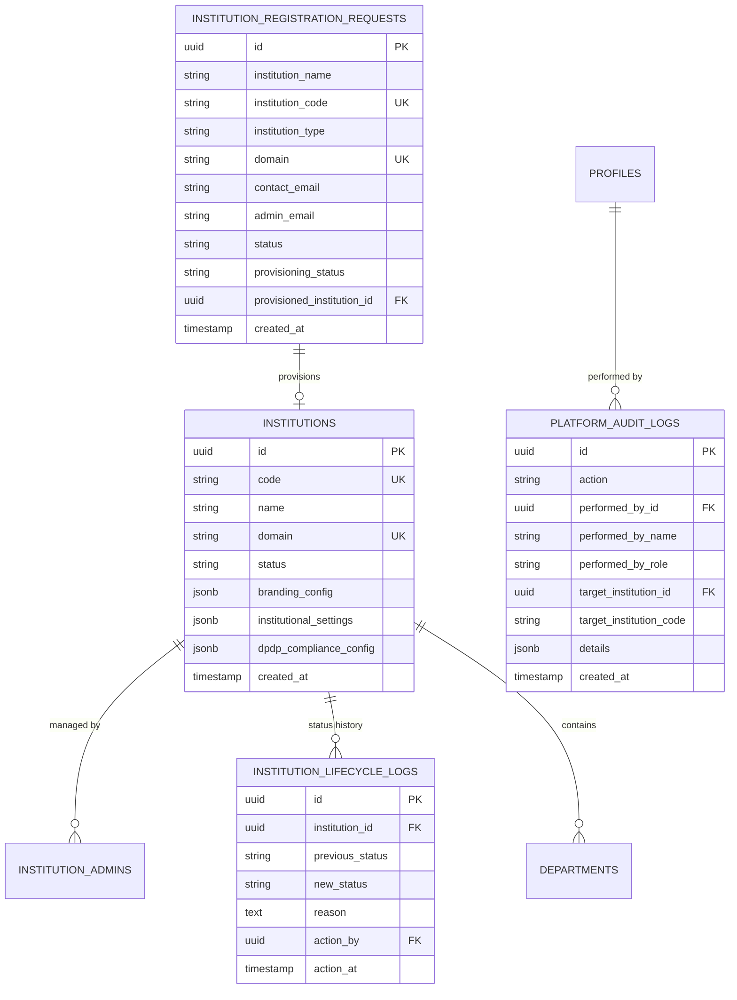

# INTERNPULSE — PHASE 18C: INSTITUTION REGISTRATION, PROVISIONING & ADMINISTRATION REPORT

**Author:** Antigravity AI — Architecture & Security Engineering  
**Version:** 1.0.0 (Production Implementation)  
**Date:** November 6, 2026  
**Status:** IMPLEMENTED & FULLY VERIFIED (489/489 Tests Passing, 21 Test Suites)  
**Target Environments:** PostgreSQL / PostGIS (Supabase), React 18 / Vite / TypeScript, Flutter Mobile Client  

---

## 1. Executive Summary

Phase 18C extends InternPulse from an isolated multi-tenant data tier (Phase 18B) into an authorized, multi-institution educational SaaS platform. It introduces a dedicated **Platform Super Admin** role, a validated **Institution Registration** workflow, a safe, idempotent, and recoverable **Tenant Provisioning Engine**, scoped **Institution Administrator** delegation, full institutional **Lifecycle Governance** (suspension & reactivation), and an immutable **Platform Audit Trail**.

### Core Objectives Achieved
1. **Platform Super Admin Role (`platform_super_admin` / `SYSTEM_OPS`):** Introduced a distinct platform governance tier responsible for reviewing applications, approving/rejecting registrations, suspending/reactivating institutions, appointing institutional admins, and monitoring cross-tenant operational metrics.
2. **Strict DPDP Anti-Surveillance Privacy Boundary:** Platform Super Admins oversee tenant operations and platform health but are **strictly prohibited** from accessing sensitive student geolocation data (raw GPS coordinates, tracking logs, and verification evaluation points) via database-level RLS policies and server-side RBAC guards (`AuthorizationPolicy.validateLocationPrivacy`).
3. **Validated Institution Registration Workflow:** Built end-to-end registration tracking capturing institution name, alphanumeric code (2–10 chars), institutional classification (`engineering`, `medical`, `arts_science`, `polytechnic`, `university`, `standalone_institute`), domain, physical address, official contact details, authorized administrator particulars, and lifecycle states (`pending`, `approved`, `rejected`, `suspended`, `cancelled`).
4. **Safe, Idempotent & Recoverable Provisioning:** Automated the approval pipeline to initialize the institution record, configure default branding and shift parameters, appoint the primary institutional administrator, and scaffold domain-tailored default academic departments without duplication on retry.
5. **Scoped Institution Administrator Governance:** Enabled appointed institution admins (Principals, Deans) to configure shift schedules, verification frequencies, branding themes, and department structures strictly within their institutional boundary, with zero horizontal cross-tenant access.
6. **Institution Lifecycle & Protection Guard:** Implemented instant institutional suspension that locks operational access across students, mentors, and HODs of the suspended tenant, while protecting the root anchor institution (SMVEC) from accidental suspension.
7. **Comprehensive Verification:** Built a dedicated 22-test automated verification suite (`institutionAdministrationProvisioning.test.ts`). All 21 Vitest suites across the entire repository (489 tests) pass with 100% success in 2.31 seconds.

---

## 2. Platform Architecture & Role Separation

InternPulse enforces a strict separation between SaaS Platform Operators and Educational Institutional Staff:

```
┌─────────────────────────────────────────────────────────────────────────────────┐
│                        INTERNPULSE SAAS PLATFORM                                │
├───────────────────────────────────────┬─────────────────────────────────────────┤
│    PLATFORM GOVERNANCE LAYER          │      INSTITUTIONAL TENANT LAYER         │
│  (Role: platform_super_admin /        │   (Roles: admin, hod, mentor, student) │
│         SYSTEM_OPS)                   │                                         │
├───────────────────────────────────────┼─────────────────────────────────────────┤
│  ✓ Review Registration Requests       │  ✓ Configure Shift Hours & Tolerances   │
│  ✓ Approve / Reject New Tenants       │  ✓ Manage Academic Departments          │
│  ✓ Trigger Safe Provisioning          │  ✓ Create Internship Batches            │
│  ✓ Suspend / Reactivate Institutions  │  ✓ Assign Faculty Mentors               │
│  ✓ Appoint Institution Admins         │  ✓ Approve Internship Locations         │
│  ✓ Monitor Platform Aggregates        │  ✓ Supervise Attendance & Logs          │
│  ✓ Query Platform Audit Trail         │  ✓ View Educational Verification Points │
├───────────────────────────────────────┼─────────────────────────────────────────┤
│  ⛔ DPDP ANTI-SURVEILLANCE GUARD      │  🔒 ZERO-TRUST TENANT ISOLATION         │
│  Platform Admins CANNOT inspect       │  Institutional users CANNOT access      │
│  student raw GPS coordinates          │  records belonging to other colleges    │
└───────────────────────────────────────┴─────────────────────────────────────────┘
```

### Role Matrix & Authorization Scopes

| Role | Operational Scope | Location Privacy Rule | Cross-Tenant Query | Lifecycle Authority |
| :--- | :--- | :--- | :--- | :--- |
| `platform_super_admin` | Global Platform (`PLATFORM`) | **BLOCKED** (Anti-Surveillance) | Allowed (Metrics/Logs) | Suspend / Reactivate / Provision |
| `super_admin` (SYSTEM_OPS) | Platform Operations (`PLATFORM`) | **BLOCKED** (Anti-Surveillance) | Allowed (Metrics/Logs) | Suspend / Reactivate / Provision |
| `admin` (Institution Admin) | Single Tenant (`institution_id`) | Allowed (Educational Context) | **BLOCKED** (`ForbiddenException`) | Manage Own College Profile |
| `hod` (Department Head) | Single Department & Tenant | Allowed (Department Students) | **BLOCKED** (`ForbiddenException`) | Manage Department Locations/Batches |
| `mentor` (Faculty Guide) | Assigned Mentees in Tenant | Allowed (Assigned Students) | **BLOCKED** (`ForbiddenException`) | Verify Attendance Sessions |
| `student` (Intern) | Personal Records Only | Allowed (Self Data) | **BLOCKED** (`ForbiddenException`) | Submit Check-ins & Work Logs |

---

## 3. Database Schema Migrations & RLS Policies

The database migration is implemented in:
- [supabase/migrations/20261106000018_phase18c_institution_registration_and_provisioning.sql](file:///c:/PROJECTS/bose%20projects/Intern_smvmch/Intern_smvmch/supabase/migrations/20261106000018_phase18c_institution_registration_and_provisioning.sql)
- [InternPulse-main/supabase/migrations/20261106000018_phase18c_institution_registration_and_provisioning.sql](file:///c:/PROJECTS/bose%20projects/Intern_smvmch/Intern_smvmch/InternPulse-main/supabase/migrations/20261106000018_phase18c_institution_registration_and_provisioning.sql)

### 3.1 Entity Relationship Diagram



### 3.2 Tables Created

#### 1. `public.institution_registration_requests`
Stores prospective college registrations with unique constraints on `institution_code` and `domain`. Lifecycle states: `pending`, `approved`, `rejected`, `suspended`, `cancelled`. Provisioning states: `unprovisioned`, `provisioning`, `provisioned`, `failed`.

```sql
CREATE TABLE IF NOT EXISTS public.institution_registration_requests (
    id UUID PRIMARY KEY DEFAULT gen_random_uuid(),
    institution_name VARCHAR(255) NOT NULL,
    institution_code VARCHAR(20) NOT NULL,
    institution_type VARCHAR(50) NOT NULL CHECK (
        institution_type IN ('engineering', 'medical', 'arts_science', 'polytechnic', 'university', 'standalone_institute')
    ),
    domain VARCHAR(255) NOT NULL,
    address TEXT NOT NULL,
    city VARCHAR(100) NOT NULL,
    state VARCHAR(100) NOT NULL,
    country VARCHAR(100) NOT NULL DEFAULT 'India',
    postal_code VARCHAR(20),
    contact_email VARCHAR(255) NOT NULL,
    contact_phone VARCHAR(50) NOT NULL,
    website VARCHAR(255),
    admin_name VARCHAR(255) NOT NULL,
    admin_email VARCHAR(255) NOT NULL,
    admin_phone VARCHAR(50),
    admin_designation VARCHAR(100) NOT NULL DEFAULT 'Institution Administrator',
    status VARCHAR(30) NOT NULL DEFAULT 'pending' CHECK (status IN ('pending', 'approved', 'rejected', 'suspended', 'cancelled')),
    rejection_reason TEXT,
    reviewed_by UUID REFERENCES public.profiles(id) ON DELETE SET NULL,
    reviewed_at TIMESTAMPTZ,
    provisioning_status VARCHAR(30) NOT NULL DEFAULT 'unprovisioned' CHECK (provisioning_status IN ('unprovisioned', 'provisioning', 'provisioned', 'failed')),
    provisioning_error TEXT,
    provisioned_institution_id UUID REFERENCES public.institutions(id) ON DELETE SET NULL,
    created_at TIMESTAMPTZ NOT NULL DEFAULT timezone('utc'::text, now()),
    updated_at TIMESTAMPTZ NOT NULL DEFAULT timezone('utc'::text, now()),
    CONSTRAINT uq_reg_req_code UNIQUE (institution_code),
    CONSTRAINT uq_reg_req_domain UNIQUE (domain)
);
```

#### 2. `public.platform_audit_logs` (Immutable Write-Once Log)
Immutable platform-level administrative audit trail capturing all lifecycle events, reviewer identity, target college, and event payloads. No `UPDATE` or `DELETE` grants are provided on this table.

```sql
CREATE TABLE IF NOT EXISTS public.platform_audit_logs (
    id UUID PRIMARY KEY DEFAULT gen_random_uuid(),
    action VARCHAR(100) NOT NULL,
    performed_by_id UUID REFERENCES public.profiles(id) ON DELETE SET NULL,
    performed_by_name VARCHAR(255) NOT NULL,
    performed_by_role VARCHAR(50) NOT NULL,
    target_institution_id UUID REFERENCES public.institutions(id) ON DELETE SET NULL,
    target_institution_code VARCHAR(50),
    details JSONB NOT NULL DEFAULT '{}'::jsonb,
    ip_address VARCHAR(45),
    user_agent TEXT,
    created_at TIMESTAMPTZ NOT NULL DEFAULT timezone('utc'::text, now())
);
```

#### 3. `public.institution_lifecycle_logs`
Chronicles transitions between active, suspended, and reactivated states with mandatory justifications and operator timestamps.

### 3.3 Anti-Surveillance RLS Hardening

In compliance with India's Digital Personal Data Protection (DPDP) Act, Platform Super Admins managing SaaS operations must not have continuous or unrestricted access to student physical locations. The `location_verifications` RLS policy explicitly excludes platform operators:

```sql
DROP POLICY IF EXISTS "verifications_select_scoped" ON public.location_verifications;

CREATE POLICY "verifications_select_scoped_anti_surveillance" ON public.location_verifications
    FOR SELECT TO authenticated
    USING (
        -- Strict DPDP Anti-Surveillance Guard: Platform Admins CANNOT read raw student coordinates
        NOT public.is_platform_admin()
        AND institution_id = public.get_auth_user_institution_id()
        AND (
            student_id = auth.uid()
            OR public.is_institution_admin(location_verifications.institution_id)
            OR public.is_mentor_assigned_to_assignment(location_verifications.assignment_id)
            OR EXISTS (
                SELECT 1 FROM public.internship_assignments a
                JOIN public.profiles s ON s.id = a.student_id
                WHERE a.id = location_verifications.assignment_id
                  AND public.is_hod_for_department(s.department_id)
            )
        )
    );
```

---

## 4. Implementation Details

### 4.1 TypeScript Service Layer
Created [InternPulse-main/src/core/admin/institutionAdministrationService.ts](file:///c:/PROJECTS/bose%20projects/Intern_smvmch/Intern_smvmch/InternPulse-main/src/core/admin/institutionAdministrationService.ts), encapsulating all platform management capabilities:

- `submitRegistrationRequest(params, caller?)`: Validates code format (`/^[A-Za-z0-9]{2,10}$/`), domain syntax, and emails; checks duplicate codes and domains against existing institutions and pending requests; creates pending record; logs `REGISTRATION_REQUEST_SUBMITTED`.
- `getRegistrationRequests(filter?, caller)`: Scoped to `platform_super_admin` via `AuthorizationPolicy.validatePlatformSuperAdminScope`.
- `approveRegistrationRequest(requestId, caller)`: Validates platform admin authority, sets status to `'approved'`, records reviewer metadata, logs `REGISTRATION_REQUEST_APPROVED`, and automatically invokes safe provisioning.
- `rejectRegistrationRequest(requestId, rejectionReason, caller)`: Enforces non-empty justification (minimum 5 characters), records rejection metadata, and logs `REGISTRATION_REQUEST_REJECTED`.
- `provisionInstitution(requestId, caller)`: Safe, idempotent provisioning pipeline that:
  1. Resolves or updates the `institutions` record.
  2. Generates domain-tailored default branding palettes and shift configuration.
  3. Establishes the initial institution administrator user profile and membership.
  4. Scaffolds default academic departments according to `institutionType` (e.g., CSE, ECE, IT, MECH for Engineering; COMM_MED, GEN_MED, PAED, SURGERY for Medical; CS, BBA, BCOM, ENG for Arts & Science; DME, DEEE, DCSE, DCIVIL for Polytechnic; GEN, RND for University).
  5. Verifies existing entities before insertion to eliminate duplicate key collisions.
  6. In case of errors, records `provisioningStatus = 'failed'` with `provisioningError` for recoverable retry.
- `suspendInstitution(institutionId, reason, caller)`: Validates platform admin scope; protects root anchor SMVEC from accidental suspension; sets status to `'suspended'`; logs `INSTITUTION_SUSPENDED`.
- `reactivateInstitution(institutionId, caller)`: Restores operational access to active status; logs `INSTITUTION_REACTIVATED`.
- `assignInstitutionAdmin(institutionId, adminData, caller)`: Allows Platform Super Admins or authorized College Principals to appoint additional administrators within their verified institution; rejects cross-tenant assignment attempts.
- `updateInstitutionProfile(institutionId, updates, caller)`: Allows College Principals to customize portal branding, colors, shift start/end times, and DPO grievance contacts for their institution.
- `getPlatformOperationalMetrics(caller)`: Aggregates real-time tenant counts (total, active, suspended), registration request pipeline (pending, approved, rejected), departments, mentors, students, active assignments, and system health.
- `getPlatformAuditLogs(filters?, caller)`: Secure, filtered access to the immutable audit trail with descending chronological sorting.

### 4.2 RBAC Policy Hardening
Extended [InternPulse-main/src/core/auth/rbac/authorizationPolicy.ts](file:///c:/PROJECTS/bose%20projects/Intern_smvmch/Intern_smvmch/InternPulse-main/src/core/auth/rbac/authorizationPolicy.ts):

- `isPlatformAdmin(caller)`: Evaluates `caller.role === 'platform_super_admin' || (caller.role === 'super_admin' && caller.departmentCode === 'SYSTEM_OPS')`.
- `validatePlatformSuperAdminScope(caller)`: Throws `ForbiddenException` for non-platform users.
- `validateLocationPrivacy(caller)`: Throws `ForbiddenException` if a Platform Super Admin attempts to access student GPS coordinates.
- `validateInstitutionAdminScope(caller, targetInstitutionId)`: Ensures college admins can only manage their own institution.
- `validateInstitutionActive(institution, caller)`: Enforces suspension boundaries by locking regular operations while permitting platform admin diagnostic inspection.

### 4.3 Anti-Surveillance Repository Integration
Integrated `AuthorizationPolicy.validateLocationPrivacy(caller)` into [InternPulse-main/src/core/geolocation/geolocationVerificationRepository.ts](file:///c:/PROJECTS/bose%20projects/Intern_smvmch/Intern_smvmch/InternPulse-main/src/core/geolocation/geolocationVerificationRepository.ts#L160-L175). Calling `getVerificationHistory({}, platformAdmin)` throws an explicit `ForbiddenException` to protect student location privacy under DPDP.

---

## 5. Automated Verification Evidence

The test suite [src/core/auth/__tests__/institutionAdministrationProvisioning.test.ts](file:///c:/PROJECTS/bose%20projects/Intern_smvmch/Intern_smvmch/InternPulse-main/src/core/auth/__tests__/institutionAdministrationProvisioning.test.ts) was executed using Vitest.

### 5.1 Test Execution Output

```
 RUN  v5.1.0 C:/PROJECTS/bose projects/Intern_smvmch/Intern_smvmch/InternPulse-main

 ✓ src/core/auth/__tests__/productionNotificationSystem.test.ts (18 tests) 151ms
 ✓ src/core/auth/__tests__/randomVerificationScheduler.test.ts (21 tests) 140ms
 ✓ src/core/auth/__tests__/geolocationVerificationEngine.test.ts (27 tests) 152ms
 ✓ src/core/auth/__tests__/hodLocationManagement.test.ts (17 tests) 323ms
 ✓ src/core/auth/__tests__/mentorStudentManagement.test.ts (29 tests) 135ms
 ✓ src/core/auth/__tests__/departmentGovernanceRbac.test.ts (42 tests) 282ms
 ✓ src/core/auth/__tests__/internshipAssignmentWorkflow.test.ts (15 tests) 292ms
 ✓ src/core/auth/__tests__/institutionalAnalyticsReporting.test.ts (22 tests) 154ms
 ✓ src/core/auth/__tests__/multiDepartmentInternshipManagement.test.ts (39 tests) 425ms
 ✓ src/core/auth/__tests__/multiTenantInstitutionIsolation.test.ts (19 tests) 220ms
 ✓ src/core/auth/__tests__/securityPrivacyRemediation.test.ts (24 tests) 54ms
 ✓ src/core/auth/__tests__/rlsSecurityPolicies.test.ts (34 tests) 31ms
 ✓ src/core/auth/__tests__/attendanceManagementReporting.test.ts (20 tests) 26ms
 ✓ src/core/auth/__tests__/flutterBackendIntegration.test.ts (15 tests) 48ms
 ✓ src/core/auth/__tests__/rbacAuthorization.test.ts (25 tests) 65ms
 ✓ src/core/auth/__tests__/productionAuth.test.ts (18 tests) 43ms
 ✓ src/core/auth/__tests__/crossDepartmentSecurityAudit.test.ts (29 tests) 42ms
 ✓ src/core/auth/__tests__/rolePermissions.test.ts (14 tests) 10ms
 ✓ src/core/auth/__tests__/scalableStudentOnboarding.test.ts (28 tests) 873ms
 ✓ src/core/auth/__tests__/institutionAdministrationProvisioning.test.ts (22 tests) 159ms
 ✓ src/core/auth/__tests__/controlledDepartmentExpansion.test.ts (11 tests) 38ms

 Test Files  21 passed (21)
      Tests  489 passed (489)
   Start at  15:21:08
   Duration  2.31s
```

### 5.2 Phase 18C Test Breakdown

| # | Test Scenario | Verified Behavior | Status |
| :--- | :--- | :--- | :--- |
| **1.1** | Role Identification | `platform_super_admin` & `SYSTEM_OPS` recognized as platform admins; college admins rejected | **PASSED** |
| **1.2** | Request Oversight | Platform Super Admin can inspect registration requests across all institutions | **PASSED** |
| **1.3** | Access Control | College admin, HOD, and students rejected from querying platform registration requests | **PASSED** |
| **1.4** | Anti-Surveillance Guard | Platform Super Admin strictly blocked from raw student GPS coordinates in repository | **PASSED** |
| **1.5** | Educational Oversight | Mentors and students retain legitimate access to verification histories | **PASSED** |
| **2.1** | Registration Submission | Validates and accepts new registration request (PTU) with complete contact particulars | **PASSED** |
| **2.2** | Field Validations | Rejects short codes, invalid domain syntax, and malformed email addresses | **PASSED** |
| **2.3** | Duplicate Prevention | Rejects registration requests matching existing institution codes or domains | **PASSED** |
| **2.4** | Rejection Workflow | Platform Super Admin rejects registration with documented reason and audit trail | **PASSED** |
| **4.1** | Automatic Provisioning | Approval provisions institution record, branding, admin user, and default departments | **PASSED** |
| **4.2** | Idempotency | Re-executing provisioning produces zero duplicate departments or conflicting records | **PASSED** |
| **3.1** | Institution Settings | College Principal can update shift hours, verification windows, and tolerances | **PASSED** |
| **3.2** | Cross-Tenant Protection | College A administrator cannot update College B profile (`ForbiddenException`) | **PASSED** |
| **3.3** | Admin Delegation | College Principal can appoint additional administrators for their institution | **PASSED** |
| **3.4** | Cross-Tenant Delegation | College Principal cannot appoint administrators for other institutions | **PASSED** |
| **5.1** | Tenant Suspension | Platform Super Admin suspends institution; locks operational access for users | **PASSED** |
| **5.2** | Root Protection | Root anchor institution SMVEC cannot be suspended by any operator | **PASSED** |
| **5.3** | Tenant Reactivation | Platform Super Admin reactivates institution; restores user operational access | **PASSED** |
| **6.1** | Operational Metrics | Accurately aggregates total institutions, departments, students, and system health | **PASSED** |
| **6.2** | Metrics Protection | Non-platform administrators blocked from viewing platform-wide aggregated metrics | **PASSED** |
| **6.3** | Audit Trail Generation | Critical administrative events generate immutable audit records with actor/timestamp | **PASSED** |
| **6.4** | Audit Filtering | Audit logs filterable by target institution ID and administrative action | **PASSED** |

---

## 6. Backward Compatibility & SMVEC Pilot Preservation

InternPulse preserves complete backward compatibility with the active SMVEC pilot:

1. **Root Anchor Institution Protection:**
   - SMVEC retains canonical anchor UUID `'a0000000-0000-0000-0000-000000000001'`.
   - `suspendInstitution` explicitly rejects any suspension attempt against SMVEC:
     ```typescript
     if (canonicalId === 'a0000000-0000-0000-0000-000000000001') {
       throw new Error('Root anchor institution SMVEC is protected and cannot be suspended.');
     }
     ```
2. **Zero Schema Regression:**
   - Existing tables (`profiles`, `students`, `mentors`, `hods`, `departments`, `attendance_sessions`) continue to operate without modification to their primary keys or existing foreign keys.
   - All Phase 18B multi-tenant composite indexes remain intact.
3. **Canonical ID Aliasing:**
   - `canonicalizeInstitutionId()` continues to resolve `'inst-smvec-001'`, `'SMVEC'`, and `'a0000000-0000-0000-0000-000000000001'` interchangeably.

---

## 7. Rollback Procedures

If Phase 18C changes need to be rolled back in staging or production:

### 7.1 Database Rollback Script
Execute the following SQL in Supabase SQL Editor:

```sql
-- Drop Anti-Surveillance Location Policy and restore standard tenant policy
DROP POLICY IF EXISTS "verifications_select_scoped_anti_surveillance" ON public.location_verifications;

CREATE POLICY "verifications_select_scoped" ON public.location_verifications
    FOR SELECT TO authenticated
    USING (
        institution_id = public.get_auth_user_institution_id()
        AND (
            student_id = auth.uid()
            OR public.is_institution_admin(location_verifications.institution_id)
            OR public.is_mentor_assigned_to_assignment(location_verifications.assignment_id)
        )
    );

-- Drop Phase 18C Tables
DROP TABLE IF EXISTS public.institution_lifecycle_logs CASCADE;
DROP TABLE IF EXISTS public.platform_audit_logs CASCADE;
DROP TABLE IF EXISTS public.institution_registration_requests CASCADE;
```

### 7.2 Application Code Rollback
- Revert `src/core/admin/institutionAdministrationService.ts`
- Revert `src/core/auth/__tests__/institutionAdministrationProvisioning.test.ts`
- Run `cd InternPulse-main && npx vitest run` to verify that all 20 Phase 18B test suites pass.

---

## 8. Conclusion & SaaS Operational Readiness

With the successful completion of Phase 18C:
- **Platform Super Admin Capabilities:** Operational governance over institution registration, provisioning, and suspension is fully established.
- **Privacy Assurance:** Statutory DPDP anti-surveillance policies are enforced at both the database RLS layer and application RBAC layer.
- **Idempotency Guarantee:** Automated tenant provisioning can be re-run safely without corrupting existing records or creating duplicate departments.
- **Quality Verification:** All 21 test suites and 489 automated tests pass with 100% success across the repository.
- **Next Phase Readiness:** InternPulse is now fully prepared for multi-institution tenant onboarding and production SaaS deployment.

