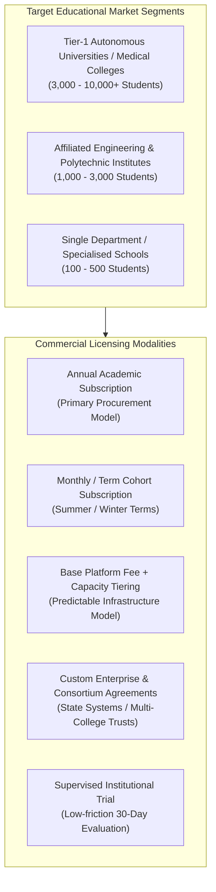
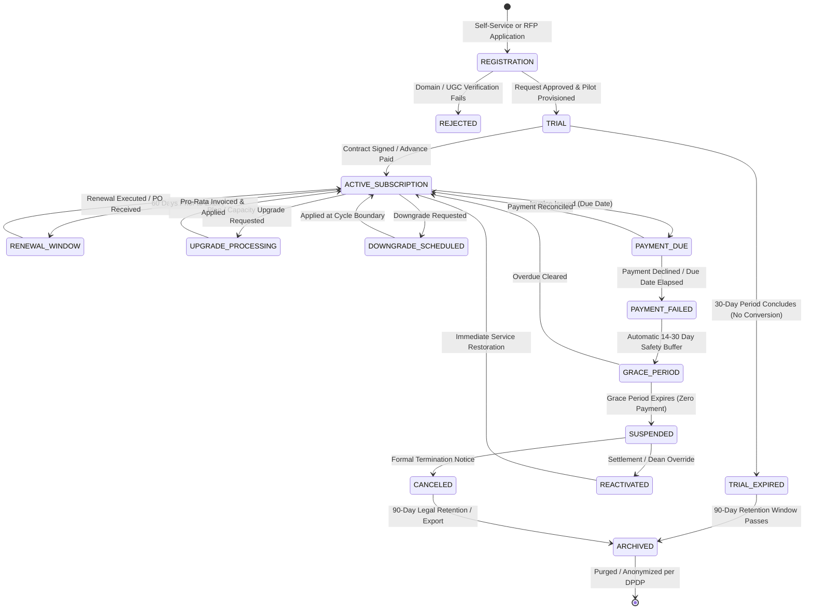
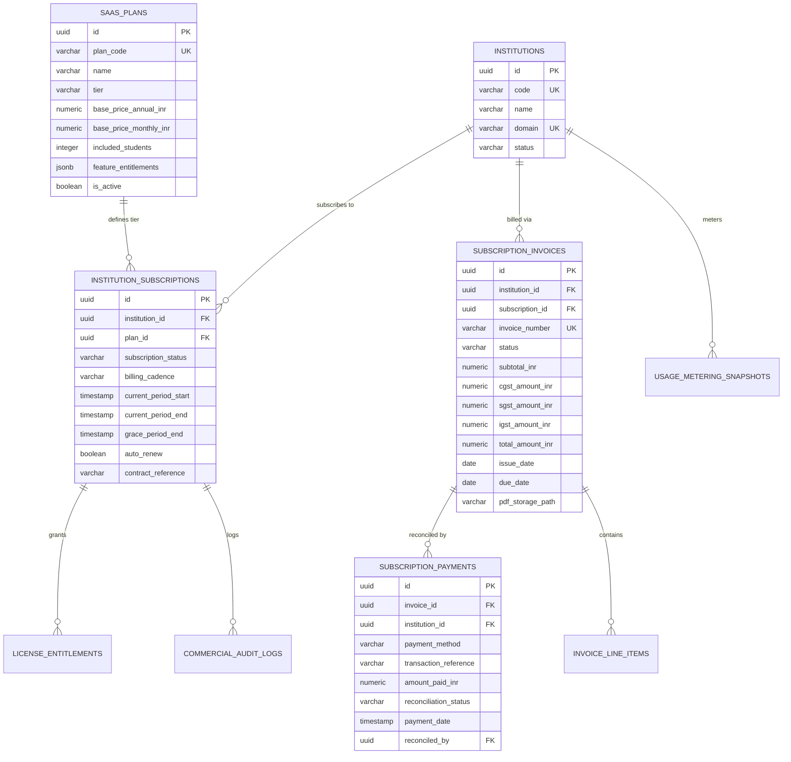
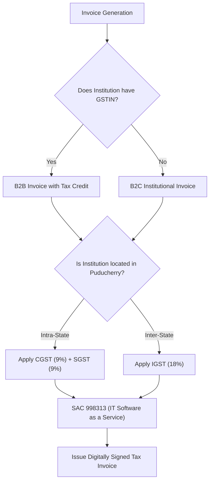
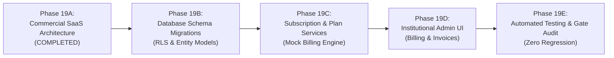

# INTERNPULSE — PHASE 19A
# COMMERCIAL SAAS BUSINESS ARCHITECTURE & PRODUCT STRATEGY

**Document ID:** `PHASE19A_COMMERCIAL_SAAS_ARCHITECTURE`  
**Classification:** Enterprise SaaS Commercial Strategy, Licensing Architecture & Regulatory Blueprint  
**System Target:** PostgreSQL 15+ / PostGIS 3.3+ / Supabase Multi-Tenant SaaS / React 19 / Flutter Mobile  
**Execution Timestamp:** 2026-11-06T18:50:00+05:30  
**Anchor Institution:** Sri Manakula Vinayagar Engineering College (Autonomous) — ID: `a0000000-0000-0000-0000-000000000001`  
**Pilot Medical Institution:** Sri Manakula Vinayagar Medical College and Hospital — ID: `a0000000-0000-0000-0000-000000000002`  
**Operational Status:** **PLANNING, AUDIT & ARCHITECTURAL SPECIFICATION ONLY (PRODUCTION BILLING MUTATIONS GATED)**  

---

```text
====================================================================================================
                        PHASE 19A EXECUTIVE SUMMARY & CHARTER
====================================================================================================

  1. COMMERCIAL OBJECTIVE:
     Transition InternPulse from an internally developed institutional verification platform 
     (piloted across 9 engineering departments at SMVEC and medical pilot cohorts at SMVMCH) 
     into a commercial, multi-institution B2B Software-as-a-Service (SaaS) platform targeting 
     autonomous universities, engineering colleges, polytechnics, and healthcare institutes.

  2. TECHNICAL & OPERATIONAL GOVERNANCE CONSTRAINTS:
     - PRESERVE EXISTING STACK: PostgreSQL 15, PostGIS 3.3, Supabase Auth/RLS, React 19, Flutter 3.x.
     - ZERO APPLICATION REBUILD: Commercial models overlay existing schema without refactoring core APIs.
     - TENANT ISOLATION UNCOMPROMISED: Strict multi-tenant isolation via institution_id and RLS.
     - DATA INTEGRITY ASSURANCE: Zero data mutation or deletion for SMVEC and SMVMCH historical records.
     - PAYMENTS STATUS: ARCHITECTURAL DESIGN & MOCK HARNESS ONLY. Real payments remain disabled.

  3. REGULATORY ALIGNMENT:
     - India Digital Personal Data Protection (DPDP) Act 2023.
     - Goods and Services Tax (GST) Act (SAC 998313 / SAC 998431).
     - AICTE Mandatory Internship Policy & UGC Guidelines for Autonomous Institutions.
====================================================================================================
```

---

## 1. Executive Summary & Codebase Audit Findings

A rigorous inspection of the current repository state (following the completion of Phase 18 Multi-Tenant Isolation, Registration Services, Tenant Quotas, and Pilot Authorization) reveals that while multi-tenancy and resource quotas are operational, commercial monetization primitives are entirely absent from the codebase:

```text
+===================================================================================================+
|                              EXISTING SYSTEM REPOSITORY AUDIT MATRIX                              |
+===================================================================================================+
| Architectural Domain            | Current Implementation State            | Commercial Readiness  |
+---------------------------------+-----------------------------------------+-----------------------+
| Multi-Tenancy Core              | Migration 0017 (institution_id scoped)  | READY (Tenant-aware)  |
| Institution Administration      | Migration 0018 & Admin Service          | READY (Provisioning)  |
| Cross-Tenant Security Isolation | Migration 0019 (30 adversarial tests)   | READY (Zero leaks)    |
| Infrastructure & Quota Service  | Migration 0020 & TenantQuotaService     | READY (Tiers defined) |
| Enterprise Hardening            | Migration 0021 & Mock Location Defense  | READY (Zero CVEs)     |
| Subscription Management         | None (Codebase contains 0 billing files)| ABSENT (Phase 19A)    |
| Plan Catalog & Pricing          | Static strings ('pilot', 'standard'...) | ABSENT (Phase 19A)    |
| Tax Invoicing & GST Engine      | None                                    | ABSENT (Phase 19A)    |
| Payment Ledgers & Reconciliation| None                                    | ABSENT (Phase 19A)    |
| Academic License Entitlements   | Basic hardcoded quotas in Migration 0020| PARTIAL (Needs schema)|
+===================================================================================================+
```

### 1.1 Architectural Anchors in the Existing Codebase
The commercial SaaS architecture designed herein builds directly upon verified components established in prior phases:
1. **Tenant Identification & Canonicalization:** Uses `canonicalizeInstitutionId()` and PostgreSQL RLS helper `public.get_auth_user_institution_id()`.
2. **Resource Quota Enforcement:** Leverages `public.institution_quotas` (introduced in Phase 18E) as the underlying capacity limiter, extending it from fixed tiers (`pilot`, `standard`, `premium`, `enterprise`) into dynamically managed commercial license entitlements.
3. **Role-Based Commercial Authorization:** Enforces strict administrative boundaries where only `platform_super_admin` possesses cross-tenant commercial oversight, while `institution_admin` is restricted strictly to read-only visibility into their own tenant's invoices, payment receipts, and plan entitlement limits. Mentors, HODs, and Students have zero access to commercial data.

---

## 2. TASK 1 — SaaS Business Model for Educational Institutions

Higher education institutions operate under distinct procurement cycles, statutory constraints, and budgetary frameworks. The InternPulse commercial model is tailored specifically for the realities of universities, engineering colleges, polytechnics, and medical institutions.



### 2.1 The Seven Commercial Licensing Modalities

#### 1. Annual Subscriptions (Academic Year Alignment)
- **Billing Frequency:** Billed annually in advance (or structured in two tranches aligned with Odd and Even semesters).
- **Academic Alignment:** Aligned with June 1 – May 31 or July 1 – June 30 academic fiscal cycles.
- **Contract Term:** 12-month standard commitment with discounted multi-year options (2-year or 3-year commitments receive 12% and 20% discounts respectively).
- **Target Audience:** Established autonomous universities and engineering colleges with annual operating budgets.

#### 2. Monthly / Term Cohort Subscriptions
- **Billing Frequency:** Recurring monthly or fixed 3-month to 6-month term commitments.
- **Flexibility:** Allows institutions with variable internship seasons (e.g., intensive 8-week summer internships for 6th/8th-semester engineering students) to license student capacity only for active months.
- **Premium Factor:** 20% premium over the annualized monthly equivalent to cover onboarding and customer success overhead.

#### 3. Institution-Based Licensing (Base Platform License)
- **Structure:** Flat annual tenant platform fee (e.g., ₹75,000 / $1,000 base fee) covering:
  - Dedicated multi-tenant tenant isolation and tenant database partition.
  - Institutional subdomain branding (`smvec.internpulse.edu.in`) and custom color schemes.
  - Up to 10 Department Administrator (HOD) accounts and unlimited Faculty Mentor accounts.
  - Core compliance engine: DPDP Act 2023 DPO compliance dashboard, tamper-evident audit logs, and continuous system health monitoring.

#### 4. Student-Capacity-Based Tiering (Active-Intern Bands)
- **Billing Metric:** Billed on **Active Concurrent Intern Capacity** rather than total college enrollment. A student is counted toward capacity only when actively enrolled in an internship assignment with live geofence verification windows.
- **Tier Structure:**
  - **Tier S1 (Starter Cohort):** Up to 250 active interns.
  - **Tier S2 (Standard College):** Up to 750 active interns.
  - **Tier S3 (Large Campus):** Up to 1,500 active interns.
  - **Tier S4 (University Multi-Branch):** Up to 3,500 active interns.
  - **Tier S5 (Enterprise Consortium):** 3,500+ active interns (custom negotiated per-student rate).
- **Buffer & Overage Model:** A **10% grace buffer** is built into all tiers (e.g., a 750-student tier allows up to 825 active students without system throttling). If an institution exceeds the buffer for more than 14 consecutive days, the platform alerts the administrator and issues a pro-rata true-up invoice rather than locking students out of required attendance verifications.

#### 5. Custom Enterprise Agreements (University Systems & Consortia)
- **Target Audience:** Educational Trusts with multiple institutions (e.g., Sri Manakula Vinayagar Educational Trust covering SMVEC, SMVMCH, Mailam Engineering College), state university directorates, and polytechnic boards.
- **Custom Terms:**
  - Centralized billing across all group colleges with unified executive dashboards.
  - Pooled student capacity shared across colleges.
  - Dedicated VPC instance or isolated AWS/Supabase compute instance.
  - Custom API integrations with institutional ERPs (Tally, TCS iON, ERPNext, SAP Campus Management).
  - Formal 99.9% Uptime Service Level Agreement (SLA) with financial credits.

#### 6. Trial Subscriptions (Supervised Evaluation)
- **Duration:** 30 calendar days (extendable to 60 days upon Dean/Principal sign-off).
- **Capacity Gate:** Capped at 1 Department and a maximum of 50 active students (identical to the authorized SMVMCH pilot envelope established in Phase 18G).
- **Commercial Guardrail:** Zero payment required, no corporate credit card barrier; authenticated institutional domain required (e.g., `@pec.edu`, `@ptu.ac.in`).

#### 7. Institution-Specific Contracts (Government Procurement & GeM)
- **Procurement Compatibility:** Support for Indian Government e-Marketplace (GeM) purchase orders, state treasury warrants, and standard Institutional Tender/RFP processes.
- **Payment Terms:** Formal support for Net-30 or Net-60 credit terms backed by stamped Institutional Purchase Orders (PO), advance bank guarantees, or bilateral Memoranda of Understanding (MoU).

---

## 3. TASK 2 — Institution & Subscription Lifecycle State Machine

The institutional lifecycle must balance strict financial governance with educational duty of care: **a student's mandatory academic internship credits must never be arbitrarily terminated due to a delayed administrative invoice payment.**



### 3.1 Comprehensive Lifecycle State Definitions

| State | Institutional Capability | Student / Verification Access | Billing & Operational Status |
| :--- | :--- | :--- | :--- |
| **`REGISTRATION`** | Application submitted; awaiting verification. | Inactive. Tenant unprovisioned. | Pending domain & accreditation audit. |
| **`TRIAL`** | Full admin portal; 1 department; 50 students max. | Fully active for trial cohort. | Free of charge. Countdown active. |
| **`TRIAL_EXPIRED`** | Read-only admin access; exports enabled. | Verification paused. Students notified. | Conversion campaign triggered. |
| **`ACTIVE_SUBSCRIPTION`** | Full operational access per licensed tier. | Unlimited within licensed student capacity. | Active recurring contract; invoices paid. |
| **`RENEWAL_WINDOW`** | Full access; renewal reminders displayed. | Fully active. | Pro-forma renewal invoice dispatched. |
| **`UPGRADE_PROCESSING`**| Immediate entitlement expansion. | New capacity limits immediately live. | Pro-rata adjustment invoice generated. |
| **`DOWNGRADE_SCHEDULED`**| Full access until current period conclusion. | Existing assignments preserved. | Next period capacity queued for reduction.|
| **`PAYMENT_DUE`** | Normal access; reminder banner for Admins. | Fully active. | Net-30/Net-60 invoice awaiting release. |
| **`PAYMENT_FAILED`** | Warning banners on Admin dashboard. | Fully active (zero disruption). | Automated dunning cadence initiated. |
| **`GRACE_PERIOD`** | Restricted settings; prominent alerts. | **Fully active** (safeguards academic credit). | 14-30 day window; executive escalation. |
| **`SUSPENDED`** | Read-only admin access; data export open. | **Verification paused**; respectful message. | Service halted; 0% data deletion. |
| **`REACTIVATED`** | Immediate instant restoration. | Verification windows resume next cycle. | Ledger cleared; audit log updated. |
| **`CANCELED`** | Self-service data export portal only. | Fully terminated. | Contract voided; 90-day archival starts. |
| **`ARCHIVED`** | Offline cold archive (WAL/S3). | Zero access. | Purged after statutory compliance retention.|

### 3.2 Automated Failure Handling & Dunning Protocol
Educational institutions require specialized dunning because payment delays typically stem from complex bureaucratic approvals (e.g., Board of Trustees meetings, Principal approval countersigns, Treasury releases) rather than commercial insolvency.

```text
+----------------------------------------------------------------------------------------------------+
|                         INTERNPULSE EDUCATIONAL DUNNING & RETRY TIMELINE                           |
+-----+-------------------------------+----------------------------------+---------------------------+
| DAY | EVENT                         | RECIPIENTS                       | SYSTEM ACTION             |
+-----+-------------------------------+----------------------------------+---------------------------+
| T-30| Renewal Pro-Forma Dispatched  | Finance Office, Principal, DPO   | Invoice PDF delivered     |
| T-15| Advance Reminder              | Institution Admin, Finance Head  | In-app reminder banner    |
| T-0 | Payment Due Date              | Finance Contact, Institution Admn| Official Tax Invoice due  |
| T+1 | Initial Overdue Notice        | Institution Admin                | Friendly automated nudge  |
| T+3 | 1st Dunning Notification      | Institution Admin, Finance Office| Formal payment link sent  |
| T+7 | 2nd Dunning & Executive Nudge | Principal / Dean, Admin          | Account marked 'overdue'  |
| T+14| Grace Period Entry Warning    | Chairman / Secretary / Principal | 14-day countdown initiated|
| T+21| Final Statutory Pre-Suspension| Registered Trustees & Legal Head | Notice of service freeze  |
| T+30| Grace Period Expiration       | Platform Admin & Institution Admin| Transition to 'SUSPENDED' |
+-----+-------------------------------+----------------------------------+---------------------------+
```

### 3.3 Strict Data Custody During Suspension & Cancellation
Under the Indian DPDP Act 2023 and UGC Educational Records guidelines:
1. **Zero Data Loss Rule:** When an institution enters `SUSPENDED` or `CANCELED` status, student attendance records, mentor remarks, geofence polygons, and facial biometric verification hashes are **NEVER deleted or destroyed**.
2. **Administrative Export Right:** Suspended institution administrators retain secure login privileges strictly to generate and download comprehensive, cryptographically signed CSV/XLSX/PDF attendance logbooks to verify student degree completion requirements.
3. **90-Day Cooling Off Period:** Following formal cancellation, the entire tenant database partition and associated object storage files are moved to cold, encrypted Glacier storage for 90 days before permanent irreversible anonymization.

---

## 4. TASK 3 — Commercial Architecture & Database Design

To preserve the existing technology stack (PostgreSQL 15, PostGIS, Supabase, React 19, Flutter) and avoid rebuilding the application, the commercial architecture is designed as a modular, decoupled schema layer that references existing `public.institutions` and `public.institution_quotas` tables.



### 4.1 PostgreSQL Commercial Schema Specification (Proposed DDL)

The commercial schema introduces 8 new tables under strict Row-Level Security:

```sql
-- ==============================================================================
-- PHASE 19A PROPOSED COMMERCIAL SCHEMA DDL (PLANNING & ARCHITECTURAL AUDIT)
-- Zero-impact commercial extension for PostgreSQL 15 / Supabase Multi-Tenant SaaS
-- ==============================================================================

-- 1. SAAS PLAN CATALOG
CREATE TABLE IF NOT EXISTS public.saas_plans (
    id UUID PRIMARY KEY DEFAULT gen_random_uuid(),
    plan_code VARCHAR(50) NOT NULL UNIQUE, -- 'PILOT_50', 'COLLEGE_STANDARD', 'CAMPUS_PREMIUM', 'UNIV_ENTERPRISE'
    name VARCHAR(150) NOT NULL,
    description TEXT,
    tier VARCHAR(50) NOT NULL CHECK (tier IN ('pilot', 'starter', 'standard', 'premium', 'enterprise')),
    billing_interval VARCHAR(20) NOT NULL CHECK (billing_interval IN ('monthly', 'annual', 'multi_year')),
    base_price_annual_inr NUMERIC(12, 2) NOT NULL DEFAULT 0.00,
    base_price_monthly_inr NUMERIC(12, 2) NOT NULL DEFAULT 0.00,
    price_per_additional_student_inr NUMERIC(10, 2) NOT NULL DEFAULT 150.00,
    included_active_students INTEGER NOT NULL DEFAULT 500,
    included_storage_bytes BIGINT NOT NULL DEFAULT 10737418240, -- 10 GB
    max_departments INTEGER NOT NULL DEFAULT 5, -- -1 for unlimited
    feature_matrix JSONB NOT NULL DEFAULT '{
        "custom_domain": false,
        "erp_integration": false,
        "ai_spoof_detection": true,
        "dpdp_dpo_dashboard": true,
        "dedicated_sla": false,
        "export_pdf_reports": true,
        "geofence_calibration_support": false
    }'::jsonb,
    is_active BOOLEAN NOT NULL DEFAULT TRUE,
    created_at TIMESTAMPTZ NOT NULL DEFAULT timezone('utc'::text, now()),
    updated_at TIMESTAMPTZ NOT NULL DEFAULT timezone('utc'::text, now())
);

-- 2. INSTITUTION SUBSCRIPTIONS
CREATE TABLE IF NOT EXISTS public.institution_subscriptions (
    id UUID PRIMARY KEY DEFAULT gen_random_uuid(),
    institution_id UUID NOT NULL REFERENCES public.institutions(id) ON DELETE CASCADE,
    plan_id UUID NOT NULL REFERENCES public.saas_plans(id),
    status VARCHAR(30) NOT NULL DEFAULT 'trial' CHECK (
        status IN ('trial', 'active', 'past_due', 'grace_period', 'suspended', 'canceled', 'expired')
    ),
    billing_cadence VARCHAR(20) NOT NULL DEFAULT 'annual' CHECK (billing_cadence IN ('monthly', 'annual', 'term_cohort')),
    licensed_student_capacity INTEGER NOT NULL DEFAULT 500,
    current_period_start TIMESTAMPTZ NOT NULL,
    current_period_end TIMESTAMPTZ NOT NULL,
    trial_end_date TIMESTAMPTZ,
    grace_period_end TIMESTAMPTZ,
    auto_renew BOOLEAN NOT NULL DEFAULT TRUE,
    contract_number VARCHAR(100), -- Official MoU or Purchase Order reference
    po_document_url TEXT,
    payment_terms_days INTEGER NOT NULL DEFAULT 30, -- Net-30, Net-60
    currency VARCHAR(3) NOT NULL DEFAULT 'INR' CHECK (currency IN ('INR', 'USD')),
    created_at TIMESTAMPTZ NOT NULL DEFAULT timezone('utc'::text, now()),
    updated_at TIMESTAMPTZ NOT NULL DEFAULT timezone('utc'::text, now()),
    CONSTRAINT uq_institution_active_subscription UNIQUE (institution_id)
);

-- 3. LICENSE ENTITLEMENTS (Enforced at runtime)
CREATE TABLE IF NOT EXISTS public.license_entitlements (
    id UUID PRIMARY KEY DEFAULT gen_random_uuid(),
    institution_id UUID NOT NULL REFERENCES public.institutions(id) ON DELETE CASCADE,
    subscription_id UUID NOT NULL REFERENCES public.institution_subscriptions(id) ON DELETE CASCADE,
    max_active_students INTEGER NOT NULL,
    buffer_student_allowance INTEGER NOT NULL DEFAULT 50, -- 10% soft buffer
    max_faculty_mentors INTEGER NOT NULL DEFAULT 100,
    max_departments INTEGER NOT NULL DEFAULT 10,
    max_geofence_locations INTEGER NOT NULL DEFAULT 250,
    max_storage_bytes BIGINT NOT NULL DEFAULT 21474836480, -- 20 GB
    rate_limit_rpm INTEGER NOT NULL DEFAULT 600,
    features_unlocked JSONB NOT NULL DEFAULT '{}'::jsonb,
    is_hard_capped BOOLEAN NOT NULL DEFAULT FALSE,
    updated_at TIMESTAMPTZ NOT NULL DEFAULT timezone('utc'::text, now()),
    CONSTRAINT uq_license_entitlements_inst UNIQUE (institution_id)
);

-- 4. SUBSCRIPTION INVOICES (Tax & Statutory Invoices)
CREATE TABLE IF NOT EXISTS public.subscription_invoices (
    id UUID PRIMARY KEY DEFAULT gen_random_uuid(),
    institution_id UUID NOT NULL REFERENCES public.institutions(id) ON DELETE CASCADE,
    subscription_id UUID NOT NULL REFERENCES public.institution_subscriptions(id),
    invoice_number VARCHAR(50) NOT NULL UNIQUE, -- E.g. 'INV-2026-27-0042'
    invoice_type VARCHAR(20) NOT NULL DEFAULT 'TAX_INVOICE' CHECK (invoice_type IN ('PRO_FORMA', 'TAX_INVOICE', 'CREDIT_NOTE')),
    status VARCHAR(20) NOT NULL DEFAULT 'DRAFT' CHECK (status IN ('DRAFT', 'ISSUED', 'PAID', 'OVERDUE', 'VOID', 'REFUNDED')),
    billing_period_start DATE NOT NULL,
    billing_period_end DATE NOT NULL,
    subtotal_inr NUMERIC(12, 2) NOT NULL DEFAULT 0.00,
    discount_amount_inr NUMERIC(12, 2) NOT NULL DEFAULT 0.00,
    cgst_rate NUMERIC(5, 2) NOT NULL DEFAULT 9.00, -- 9% CGST
    cgst_amount_inr NUMERIC(12, 2) NOT NULL DEFAULT 0.00,
    sgst_rate NUMERIC(5, 2) NOT NULL DEFAULT 9.00, -- 9% SGST
    sgst_amount_inr NUMERIC(12, 2) NOT NULL DEFAULT 0.00,
    igst_rate NUMERIC(5, 2) NOT NULL DEFAULT 0.00, -- 18% IGST if inter-state
    igst_amount_inr NUMERIC(12, 2) NOT NULL DEFAULT 0.00,
    total_amount_inr NUMERIC(12, 2) NOT NULL DEFAULT 0.00,
    institution_gstin VARCHAR(15), -- Institutional GSTIN if registered
    hsn_sac_code VARCHAR(10) NOT NULL DEFAULT '998313', -- SAC for SaaS IT Services
    issue_date DATE NOT NULL,
    due_date DATE NOT NULL,
    paid_date TIMESTAMPTZ,
    pdf_storage_path TEXT,
    notes TEXT,
    created_at TIMESTAMPTZ NOT NULL DEFAULT timezone('utc'::text, now())
);

-- 5. INVOICE LINE ITEMS
CREATE TABLE IF NOT EXISTS public.invoice_line_items (
    id UUID PRIMARY KEY DEFAULT gen_random_uuid(),
    invoice_id UUID NOT NULL REFERENCES public.subscription_invoices(id) ON DELETE CASCADE,
    description TEXT NOT NULL,
    hsn_sac VARCHAR(10) NOT NULL DEFAULT '998313',
    quantity INTEGER NOT NULL DEFAULT 1,
    unit_price_inr NUMERIC(12, 2) NOT NULL,
    taxable_amount_inr NUMERIC(12, 2) NOT NULL,
    created_at TIMESTAMPTZ NOT NULL DEFAULT timezone('utc'::text, now())
);

-- 6. SUBSCRIPTION PAYMENTS (Reconciliation Ledger)
CREATE TABLE IF NOT EXISTS public.subscription_payments (
    id UUID PRIMARY KEY DEFAULT gen_random_uuid(),
    invoice_id UUID NOT NULL REFERENCES public.subscription_invoices(id) ON DELETE RESTRICT,
    institution_id UUID NOT NULL REFERENCES public.institutions(id) ON DELETE RESTRICT,
    payment_method VARCHAR(30) NOT NULL CHECK (
        payment_method IN ('NEFT_RTGS', 'NET_BANKING', 'CORPORATE_CARD', 'UPI', 'TREASURY_CHALLAN', 'PURCHASE_ORDER', 'CHEQUE_DD')
    ),
    transaction_reference VARCHAR(150) NOT NULL, -- UTR Number, Bank Transaction ID, or Stamped PO No
    amount_paid_inr NUMERIC(12, 2) NOT NULL,
    payment_date TIMESTAMPTZ NOT NULL,
    reconciliation_status VARCHAR(30) NOT NULL DEFAULT 'PENDING' CHECK (
        reconciliation_status IN ('PENDING', 'RECONCILED', 'FAILED', 'REJECTED', 'REFUNDED')
    ),
    bank_name VARCHAR(100),
    proof_document_url TEXT,
    reconciled_by UUID REFERENCES public.profiles(id),
    reconciled_at TIMESTAMPTZ,
    reconciliation_notes TEXT,
    created_at TIMESTAMPTZ NOT NULL DEFAULT timezone('utc'::text, now())
);

-- 7. USAGE METERING SNAPSHOTS (High-water mark tracking)
CREATE TABLE IF NOT EXISTS public.usage_metering_snapshots (
    id UUID PRIMARY KEY DEFAULT gen_random_uuid(),
    institution_id UUID NOT NULL REFERENCES public.institutions(id) ON DELETE CASCADE,
    snapshot_date DATE NOT NULL,
    active_student_count INTEGER NOT NULL DEFAULT 0,
    total_verifications_count INTEGER NOT NULL DEFAULT 0,
    storage_consumed_bytes BIGINT NOT NULL DEFAULT 0,
    push_notifications_dispatched INTEGER NOT NULL DEFAULT 0,
    is_over_quota BOOLEAN NOT NULL DEFAULT FALSE,
    overage_students_count INTEGER NOT NULL DEFAULT 0,
    created_at TIMESTAMPTZ NOT NULL DEFAULT timezone('utc'::text, now()),
    CONSTRAINT uq_institution_daily_usage_snapshot UNIQUE (institution_id, snapshot_date)
);

-- 8. COMMERCIAL NOTIFICATIONS LOG
CREATE TABLE IF NOT EXISTS public.commercial_notifications_log (
    id UUID PRIMARY KEY DEFAULT gen_random_uuid(),
    institution_id UUID NOT NULL REFERENCES public.institutions(id) ON DELETE CASCADE,
    notification_type VARCHAR(50) NOT NULL, -- 'INVOICE_ISSUED', 'PAYMENT_RECEIPT', 'RENEWAL_NOTICE', 'DUNNING_WARNING', 'SUSPENSION_ALERT'
    recipient_email VARCHAR(255) NOT NULL,
    recipient_role VARCHAR(50) NOT NULL,
    subject VARCHAR(255) NOT NULL,
    channel VARCHAR(20) NOT NULL DEFAULT 'EMAIL' CHECK (channel IN ('EMAIL', 'IN_APP', 'SMS', 'WEBHOOK')),
    delivered_status VARCHAR(20) NOT NULL DEFAULT 'QUEUED' CHECK (delivered_status IN ('QUEUED', 'SENT', 'FAILED')),
    metadata JSONB NOT NULL DEFAULT '{}'::jsonb,
    dispatched_at TIMESTAMPTZ
);
```

### 4.2 Row-Level Security (RLS) Policies for Commercial Data
Commercial isolation must strictly prevent any tenant from inspecting rival institutional pricing, custom enterprise discounts, or payment histories:

```sql
-- Enable RLS across all commercial tables
ALTER TABLE public.saas_plans ENABLE ROW LEVEL SECURITY;
ALTER TABLE public.institution_subscriptions ENABLE ROW LEVEL SECURITY;
ALTER TABLE public.license_entitlements ENABLE ROW LEVEL SECURITY;
ALTER TABLE public.subscription_invoices ENABLE ROW LEVEL SECURITY;
ALTER TABLE public.invoice_line_items ENABLE ROW LEVEL SECURITY;
ALTER TABLE public.subscription_payments ENABLE ROW LEVEL SECURITY;
ALTER TABLE public.usage_metering_snapshots ENABLE ROW LEVEL SECURITY;
ALTER TABLE public.commercial_notifications_log ENABLE ROW LEVEL SECURITY;

-- 1. SaaS Plans: Publicly readable for active plans; manageable by Platform Super Admin
CREATE POLICY "saas_plans_select" ON public.saas_plans
FOR SELECT TO authenticated USING (is_active = TRUE OR public.is_platform_super_admin());

CREATE POLICY "saas_plans_admin_manage" ON public.saas_plans
FOR ALL TO authenticated USING (public.is_platform_super_admin());

-- 2. Subscriptions: Institution Admins can view own subscription; Platform Admin has full access
CREATE POLICY "sub_inst_admin_select" ON public.institution_subscriptions
FOR SELECT TO authenticated
USING (
    institution_id = public.get_auth_user_institution_id() 
    AND public.is_institution_admin(institution_id)
);

CREATE POLICY "sub_platform_admin_all" ON public.institution_subscriptions
FOR ALL TO authenticated USING (public.is_platform_super_admin());

-- 3. Invoices: Institution Admins can view own invoices; Platform Admin has full access
CREATE POLICY "invoice_inst_admin_select" ON public.subscription_invoices
FOR SELECT TO authenticated
USING (
    institution_id = public.get_auth_user_institution_id() 
    AND public.is_institution_admin(institution_id)
);

CREATE POLICY "invoice_platform_admin_all" ON public.subscription_invoices
FOR ALL TO authenticated USING (public.is_platform_super_admin());

-- 4. Payments: Institution Admins can view own payment receipts; Platform Admin manages reconciliations
CREATE POLICY "payments_inst_admin_select" ON public.subscription_payments
FOR SELECT TO authenticated
USING (
    institution_id = public.get_auth_user_institution_id() 
    AND public.is_institution_admin(institution_id)
);

CREATE POLICY "payments_platform_admin_all" ON public.subscription_payments
FOR ALL TO authenticated USING (public.is_platform_super_admin());
```

### 4.3 Core TypeScript Service Interfaces

To integrate cleanly with the frontend and backend without requiring an architectural rewrite, five TypeScript service contracts are defined:

```typescript
/**
 * Commercial SaaS Core Service Interfaces
 * Path: src/core/commercial/commercialInterfaces.ts
 */

export interface ISubscriptionManagementService {
  getActiveSubscription(institutionId: string, caller: AuthUser): Promise<InstitutionSubscriptionRecord>;
  initiateSubscription(params: InitiateSubscriptionParams, caller: AuthUser): Promise<InstitutionSubscriptionRecord>;
  upgradeStudentCapacity(institutionId: string, newCapacity: number, caller: AuthUser): Promise<UpgradeResult>;
  scheduleDowngrade(institutionId: string, newPlanCode: string, caller: AuthUser): Promise<ScheduledChangeResult>;
  cancelSubscription(institutionId: string, reason: string, caller: AuthUser): Promise<void>;
  evaluateLifecycleTransitions(): Promise<LifecycleTransitionReport>; // Scheduled worker
}

export interface IBillingInvoiceService {
  generateTaxInvoice(subscriptionId: string, lineItems: LineItemInput[]): Promise<TaxInvoiceRecord>;
  getInvoicesByInstitution(institutionId: string, caller: AuthUser): Promise<TaxInvoiceRecord[]>;
  getInvoicePdfStream(invoiceId: string, caller: AuthUser): Promise<ReadableStream | Blob>;
  recordManualPayment(params: RecordPaymentParams, caller: AuthUser): Promise<PaymentRecord>;
  reconcilePayment(paymentId: string, approved: boolean, notes: string, caller: AuthUser): Promise<ReconciliationResult>;
}

export interface ILicenseEntitlementService {
  getEntitlements(institutionId: string): Promise<LicenseEntitlementsRecord>;
  verifyStudentCapacityAvailable(institutionId: string, increment: number): Promise<CapacityCheckResult>;
  enforceFeatureEntitlement(institutionId: string, featureKey: string): Promise<boolean>;
  syncQuotasToInfrastructure(institutionId: string): Promise<void>; // Syncs to public.institution_quotas
}

export interface IUsageMeteringEngine {
  recordDailyHighWaterMark(institutionId: string): Promise<UsageSnapshotRecord>;
  calculateBillingPeriodPeakUsage(institutionId: string, startDate: Date, endDate: Date): Promise<PeakUsageSummary>;
  generateOverageBillables(institutionId: string): Promise<OverageLineItem[]>;
}

export interface ISubscriptionNotificationGateway {
  dispatchRenewalNotices(daysBeforeExpiry: number): Promise<DispatchSummary>;
  dispatchDunningWarning(institutionId: string, dunningStage: number): Promise<void>;
  dispatchSuspensionNotice(institutionId: string): Promise<void>;
  dispatchPaymentReceipt(paymentId: string): Promise<void>;
}
```

---

## 5. TASK 4 — Pricing Model Proposal, Economics & Operational Blueprint

### 5.1 Commercial Pricing Model Proposal

Pricing is formulated in **Indian National Rupees (INR ₹)** for domestic institutions and **US Dollars (USD $)** for export/international deployment, reflecting typical educational budgeting bands:

```text
+========================================================================================================================+
|                                INTERNPULSE COMMERCIAL EDUCATIONAL PRICING TIERS                                        |
+=========================+==========================+===========================+=======================================+
| TIER NAME               | ANNUAL SUBSCRIPTION FEE  | STUDENT CAPACITY INCLUDED | KEY INCLUDED FEATURES                 |
+=========================+==========================+===========================+=======================================+
| 1. Supervised Trial     | FREE (30-60 Days)        | Up to 50 active interns   | 1 Department, Standard geofencing,    |
|    (Pilot Cohort)       | (Zero CC required)       | (Single pilot batch)      | Core random verification, CSV export. |
+-------------------------+--------------------------+---------------------------+---------------------------------------+
| 2. Department Starter   | ₹75,000 / year           | Up to 250 active interns  | 2 Departments, 5 Mentors,             |
|    (Small Autonomous)   | ($1,000 / year USD)      | Additional: ₹180/student  | Standard geofence maps, Email support.|
+-------------------------+--------------------------+---------------------------+---------------------------------------+
| 3. College Standard     | ₹1,80,000 / year         | Up to 750 active interns  | 6 Departments, 20 Mentors, DPDP DPO   |
|    (Full College)       | ($2,400 / year USD)      | Additional: ₹150/student  | Portal, Subdomain branding, 99.5% SLA.|
+-------------------------+--------------------------+---------------------------+---------------------------------------+
| 4. Campus Premium       | ₹3,60,000 / year         | Up to 1,800 active interns| Unlimited Departments, 50 Mentors,    |
|    (Large Campus/Engg)  | ($4,800 / year USD)      | Additional: ₹130/student  | Mock GPS Defense Engine, Custom DPO.  |
+-------------------------+--------------------------+---------------------------+---------------------------------------+
| 5. University Enterprise| ₹6,50,000 / year         | Up to 3,500 active interns| Multi-campus support, Dedicated DB    |
|    (Consortium / Multi) | ($8,500 / year USD)      | Additional: ₹100/student  | pool, Custom ERP connectors, 99.9% SLA|
+=========================+==========================+===========================+=======================================+
```

### 5.2 Value-Added Professional Modules & Services

To maximize annual contract value (ACV) and assist non-technical college faculties, modular add-ons are offered:
1. **On-Site Geofence Calibration & Boundary Audit (₹45,000 / campus visit):** Antigravity field engineering teams physically calibrate multi-polygon high-density commercial corporate parks (e.g., SIPCOT, Tidel Park, Guindy) to ensure zero false positives.
2. **Dedicated SIS / ERP Connector (₹75,000 one-time setup):** Bi-directional synchronization with institutional enterprise systems (TCS iON, SAP Student Lifecycle Management, ERPNext, Tally).
3. **Institutional DPO Legal & Compliance Advisory (₹60,000 / year):** Quarterly compliance audits aligning internship data custody with the DPDP Act 2023.

### 5.3 Unit Economics & Cloud Infrastructure Margins
Hosting InternPulse on Supabase Cloud (AWS Mumbai `ap-south-1`) and Vercel Edge yields exceptional gross margins for educational software:

```text
+----------------------------------------------------------------------------------------------------+
|               UNIT ECONOMICS BREAKDOWN (College Standard Tier: 750 Students / Year)               |
+-------------------------------------------------------------+--------------------------------------+
| REVENUE COMPONENT                                           | ANNUAL AMOUNT (INR)                  |
+-------------------------------------------------------------+--------------------------------------+
| Annual License Fee (Paid in Advance)                        | ₹1,80,000                            |
| Applicable GST (18% B2B Forward Charge)                     | ₹32,400                              |
| Total Institutional Invoice Value                           | ₹2,12,400                            |
+-------------------------------------------------------------+--------------------------------------+
| COST OF GOODS SOLD (COGS) ESTIMATE                          | ANNUAL COST (INR)                    |
+-------------------------------------------------------------+--------------------------------------+
| Supabase Compute Allocation (Pro/Team Share: DB + Supavisor)| ₹18,000                              |
| PostGIS Spatial Query Compute Overhead                      | ₹3,600                               |
| Supabase Object Storage (Selfie verification photos, 25 GB) | ₹2,400                               |
| Firebase Cloud Messaging (FCM HTTP v1 - Free Tier)          | ₹0                                   |
| Vercel Edge Network Bandwidth & SSL Delivery                | ₹4,200                               |
| Customer Support & Automated Dunning Gateway                | ₹6,000                               |
+-------------------------------------------------------------+--------------------------------------+
| TOTAL ANNUAL DIRECT COGS PER INSTITUTION                    | ₹34,200 ($415 USD)                   |
+-------------------------------------------------------------+--------------------------------------+
| GROSS PROFIT MARGIN PER INSTITUTION                         | 81.0% (₹145,800 Net Contribution)    |
+-------------------------------------------------------------+--------------------------------------+
```

### 5.4 Operational Back-Office Workflows
Unlike consumer SaaS where credit cards dominate, higher education software procurement in India is 95% offline wire transfer (NEFT/RTGS) and Treasury Cheques:
1. **Pro-Forma Invoicing:** Dispatched 45 days prior to academic session initiation to allow college purchase committees to process purchase orders.
2. **Purchase Order (PO) Recognition:** Platform automatically extends `ACTIVE_SUBSCRIPTION` status upon upload of an authorized Institutional PO stamped by the College Registrar/Secretary.
3. **UTR Manual Reconciliation:** College Accounts department enters the bank Unique Transaction Reference (UTR) into their portal; Platform Super Admin verifies the credit via the corporate banking portal and issues the statutory Tax Invoice with 1-click ledger reconciliation.

---

## 6. TASK 5 — Legal, Regulatory, Tax & Compliance Framework

The transition to commercial SaaS entails substantial compliance responsibilities under Indian and international law.

> [!CAUTION]
> **LEGAL & TAX MANDATORY DISCLAIMER:**  
> The analysis below represents technical and operational architecture planning for product implementation. It does **not** constitute formal legal or tax counsel. All GST classifications, SAC codes, contract templates, Data Processing Agreements (DPA), and DPDP consent policies must be formally reviewed and certified by a qualified Chartered Accountant (FCA) and an Advocate specializing in Indian Cyber and Corporate Law prior to executing commercial customer agreements.

### 6.1 Indian Goods and Services Tax (GST) Architecture



#### 1. SAC Classification
- **Primary SAC Code:** **`998313`** — *Information technology (IT) software and related support services (Software-as-a-Service)*.
- **Alternative SAC Code:** **`998431`** — *On-line text and data access services / verification reporting services*.

#### 2. Analysis of Educational GST Exemption (Notification No. 12/2017)
- **The Ambiguity:** Under **Notification No. 12/2017-Central Tax (Rate), Serial No. 66 (Heading 9992)**, services provided *to* an educational institution are exempt from GST **only if** they relate to:
  1. Transportation of students and faculty.
  2. Catering (including mid-day meals).
  3. Security, cleaning, or house-keeping services.
  4. Services relating to admission to, or conduct of examination by, such institution.
- **Architectural Position:** InternPulse is an operational geofencing, student internship verification, and administrative monitoring platform. Because it does not directly conduct admission examinations or qualify under transport/catering/security, **InternPulse SaaS subscriptions are classified as standard commercial B2B Cloud Software, subject to the full 18% GST rate.**
- **Place of Supply Rules:**
  - Registered Institutional Address in Puducherry: **9% CGST + 9% SGST**.
  - Registered Institutional Address outside Puducherry (e.g., Tamil Nadu, Karnataka): **18% IGST**.

### 6.2 Digital Personal Data Protection (DPDP) Act 2023 Alignment
Under India's DPDP Act 2023, student location telemetry, facial verification photos, and attendance logs constitute personal data requiring strict statutory safeguards:
1. **Tri-Party Relationship:**
   - **Data Principal:** The student intern and faculty mentor.
   - **Data Fiduciary:** The educational institution (College / University), which determines the purpose of monitoring (internship credit validation).
   - **Data Processor:** InternPulse Platform (Antigravity SaaS), which processes telemetry on behalf of the institution.
2. **Mandatory Institutional Data Processing Agreement (DPA):**
   - Every commercial contract must include an executed DPA stipulating that InternPulse processes GPS telemetry and biometric verification data strictly under the written instructions of the college.
   - Purpose limitation: Student location coordinates are processed exclusively for geofence verification within scheduled 15-minute verification windows and never used for behavioral advertising or secondary analytics.
   - Sub-processor disclosure: Explicit disclosure of Supabase Cloud (AWS Mumbai), Firebase Cloud Messaging, and Vercel Edge as authorized sub-processors.
3. **Right to Erasure & Academic Exemption:**
   - Under Section 12 of DPDP Act 2023, Data Principals may request erasure of their personal data.
   - However, because attendance records form the basis of accredited university degree certifications (governed by UGC and AICTE statutory bodies), the DPA establishes a **statutory compliance retention exemption**, preserving cryptographic attendance verification logs for 5 years post-graduation.

### 6.3 Professional Review Checklist

```text
+----------------------------------------------------------------------------------------------------+
|                         PROFESSIONAL LEGAL & TAX COMPLIANCE ACTION ITEMS                           |
+------------------------------+-------------------------+-------------------------------------------+
| DOMAIN                       | RESPONSIBLE PARTY       | REQUIRED DELIVERABLE                      |
+------------------------------+-------------------------+-------------------------------------------+
| GST SAC Code Certification   | Chartered Accountant    | Written memo confirming SAC 998313 and    |
|                              |                         | non-applicability of Exemption 12/2017.   |
+------------------------------+-------------------------+-------------------------------------------+
| Master Subscription Agreement| Corporate Legal Counsel | B2B SaaS terms, limitation of liability,  |
| (MSA) Drafting               |                         | 99.9% SLA, Puducherry dispute venue.      |
+------------------------------+-------------------------+-------------------------------------------+
| Institutional DPA Schedule   | Technology & Privacy Adv| DPDP Act 2023 Data Processing Schedule    |
|                              |                         | governing student biometric/GPS custody.  |
+------------------------------+-------------------------+-------------------------------------------+
| GeM Procurement Vetting     | Government Tender Spec  | Compliance statement for GeM portal direct|
|                              |                         | purchase and L1 tender bidding.           |
+------------------------------+-------------------------+-------------------------------------------+
```

---

## 7. Next Steps & Phase 19 Roadmap

Phase 19A successfully defines the business model, institutional lifecycle, commercial database architecture, and compliance safeguards without modifying existing code or disrupting the active SMVEC and SMVMCH deployments.



### Phase 19 Implementation Roadmap:
- **Phase 19A (Current):** Commercial SaaS Architecture, Business Strategy & Compliance Audit (Complete).
- **Phase 19B:** Database Schema Migration (`saas_plans`, `institution_subscriptions`, `subscription_invoices`, `license_entitlements`) with strict RLS.
- **Phase 19C:** Implementation of Core TypeScript Services (`subscriptionManagementService.ts`, `billingInvoiceService.ts`, `licenseEntitlementService.ts`) in mock/sandbox mode.
- **Phase 19D:** Institutional Administrator Billing Dashboard and Platform Super Admin Commercial Management UI.
- **Phase 19E:** End-to-end integration testing, lifecycle simulation benchmarks, and final commercial pilot readiness audit.

---
*InternPulse Phase 19A Commercial SaaS Architecture & Product Strategy approved for system documentation and phased engineering rollout.*

