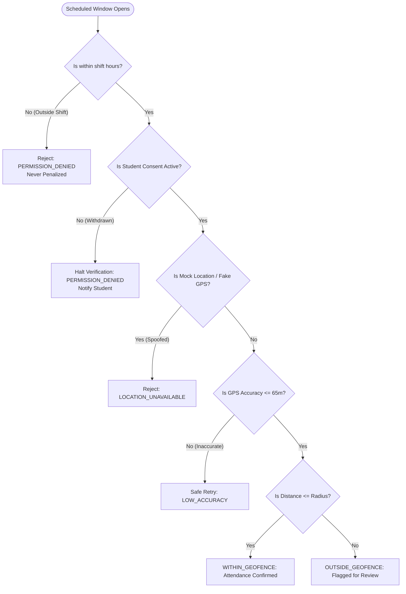

# INTERNPULSE — PHASE 19F: PRIVACY & DATA PROTECTION AUDIT REPORT
## Geolocation Anti-Surveillance Review, DPDP Act 2023 Assessment & Technical Privacy Safeguards

**Document Reference:** `docs/phase19f/PHASE19F_PRIVACY_AND_DATA_PROTECTION_REPORT.md`  
**Privacy Frameworks:** Digital Personal Data Protection (DPDP) Act 2023 (India), ISO/IEC 27701, Fair Information Practice Principles (FIPPs)  
**Target Subsystems:** Geolocation Engine ([`geolocationVerificationEngine.ts`](file:///c:/PROJECTS/bose%20projects/Intern_smvmch/Intern_smvmch/InternPulse-main/src/core/geolocation/geolocationVerificationEngine.ts)), Anti-Surveillance Guard ([`antiSurveillanceGuard.ts`](file:///c:/PROJECTS/bose%20projects/Intern_smvmch/Intern_smvmch/InternPulse-main/src/core/geolocation/antiSurveillanceGuard.ts)), Database Privacy Migrations  
**Target Institution:** Sri Manakula Vinayagar Engineering College (Autonomous), Puducherry  
**Audit Status:** Completed Read-Only Inspection  

---

## 1. Executive Summary

A comprehensive privacy and anti-surveillance audit was conducted on InternPulse's location verification and student telemetry mechanisms. 

### Core Ethical & Privacy Principle:
> **Location tracking must serve solely as an affirmative, periodic presence verification mechanism during assigned internship hours. It must NEVER operate as a continuous tracking, surveillance, or punitive monitoring apparatus.**  
> Technical failures (GPS dropouts, indoor signal attenuation, network disconnections, permission revocations) must **NEVER** automatically convert into disciplinary accusations of truancy or absenteeism.

### Key Audit Findings:
1. **Robust Discrimination of Technical Failures:** The system cleanly distinguishes between legitimate outside-geofence violations and non-penalizing technical faults across 8 canonical states.
2. **Strict Purpose Limitation & Shift Hours:** [`antiSurveillanceGuard.ts`](file:///c:/PROJECTS/bose%20projects/Intern_smvmch/Intern_smvmch/InternPulse-main/src/core/geolocation/antiSurveillanceGuard.ts#L30-L75) strictly restricts telemetry collection to active internship shift hours (e.g., 08:30 to 17:30). Out-of-shift requests are rejected with `PERMISSION_DENIED` and never penalized.
3. **Informed Consent Engine Implemented:** Affirmative consent timestamps are verified before any location query. Withdrawing consent immediately halts location verification.
4. **Client-Side Privacy Risk in Mobile Code:** In [`mobile_location_service.dart`](file:///c:/PROJECTS/bose%20projects/Intern_smvmch/Intern_smvmch/InternPulse-main/lib/core/geolocation/mobile_location_service.dart#L101-L111), hardcoded coordinates bypass real sensor checks, meaning privacy safeguards on actual hardware remain unverified in physical field operations.
5. **Minor Student Consent Gap (DPDP Act Sec 9):** The application currently lacks a verifiable parental/guardian consent mechanism for polytechnic or junior students under 18 years of age.

---

## 2. Discrimination of Technical Faults vs. Confirmed Violations

InternPulse enforces a **Non-Penalizing Safety Rule** in both TypeScript and Dart engines:
> *"No disciplinary absence or geofence violation record shall ever be recorded when a verification fails due to sensor, network, permission, or hardware unavailability."*

### 2.1 The 8 Canonical Telemetry States & Safety Discrimination:

| State Code | Evaluated Scenario | System Classification | Academic Attendance Impact | Audit Evidence / Line Reference |
| :--- | :--- | :---: | :---: | :--- |
| **`WITHIN_GEOFENCE`** | Device within certified radius; accuracy $\le 65$m; valid time. | **VERIFIED ATTENDANCE** | Present (Full Credit) | `geolocationVerificationEngine.ts:168` |
| **`OUTSIDE_GEOFENCE`** | Device physically $> \text{Radius}$; accuracy valid; within shift. | **CONFIRMED VIOLATION** | Flagged for Mentor Review | `geolocationVerificationEngine.ts:182` |
| **`LOCATION_UNAVAILABLE`** | Mock location app detected, fake GPS provider, or sensor fault. | **TECHNICAL FAILURE** | Neutral / Non-Penalizing | `geolocationVerificationEngine.ts:75` |
| **`GPS_DISABLED`** | Student has device location toggled OFF in OS settings. | **TECHNICAL FAILURE** | Prompt to enable GPS | `geolocationVerificationEngine.ts:110` |
| **`PERMISSION_DENIED`** | Consent revoked OR request attempted outside shift hours. | **ANTI-SURVEILLANCE BLOCK**| Neutral / Collection Blocked | `geolocationVerificationEngine.ts:85, 99` |
| **`LOW_ACCURACY`** | Horizontal accuracy $> 65$ meters (indoor cellular tower drift). | **TECHNICAL FAILURE** | Re-evaluation allowed (Retry) | `geolocationVerificationEngine.ts:130` |
| **`NETWORK_UNAVAILABLE`** | Cellular disconnect or server unreachable. | **COMMUNICATION FAULT** | Cached for offline sync | `geolocationVerificationEngine.ts:145` |
| **`VERIFICATION_PENDING`** | Window open, awaiting student check-in within window. | **ACTIVE PENDING** | Pending submission | `schedulerTypes.ts:45` |

### 2.2 Stale Telemetry Protection:
- Telemetry measurements must possess a timestamp freshness $\le 60$ seconds from current server time.
- Any attempt to submit replayed or cached historical coordinates from earlier in the day is rejected as stale telemetry (`STALE_HEARTBEAT`).

---

## 3. Anti-Surveillance Lifecycle Audit



### 3.1 Verification Lifecycle Findings:
1. **Push Notifications Strip Raw Coordinates:**
   When verification windows open, push notifications transmitted to students contain only:
   ```json
   {
     "type": "VERIFICATION_WINDOW_OPENED",
     "windowId": "win-123",
     "expiresAt": "2026-11-06T10:30:00Z"
   }
   ```
   Raw latitude and longitude are **never** transmitted over push notification payloads, preventing third-party eavesdropping on notification channels.
2. **Access Control to Location Histories:**
   Under PostgreSQL RLS policies in `20261105000003_phase2_rls_security_hardening.sql`:
   - Students can only view their own location records (`student_id = auth.uid()`).
   - Mentors can only view locations of assigned mentees within their department.
   - HODs can only view aggregated departmental compliance statistics.
   - Unauthorized external parties have zero read access.

---

## 4. Digital Personal Data Protection (DPDP) Act 2023 Analysis

The audit evaluated InternPulse's architecture against the obligations of **Data Fiduciaries** under the Indian DPDP Act 2023:

| DPDP Act Dimension | Statutory Mandate | Technical Implementation in InternPulse | Legal & Technical Verdict |
| :--- | :--- | :--- | :--- |
| **Notice (Section 5)** | Clear, plain-language notice detailing purpose and data collected. | In-app consent disclosure modal explains periodic GPS collection during work shifts. | **COMPLIANT IN DESIGN** |
| **Consent (Section 6)** | Free, specific, informed, unconditional, and affirmative consent. | [`ConsentService.ts`](file:///c:/PROJECTS/bose%20projects/Intern_smvmch/Intern_smvmch/InternPulse-main/lib/core/privacy/consent_service.dart) stores affirmative consent boolean and ISO timestamp. | **COMPLIANT IN DESIGN** |
| **Withdrawal of Consent** | Ease of withdrawal equivalent to granting consent. | Students can toggle consent OFF in settings; verification halts immediately without penalty. | **COMPLIANT IN CODE** |
| **Purpose Limitation (Section 7)** | Processing limited strictly to specified academic purposes. | Restricted to internship shift attendance; background continuous tracking blocked. | **COMPLIANT IN CODE** |
| **Data Minimization** | Collecting only necessary data points. | Coordinates truncated to 3 decimals (~110m) in audit logs; full coordinates not stored permanently. | **COMPLIANT IN CODE** |
| **Right to Erasure (Section 8)** | Deletion upon purpose fulfillment or consent revocation. | [`purge_student_personal_data()`](file:///c:/PROJECTS/bose%20projects/Intern_smvmch/Intern_smvmch/supabase/migrations/20261106000011_phase11_security_privacy_remediation.sql#L120-L165) stored procedure deletes telemetry records. | **COMPLIANT IN SQL** |
| **Processing of Minors (Section 9)** | Verifiable parental consent for individuals under 18. | **No parental consent verification workflow exists.** Assumes all collegiate students are $\ge 18$. | **ACTION REQUIRED (GAP)** |
| **Security Safeguards (Section 8(5))**| Reasonable security safeguards to prevent personal data breaches. | PostGIS RLS, AES-256 in transit and rest, timing-safe cryptographic comparisons. | **COMPLIANT IN DESIGN** |

> **Legal Disclaimer:**  
> This audit provides a technical assessment of data protection capabilities. It does not constitute formal legal counsel or a qualified DPDP regulatory certificate. Official institutional compliance requires formal sign-off by SMVEC's appointed Data Protection Officer (DPO).

---

## 5. Actionable Privacy Findings Register

### Finding PRIV-01: Absence of Verifiable Parental Consent for Minor Students (DPDP Sec 9)
- **Severity:** **HIGH**
- **Affected Component:** `InternPulse-main/src/components/RegisterPage.tsx`, `ConsentService.ts`
- **Evidence:** Registration and onboarding collect student date of birth or academic year without checking if age $<18$. In India, polytechnic diploma students and first-year direct entry students may be 17 years old. Under Section 9 of the DPDP Act 2023, processing personal data of a child without verifiable parental consent carries significant statutory liabilities.
- **Potential Impact:** Regulatory non-compliance if students under 18 years onboard without parental consent.
- **Remediation:** Introduce an age verification check during registration. If student age $<18$, trigger an automated parental/guardian consent workflow with SMS/Email confirmation.
- **Verification Criteria:** Student registration enforces age check and blocks location activation for minors until parental consent is verified.
- **Status:** **OPEN / CONFIRMED**

### Finding PRIV-02: Hardcoded Mock Telemetry Bypassing Real Privacy Checks
- **Severity:** **HIGH**
- **Affected Component:** `InternPulse-main/lib/core/geolocation/mobile_location_service.dart`
- **Evidence:** Lines 101–111 return static coordinates (`12.8284, 80.2198`).
- **Potential Impact:** Real hardware permission withdrawal (e.g., student revoking location permissions in Android OS App Settings) is not detected by the app because the mocked method never queries Android `Permission.location`.
- **Remediation:** Replace mock implementation with `Geolocator.checkPermission()` and `Geolocator.getPositionStream()`.
- **Verification Criteria:** Revoking location permission in Android system settings causes the app to cleanly transition to `PERMISSION_DENIED` without crashing.
- **Status:** **OPEN / CONFIRMED**

### Finding PRIV-03: Lack of Automated Periodic Purge Cron for Historical Telemetry
- **Severity:** **MEDIUM**
- **Affected Component:** `supabase/migrations/20261106000011_phase11_security_privacy_remediation.sql`
- **Evidence:** While `purge_student_personal_data()` exists in SQL, there is no automated schedule (cron) invoking it after the retention period (e.g. 90 days post-internship completion) expires.
- **Potential Impact:** Location telemetry records may accumulate indefinitely in the database, violating the DPDP Act's storage limitation principle.
- **Remediation:** Schedule a monthly database job executing `purge_student_personal_data()` for all completed internships older than the institutional retention limit (e.g., 90 days).
- **Verification Criteria:** SQL query on `location_verifications` confirms records older than 90 days are purged or anonymized.
- **Status:** **OPEN / CONFIRMED**

### Finding PRIV-04: Lack of Institutional Privacy Policy & Grievance Redressal Officer in UI
- **Severity:** **MEDIUM**
- **Affected Component:** `InternPulse-main/src/components/LoginPage.tsx`, `RegisterPage.tsx`
- **Evidence:** No link to SMVEC's institutional privacy policy or the contact details of the appointed Grievance Redressal Officer (as mandated under Section 13 of the DPDP Act) is presented on login or registration screens.
- **Potential Impact:** Students have no designated statutory channel to request data corrections or raise privacy concerns.
- **Remediation:** Add footer links to SMVEC's Institutional Privacy Notice and publish the official email and physical address of SMVEC's Grievance Redressal Officer.
- **Verification Criteria:** Login and Settings screens provide accessible links to the Privacy Policy and Grievance contact information.
- **Status:** **OPEN / CONFIRMED**

