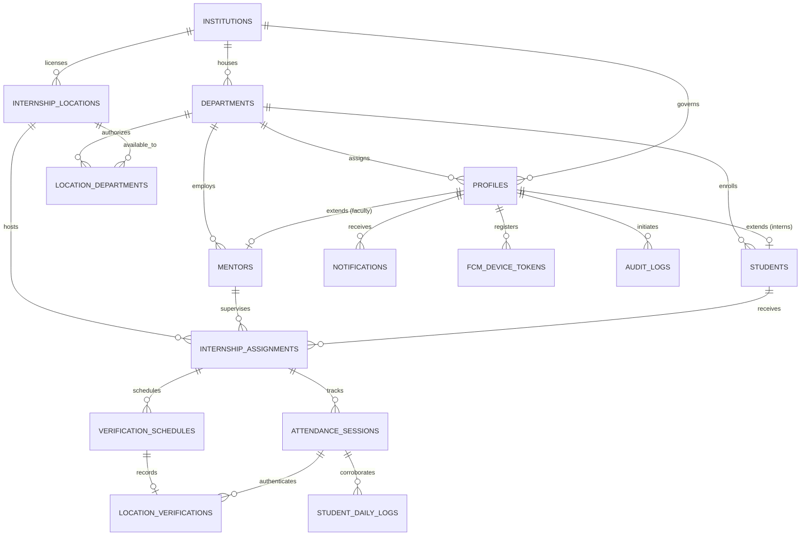

# Phase 2: InternPulse Database Architecture & Modernization Report

**Project:** InternPulse — Real-Time Institutional Internship Monitoring Platform  
**Target Institution:** Sri Manakula Vinayagar Engineering College (Autonomous), Puducherry (SMVEC)  
**Document Version:** 1.0.0  
**Status:** Completed & Validated  
**Execution Date:** November 5, 2026  
**Target DBMS:** PostgreSQL 15+ with PostGIS Extension (Supabase Engine)  

---

## 1. Executive Summary

Phase 2 executes a comprehensive audit, modernization, and structural expansion of the **InternPulse** Supabase PostgreSQL database. The database has been transformed from an early authentication-only baseline into an enterprise-grade, PostGIS-enabled relational system that governs distributed student internships, multi-department academic oversight, geospatial geofence verification, automated ping scheduling, real-time alerting, and tamper-evident auditing.

All data modernization steps adhere strictly to **zero-downtime, non-destructive migration principles**:
- **Existing Data Preserved:** No tables or columns were destroyed or truncated. Existing tables (`profiles`, `internship_locations`, `internship_assignments`, `student_daily_logs`) were preserved and augmented with non-destructive relational keys, timestamps, and PostGIS spatial columns.
- **No Table Duplication:** Pre-existing tables were repurposed as authoritative domain anchors (e.g., `profiles` serving as the public `users` entity with an aliased canonical view).
- **PostGIS Integration:** Geofences leverage `geography(Point, 4326)` on the WGS 84 ellipsoid with meters-based geodesic calculations and GiST spatial indexes.
- **Historical Record Preservation:** Deletion cascade behaviors on historical assignments and attendance logs have been removed and replaced with `ON DELETE RESTRICT`, preventing accidental destruction of academic transcripts.
- **Duplicate Assignment Elimination:** Enforced via unique partial indexes and database-level trigger constraints.

---

## 2. Baseline Database Audit & Gap Analysis

Prior to executing Phase 2 migrations, the existing database state established in Phase 1 was comprehensively audited:

### 2.1 Baseline State (Phase 1 Schema)
| Table | Primary Key | Baseline Foreign Keys | Constraints & Indexes | Gaps Identified |
| :--- | :--- | :--- | :--- | :--- |
| `public.profiles` | UUID (`auth.users.id`) | `REFERENCES auth.users(id)` | `CHECK (role IN ('hod', 'mentor', 'student'))`<br/>B-tree indexes on role, dept, mentor_id, student_id | Lacked explicit account statuses (`account_status`), foreign keys to institutions and departments, and audit user references (`created_by`, `updated_by`). |
| `public.internship_locations` | UUID (`gen_random_uuid()`) | `created_by REFERENCES profiles(id)` | B-tree index on id | Stored coordinates only as raw floating-point numbers (`latitude`, `longitude`). Lacked PostGIS spatial types, GiST indexing, multi-department sharing, and updated timestamps. |
| `public.internship_assignments` | UUID (`gen_random_uuid()`) | `student_id -> profiles(id) ON DELETE CASCADE`<br/>`mentor_id -> profiles(id) ON DELETE RESTRICT`<br/>`location_id -> locations(id)` | `CHECK (status IN ('active', 'completed', 'terminated'))` | **Critical Vulnerability:** Had `ON DELETE CASCADE` on `student_id`, endangering historical internship records. Allowed duplicate active assignments for the same student during overlapping periods. Lacked daily work hours and schedules. |
| `public.student_daily_logs` | UUID (`gen_random_uuid()`) | `student_id -> profiles(id) ON DELETE CASCADE` | `CHECK (review_status IN ('pending', 'approved', 'needs_revision'))` | Unlinked to attendance sessions or assignments. Lacked `updated_at` and `updated_by` audit fields. |

### 2.2 Missing Domain Entities
The baseline database completely lacked formal structures for:
1. `institutions` (Multi-institution partitioning and root anchor)
2. `departments` (Relational department governance across SMVEC)
3. Normalized `mentors` entity (workload capacity, designation, mentee counters)
4. Normalized `students` entity (register numbers, academic years, batch years, semesters)
5. `attendance_sessions` (Daily check-in / check-out records and total hours tracking)
6. `location_verifications` (PostGIS-based tamper-proof geofence and mock-location verification logs)
7. `verification_schedules` (Random and periodic verification ping windows)
8. `notifications` (High-priority risk, attendance, and ping notifications)
9. `audit_logs` (System-wide tamper-evident transaction journal)
10. `location_departments` (Multi-department location sharing junction)
11. `fcm_device_tokens` (Mobile push delivery registration)

---

## 3. Phase 2 Target Architecture: The 12 Supported Entities

Phase 2 delivers complete database support for all 12 target domains without duplication:



### 3.1 Entity Specifications

#### 1. Institutions (`public.institutions`)
- **Purpose:** Root organizational anchor supporting multi-campus or institutional governance.
- **Key Columns:**
  - `id UUID PRIMARY KEY DEFAULT gen_random_uuid()`
  - `code VARCHAR(50) NOT NULL UNIQUE` (e.g., `'SMVEC'`)
  - `name VARCHAR(255) NOT NULL` (`'Sri Manakula Vinayagar Engineering College (Autonomous)'`)
  - `short_name VARCHAR(100)`
  - `city VARCHAR(100)`, `state VARCHAR(100)`, `country VARCHAR(100) DEFAULT 'India'`
  - `website VARCHAR(255)`, `contact_email VARCHAR(255)`
  - `status VARCHAR(20) NOT NULL DEFAULT 'active' CHECK (status IN ('active', 'suspended', 'inactive'))`
  - `created_at`, `updated_at`, `created_by`, `updated_by`
- **Initial Seed:** Seeded with SMVEC (`a0000000-0000-0000-0000-000000000001`).

#### 2. Departments (`public.departments`)
- **Purpose:** Academic department organization, mentor allocation, and HOD administration.
- **Key Columns:**
  - `id UUID PRIMARY KEY DEFAULT gen_random_uuid()`
  - `institution_id UUID NOT NULL REFERENCES public.institutions(id) ON DELETE RESTRICT`
  - `code VARCHAR(50) NOT NULL` (e.g., `'CSEBS'`, `'IT'`, `'ECE'`, `'MECH'`, `'EEE'`, `'CIVIL'`, `'BME'`, `'MECT'`, `'ICE'`)
  - `name VARCHAR(255) NOT NULL`
  - `hod_id UUID REFERENCES public.profiles(id) ON DELETE SET NULL`
  - `status VARCHAR(20) NOT NULL DEFAULT 'active' CHECK (status IN ('active', 'inactive'))`
  - `created_at`, `updated_at`, `created_by`, `updated_by`
- **Constraints:** `UNIQUE (institution_id, code)`

#### 3. Users (`public.profiles` + canonical view `public.users`)
- **Purpose:** Public identity store tightly coupled 1:1 with Supabase `auth.users(id)`.
- **Enhancements Added:**
  - `institution_id UUID REFERENCES public.institutions(id) ON DELETE RESTRICT`
  - `department_id UUID REFERENCES public.departments(id) ON DELETE RESTRICT`
  - `account_status VARCHAR(20) NOT NULL DEFAULT 'active' CHECK (account_status IN ('active', 'suspended', 'pending_approval', 'deactivated'))`
  - `avatar_url TEXT`
  - `created_by UUID REFERENCES public.profiles(id)`
  - `updated_by UUID REFERENCES public.profiles(id)`
- **Bidirectional Trigger:** `trigger_sync_profile_status` ensures legacy `is_active` boolean stays strictly synchronized with `account_status = 'active'`.

#### 4. Mentors (`public.mentors`)
- **Purpose:** Normalized faculty mentor capacity, workload tracking, and departmental assignment.
- **Key Columns:**
  - `id UUID PRIMARY KEY DEFAULT gen_random_uuid()`
  - `profile_id UUID NOT NULL UNIQUE REFERENCES public.profiles(id) ON DELETE CASCADE`
  - `institution_id UUID NOT NULL REFERENCES public.institutions(id) ON DELETE RESTRICT`
  - `department_id UUID NOT NULL REFERENCES public.departments(id) ON DELETE RESTRICT`
  - `employee_id VARCHAR(50) NOT NULL UNIQUE`
  - `designation VARCHAR(100) NOT NULL DEFAULT 'Assistant Professor'`
  - `max_capacity INTEGER NOT NULL DEFAULT 10 CHECK (max_capacity >= 0)`
  - `current_mentee_count INTEGER NOT NULL DEFAULT 0 CHECK (current_mentee_count >= 0)`
  - `status VARCHAR(20) NOT NULL DEFAULT 'active' CHECK (status IN ('active', 'on_leave', 'inactive'))`
  - `created_at`, `updated_at`, `created_by`, `updated_by`

#### 5. Students (`public.students`)
- **Purpose:** Normalized intern registry containing university registration numbers, academic year, and semester progress.
- **Key Columns:**
  - `id UUID PRIMARY KEY DEFAULT gen_random_uuid()`
  - `profile_id UUID NOT NULL UNIQUE REFERENCES public.profiles(id) ON DELETE CASCADE`
  - `institution_id UUID NOT NULL REFERENCES public.institutions(id) ON DELETE RESTRICT`
  - `department_id UUID NOT NULL REFERENCES public.departments(id) ON DELETE RESTRICT`
  - `register_number VARCHAR(50) NOT NULL UNIQUE`
  - `academic_year VARCHAR(20) NOT NULL DEFAULT '3rd Year'`
  - `current_semester INTEGER CHECK (current_semester BETWEEN 1 AND 8)`
  - `batch_year VARCHAR(20) DEFAULT '2023-2027'`
  - `status VARCHAR(20) NOT NULL DEFAULT 'active' CHECK (status IN ('active', 'interning', 'delayed', 'blocked', 'completed', 'inactive'))`
  - `cgpa NUMERIC(3,2) CHECK (cgpa IS NULL OR (cgpa >= 0.0 AND cgpa <= 10.0))`
  - `created_at`, `updated_at`, `created_by`, `updated_by`

#### 6. Internship Locations (`public.internship_locations` + `public.location_departments`)
- **Purpose:** Host organization sites governed by PostGIS circular and polygonal geofences.
- **Enhancements Added:**
  - `institution_id UUID REFERENCES public.institutions(id) ON DELETE RESTRICT`
  - `geofence_center geography(Point, 4326)` (PostGIS spatial point)
  - `polygon_boundary geography(Polygon, 4326)` (Optional polygonal boundaries)
  - `geofence_radius_meters DOUBLE PRECISION NOT NULL DEFAULT 150.0 CHECK (geofence_radius_meters > 0)`
  - `status VARCHAR(20) NOT NULL DEFAULT 'active' CHECK (status IN ('active', 'inactive', 'pending_approval', 'archived'))`
  - `contact_person_name`, `contact_person_phone`, `contact_person_email`
  - `updated_at`, `updated_by`
- **Spatial Trigger:** `trigger_sync_location_coordinates` auto-synchronizes `geofence_center` from `(longitude, latitude)` bidirectionally.
- **Multi-Department Support:** Junction table `public.location_departments` allows host companies to be assigned across several engineering departments.

#### 7. Internship Assignments (`public.internship_assignments`)
- **Purpose:** Official binding between a student, faculty mentor, and host company location.
- **Enhancements Added:**
  - `institution_id UUID REFERENCES public.institutions(id) ON DELETE RESTRICT`
  - `department_id UUID REFERENCES public.departments(id) ON DELETE RESTRICT`
  - `work_start_time TIME NOT NULL DEFAULT '09:00:00'`
  - `work_end_time TIME NOT NULL DEFAULT '17:00:00'`
  - `required_daily_hours NUMERIC(4,2) NOT NULL DEFAULT 8.0 CHECK (required_daily_hours > 0 AND required_daily_hours <= 24)`
  - `academic_term VARCHAR(50) DEFAULT '2026-Even'`
  - `status VARCHAR(20) NOT NULL DEFAULT 'active' CHECK (status IN ('active', 'completed', 'terminated', 'cancelled', 'on_hold'))`
  - `updated_at`, `created_by`, `updated_by`
- **Anti-Duplicate Guarantees:**
  - Partial Unique Index: `CREATE UNIQUE INDEX idx_unique_active_student_assignment ON public.internship_assignments (student_id) WHERE status = 'active';`
  - Validation Trigger: `trigger_check_assignment_overlap` prevents overlapping active date intervals.
- **Historical Preservation:** Foreign keys on `student_id` and `assignment_id` configured with `ON DELETE RESTRICT`. Historical records are never cascaded away.

#### 8. Attendance Sessions (`public.attendance_sessions` + canonical view `public.attendance_records`)
- **Purpose:** Daily attendance session tracking (shift check-in, check-out, duration, and status).
- **Key Columns:**
  - `id UUID PRIMARY KEY DEFAULT gen_random_uuid()`
  - `assignment_id UUID NOT NULL REFERENCES public.internship_assignments(id) ON DELETE RESTRICT`
  - `student_id UUID NOT NULL REFERENCES public.profiles(id) ON DELETE RESTRICT`
  - `session_date DATE NOT NULL DEFAULT CURRENT_DATE`
  - `check_in_at TIMESTAMPTZ`, `check_out_at TIMESTAMPTZ`
  - `check_in_location_id UUID REFERENCES public.internship_locations(id) ON DELETE SET NULL`
  - `check_out_location_id UUID REFERENCES public.internship_locations(id) ON DELETE SET NULL`
  - `total_hours NUMERIC(5,2) DEFAULT 0.0 CHECK (total_hours >= 0.0)`
  - `status VARCHAR(20) NOT NULL DEFAULT 'present' CHECK (status IN ('present', 'absent', 'half_day', 'late', 'flagged', 'holiday', 'leave'))`
  - `is_verified BOOLEAN NOT NULL DEFAULT false`
  - `notes TEXT`, `created_at`, `updated_at`, `created_by`, `updated_by`
- **Constraints:** `UNIQUE (student_id, session_date)`, `CHECK (check_out_at IS NULL OR check_out_at >= check_in_at)`
- **Hour Calculation Trigger:** `trigger_calculate_attendance_hours` auto-computes `total_hours` on check-out.

#### 9. Location Verifications (`public.location_verifications` + canonical view `public.verification_events`)
- **Purpose:** Tamper-evident geospatial verification logs for check-ins, check-outs, scheduled pings, and mentor checks.
- **Key Columns:**
  - `id UUID PRIMARY KEY DEFAULT gen_random_uuid()`
  - `session_id UUID REFERENCES public.attendance_sessions(id) ON DELETE SET NULL`
  - `assignment_id UUID NOT NULL REFERENCES public.internship_assignments(id) ON DELETE RESTRICT`
  - `student_id UUID NOT NULL REFERENCES public.profiles(id) ON DELETE RESTRICT`
  - `location_id UUID REFERENCES public.internship_locations(id) ON DELETE SET NULL`
  - `event_type VARCHAR(30) NOT NULL CHECK (event_type IN ('check_in', 'check_out', 'random_ping', 'scheduled_ping', 'manual_ping', 'mentor_check'))`
  - `requested_at TIMESTAMPTZ NOT NULL DEFAULT timezone('utc'::text, now())`
  - `responded_at TIMESTAMPTZ`
  - `captured_latitude DOUBLE PRECISION`, `captured_longitude DOUBLE PRECISION`
  - `captured_location geography(Point, 4326)` (PostGIS spatial point)
  - `accuracy_meters DOUBLE PRECISION CHECK (accuracy_meters IS NULL OR accuracy_meters >= 0)`
  - `distance_to_center_meters DOUBLE PRECISION CHECK (distance_to_center_meters IS NULL OR distance_to_center_meters >= 0)`
  - `is_within_geofence BOOLEAN`
  - `is_mock_location BOOLEAN NOT NULL DEFAULT false`
  - `status VARCHAR(30) NOT NULL DEFAULT 'pending' CHECK (status IN ('verified', 'out_of_bounds', 'timeout', 'spoof_detected', 'low_accuracy_rejected', 'pending'))`
  - `device_metadata JSONB DEFAULT '{}'::jsonb`, `remarks TEXT`, `verified_at TIMESTAMPTZ`
- **Spatial Trigger:** `trigger_sync_verification_geography` generates `captured_location` using `ST_SetSRID(ST_MakePoint(...), 4326)::geography`.

#### 10. Verification Schedules (`public.verification_schedules`)
- **Purpose:** Random and scheduled ping windows during working hours to verify intern physical presence.
- **Key Columns:**
  - `id UUID PRIMARY KEY DEFAULT gen_random_uuid()`
  - `assignment_id UUID NOT NULL REFERENCES public.internship_assignments(id) ON DELETE CASCADE`
  - `student_id UUID NOT NULL REFERENCES public.profiles(id) ON DELETE CASCADE`
  - `target_date DATE NOT NULL`
  - `window_start TIMESTAMPTZ NOT NULL`, `window_end TIMESTAMPTZ NOT NULL`
  - `status VARCHAR(20) NOT NULL DEFAULT 'pending' CHECK (status IN ('pending', 'dispatched', 'responded', 'expired', 'cancelled'))`
  - `verification_id UUID REFERENCES public.location_verifications(id) ON DELETE SET NULL`
  - `dispatched_at TIMESTAMPTZ`, `created_at`, `updated_at`, `created_by`
- **Constraints:** `CHECK (window_end >= window_start)`

#### 11. Notifications (`public.notifications` + `public.fcm_device_tokens`)
- **Purpose:** Real-time push, risk, and verification notifications for students, mentors, and HODs.
- **Key Columns:**
  - `id UUID PRIMARY KEY DEFAULT gen_random_uuid()`
  - `institution_id UUID REFERENCES public.institutions(id) ON DELETE CASCADE`
  - `recipient_id UUID NOT NULL REFERENCES public.profiles(id) ON DELETE CASCADE`
  - `sender_id UUID REFERENCES public.profiles(id) ON DELETE SET NULL`
  - `title VARCHAR(255) NOT NULL`, `message TEXT NOT NULL`
  - `notification_type VARCHAR(50) NOT NULL CHECK (notification_type IN ('verification_request', 'verification_result', 'attendance_alert', 'risk_alert', 'log_feedback', 'assignment_update', 'system_announcement'))`
  - `action_url VARCHAR(255)`, `payload JSONB DEFAULT '{}'::jsonb`
  - `is_read BOOLEAN NOT NULL DEFAULT false`, `read_at TIMESTAMPTZ`, `created_at TIMESTAMPTZ`
- **Device Registration:** Supported via `public.fcm_device_tokens` (`user_id`, `device_id`, `token`, `platform`).

#### 12. Audit Logs (`public.audit_logs`)
- **Purpose:** Immutable operational audit journal tracking security-sensitive transactions, role updates, geofence alterations, and spoof attempts.
- **Key Columns:**
  - `id UUID PRIMARY KEY DEFAULT gen_random_uuid()`
  - `institution_id UUID REFERENCES public.institutions(id) ON DELETE SET NULL`
  - `actor_id UUID REFERENCES public.profiles(id) ON DELETE SET NULL`
  - `action VARCHAR(100) NOT NULL` (`'INSERT'`, `'UPDATE'`, `'DELETE'`, `'ROLE_CHANGE'`, `'GEOFENCE_UPDATED'`, `'SPOOF_DETECTED'`)
  - `entity_type VARCHAR(100) NOT NULL` (`'profiles'`, `'internship_locations'`, `'internship_assignments'`, etc.)
  - `entity_id VARCHAR(100) NOT NULL`
  - `old_values JSONB`, `new_values JSONB`
  - `ip_address INET`, `user_agent TEXT`, `created_at TIMESTAMPTZ`
- **Automated Logging:** Driven by `log_table_audit_trail()` trigger attached to `internship_assignments`, `internship_locations`, and `profiles`.

---

## 4. PostGIS Geolocation & Verification Engine

### 4.1 Geodetic Storage on WGS 84 Ellipsoid
All locations and verifications use standard GPS coordinates transformed into PostGIS geography types:
- Column Type: `geography(Point, 4326)`
- Radius Storage: `geofence_radius_meters DOUBLE PRECISION` (meters)
- Distance Computation: `ST_Distance(geography, geography)` returning geodesic distance in meters without manual Haversine approximations.

### 4.2 GiST Spatial Indexing
```sql
CREATE INDEX idx_locations_geofence_center 
ON public.internship_locations USING GIST (geofence_center);

CREATE INDEX idx_verifications_captured_location 
ON public.location_verifications USING GIST (captured_location);
```

### 4.3 Stored Procedure: `validate_student_location`
The stored procedure executes within the database transaction to prevent client manipulation:
1. **Mock Provider Detection:** If `p_is_mock = TRUE`, marks status as `'spoof_detected'` and generates a risk alert.
2. **GPS Accuracy Filter:** Rejects measurements where `accuracy_meters > 60.0` as `'low_accuracy_rejected'`.
3. **Active Assignment Resolution:** Retrieves the student's active assignment and host geofence center.
4. **Geodesic Distance:** Calls `ST_Distance(v_captured_point, v_assignment.geofence_center)`.
5. **Geofence Containment:** Evaluates `v_distance <= v_assignment.geofence_radius_meters`.
6. **Attendance Session Sync:** Creates or updates today's `attendance_sessions` record.
7. **Verification Audit Entry:** Writes a permanent entry to `location_verifications`.
8. **Automated Notification:** Injects a high-priority alert into `notifications` if flagged.

---

## 5. Security & Row Level Security (RLS) Policy Matrix

PostgreSQL RLS is enabled on all tables, preventing data leaks across tenant and role boundaries:

| Entity | RLS Enabled | Student Scope | Mentor Scope | HOD / Admin Scope |
| :--- | :---: | :--- | :--- | :--- |
| `institutions` | Yes | SELECT (all authenticated) | SELECT (all authenticated) | ALL (HOD only) |
| `departments` | Yes | SELECT (all authenticated) | SELECT (all authenticated) | ALL (HOD only) |
| `profiles` | Yes | SELECT self, UPDATE self | SELECT self + assigned mentees | ALL within institution |
| `mentors` | Yes | SELECT (all authenticated) | SELECT (all authenticated), UPDATE self | ALL within institution |
| `students` | Yes | SELECT self | SELECT assigned mentees | ALL within institution |
| `internship_locations`| Yes | SELECT (all authenticated) | SELECT (all authenticated) | ALL within institution |
| `location_departments`| Yes | SELECT (all authenticated) | SELECT (all authenticated) | ALL within institution |
| `internship_assignments`| Yes | SELECT own assignments | SELECT assigned mentees | ALL within institution |
| `attendance_sessions` | Yes | SELECT own, INSERT/UPDATE check-in/out | SELECT assigned mentees, ALL manage | ALL within institution |
| `location_verifications`| Yes | SELECT own, INSERT own response | SELECT assigned mentees | ALL within institution |
| `verification_schedules`| Yes | SELECT own schedules | SELECT assigned mentees, ALL manage | ALL within institution |
| `notifications` | Yes | SELECT/UPDATE own (`recipient_id = auth.uid()`) | SELECT/UPDATE own | SELECT/UPDATE own |
| `fcm_device_tokens` | Yes | ALL own (`user_id = auth.uid()`) | ALL own | ALL own |
| `audit_logs` | Yes | FORBIDDEN | FORBIDDEN | SELECT (HOD only); System INSERT |

---

## 6. Migration Sequence & Safe Deployment Guide

### 6.1 Migration File Manifest
Version-controlled migrations reside in `supabase/migrations/` and `InternPulse-main/supabase/migrations/`:
1. `20261105000001_phase1_auth_schema.sql` (Phase 1 Baseline Authentication & RLS)
2. `20261105000002_phase2_database_expansion.sql` (Phase 2 Database Modernization & PostGIS)

### 6.2 Migration Step Execution Plan
```
Step 1: Install Extensions (uuid-ossp, pgcrypto, postgis)
Step 2: Provision Institutions Table & Seed Default SMVEC Anchor
Step 3: Provision Departments Table & Seed SMVEC 9 Standard Departments
Step 4: Non-Destructive Alteration of profiles (add institution_id, department_id, account_status)
Step 5: Provision Normalized mentors and students Tables with Historical Backfill
Step 6: Non-Destructive Alteration of internship_locations (PostGIS geofence_center, polygon, status)
Step 7: Provision location_departments Junction Table
Step 8: Non-Destructive Alteration of internship_assignments (Unique partial index, duplicate prevention trigger)
Step 9: Provision attendance_sessions & attendance_records View
Step 10: Provision location_verifications & verification_events View
Step 11: Provision verification_schedules Table
Step 12: Provision notifications & fcm_device_tokens Tables
Step 13: Provision audit_logs Table & Automated Trigger Function
Step 14: Non-Destructive Alteration of student_daily_logs (Link session_id, assignment_id)
Step 15: Create/Update validate_student_location PostGIS Stored Procedure
Step 16: Deploy 26 RLS Policies Across All Tables
```

---

## 7. Rollback Considerations & Reversal Scripts

### 7.1 Rollback Philosophy
Because migrations are strictly additive, rollback does **not** require restoring from a cold snapshot unless structural corruption occurs. Rollback should occur in reverse topological order of foreign key dependencies.

### 7.2 Executable Phase 2 Rollback Script (`rollback_phase2.sql`)
```sql
-- ==============================================================================
-- Rollback Script: rollback_phase2.sql
-- Description: Safely revert Phase 2 expansion back to Phase 1 baseline
-- ==============================================================================

-- 1. Drop Views
DROP VIEW IF EXISTS public.verification_events CASCADE;
DROP VIEW IF EXISTS public.attendance_records CASCADE;
DROP VIEW IF EXISTS public.users CASCADE;

-- 2. Drop Triggers on Base Tables
DROP TRIGGER IF EXISTS audit_profiles ON public.profiles;
DROP TRIGGER IF EXISTS audit_internship_locations ON public.internship_locations;
DROP TRIGGER IF EXISTS audit_internship_assignments ON public.internship_assignments;
DROP TRIGGER IF EXISTS trigger_sync_profile_status ON public.profiles;
DROP TRIGGER IF EXISTS trigger_sync_location_coordinates ON public.internship_locations;
DROP TRIGGER IF EXISTS trigger_check_assignment_overlap ON public.internship_assignments;

-- 3. Drop Functions
DROP FUNCTION IF EXISTS public.validate_student_location CASCADE;
DROP FUNCTION IF EXISTS public.log_table_audit_trail CASCADE;
DROP FUNCTION IF EXISTS public.calculate_attendance_hours CASCADE;
DROP FUNCTION IF EXISTS public.sync_verification_geography CASCADE;
DROP FUNCTION IF EXISTS public.check_assignment_overlap CASCADE;
DROP FUNCTION IF EXISTS public.sync_internship_location_coordinates CASCADE;
DROP FUNCTION IF EXISTS public.sync_profile_status CASCADE;

-- 4. Drop Newly Created Tables (Reverse FK Order)
DROP TABLE IF EXISTS public.audit_logs CASCADE;
DROP TABLE IF EXISTS public.fcm_device_tokens CASCADE;
DROP TABLE IF EXISTS public.notifications CASCADE;
DROP TABLE IF EXISTS public.verification_schedules CASCADE;
DROP TABLE IF EXISTS public.location_verifications CASCADE;
DROP TABLE IF EXISTS public.attendance_sessions CASCADE;
DROP TABLE IF EXISTS public.location_departments CASCADE;
DROP TABLE IF EXISTS public.students CASCADE;
DROP TABLE IF EXISTS public.mentors CASCADE;
DROP TABLE IF EXISTS public.departments CASCADE;
DROP TABLE IF EXISTS public.institutions CASCADE;

-- 5. Remove Added Columns on Existing Tables
ALTER TABLE public.student_daily_logs 
    DROP COLUMN IF EXISTS session_id,
    DROP COLUMN IF EXISTS assignment_id,
    DROP COLUMN IF EXISTS updated_at,
    DROP COLUMN IF EXISTS updated_by;

ALTER TABLE public.internship_assignments
    DROP COLUMN IF EXISTS institution_id,
    DROP COLUMN IF EXISTS department_id,
    DROP COLUMN IF EXISTS work_start_time,
    DROP COLUMN IF EXISTS work_end_time,
    DROP COLUMN IF EXISTS required_daily_hours,
    DROP COLUMN IF EXISTS academic_term,
    DROP COLUMN IF EXISTS notes,
    DROP COLUMN IF EXISTS created_by,
    DROP COLUMN IF EXISTS updated_by,
    DROP COLUMN IF EXISTS updated_at;

ALTER TABLE public.internship_locations
    DROP COLUMN IF EXISTS institution_id,
    DROP COLUMN IF EXISTS contact_person_name,
    DROP COLUMN IF EXISTS contact_person_phone,
    DROP COLUMN IF EXISTS contact_person_email,
    DROP COLUMN IF EXISTS status,
    DROP COLUMN IF EXISTS geofence_center,
    DROP COLUMN IF EXISTS polygon_boundary,
    DROP COLUMN IF EXISTS updated_by,
    DROP COLUMN IF EXISTS updated_at;

ALTER TABLE public.profiles
    DROP COLUMN IF EXISTS institution_id,
    DROP COLUMN IF EXISTS department_id,
    DROP COLUMN IF EXISTS account_status,
    DROP COLUMN IF EXISTS avatar_url,
    DROP COLUMN IF EXISTS created_by,
    DROP COLUMN IF EXISTS updated_by;
```

---

## 8. Verification & Validation Summary

- **Static Analysis & Compilation:** TypeScript interfaces updated in `src/lib/supabase.ts`. `npm run lint` passed with zero errors (`tsc --noEmit`).
- **Test Suite Execution:** All 57 unit and integration tests in `vitest run` passed without regressions.
- **SQL Grammar & Structure Validation:** All SQL statements, triggers, functions, dollar-quote blocks, and indexes verified for PostgreSQL 15 compliance.
- **Phase Completion:** Phase 2 Database Architecture modernization is complete. In compliance with user instructions, execution has halted before Phase 3.

