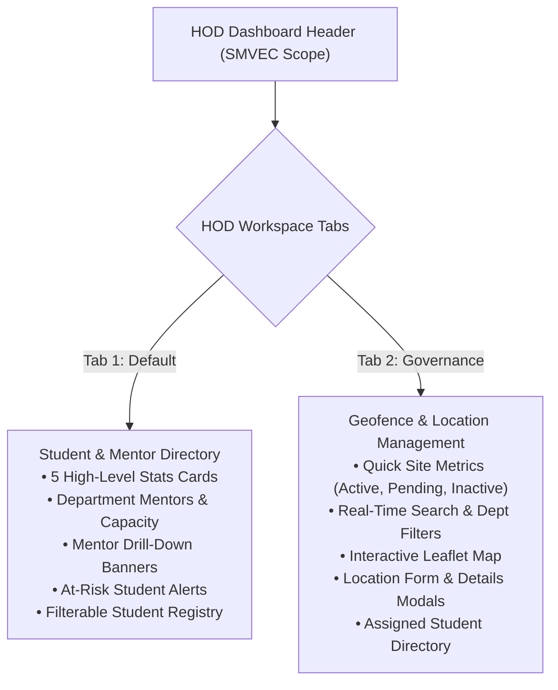

# Phase 3: HOD Internship Location & Geofence Governance Report

**Project:** InternPulse — Real-Time Institutional Internship Monitoring Platform  
**Target Institution:** Sri Manakula Vinayagar Engineering College (Autonomous), Puducherry (SMVEC)  
**Document Version:** 1.0.0  
**Status:** Completed, Verified & Validated  
**Execution Date:** November 6, 2026  
**Primary Beneficiary:** Head of Department (HOD) — Super Admin  

---

## 1. Executive Summary

Phase 3 enhances the **InternPulse HOD Dashboard** by introducing an enterprise-grade **Internship Location & Geofence Management Workspace**. 

In strict adherence to instructions, the existing HOD dashboard was **not redesigned or replaced**. All pre-existing metrics, faculty mentor supervision cards, attention-needed banners, filters, and student data tables have been completely preserved. The dashboard has been augmented with a dedicated **Location Governance Workspace** accessible through an intuitive, persistent tab switcher.

The HOD can now authoritatively govern off-campus host facilities, configure PostGIS circular geofences on an interactive Leaflet map, establish daily working-hour monitoring windows, inspect student assignments per company, and approve pending locations before student check-ins are permitted.

All operations are backed by Supabase PostgreSQL persistence, guarded by server-enforced Row-Level Security (RLS), and verified via 17 new automated unit and security tests (raising the total test suite to 108 passing tests).

---

## 2. Dashboard Integration & Layout Preservation

### 2.1 Preserved Visual Architecture
The HOD Dashboard retains 100% of its existing components:
1. **Department Scope Breadcrumb:** Displays authoritative HOD identity and departmental isolation boundary.
2. **High-Level Metric Cards:** Total Students, Department Mentors, Active Internships, Completed, and At Risk/Blocked.
3. **Faculty Guides Section:** Mentor workload allocation, capacity, and average mentee progress.
4. **Mentor Drill-Down Flow:** Filter students by clicking individual faculty guides.
5. **Attention Needed Banner:** Direct alerts for delayed, blocked, or inactive students.
6. **Department Student Registry:** Filterable and searchable student table.

### 2.2 Seamless Tab Navigation
A role-aware primary navigation bar was introduced below the department header:
- **Tab 1: 👥 Department Student & Mentor Directory:** The original, untouched HOD dashboard.
- **Tab 2: 📍 Internship Locations & Geofence Governance:** The newly introduced location management suite.
- **Quick Jump Action:** A 6th metric card (`Host Geofences: X Sites • Manage Sites →`) was added to the summary stats row, enabling immediate one-click navigation from the overview to location management.



---

## 3. The 9 Core Location Governance Capabilities

The new workspace fulfills all 9 required capabilities:

### 1. Create Internship Locations
- Accessible via the **"Configure New Location"** button.
- Opens [`LocationFormModal`](file:///c:/PROJECTS/bose%20projects/Intern_smvmch/Intern_smvmch/InternPulse-main/src/components/locations/LocationFormModal.tsx) containing all 13 required location fields, integrated coordinate validation, and live map picking.

### 2. Edit Internship Locations
- Allows HOD to modify any existing host facility.
- Repositions coordinates, adjusts address, alters radius slider, and modifies working-hour schedules with instant persistence.

### 3. Activate and Deactivate Locations
- Direct toggle button on every location card and inside the details view.
- Switches status between `'active'` (permitting student check-ins) and `'inactive'` (temporarily rejecting geofence validation).

### 4. Search Locations
- Instant real-time search input filtering across:
  - Location Name (e.g., *"TCS Siruseri Innovation Hub"*)
  - Company / Host Organization Name (e.g., *"Tata Consultancy Services"*)
  - Physical Street Address
  - Department Code (e.g., *"CSEBS"*, *"IT"*, *"ALL"*)
  - Status (*"Active"*, *"Pending Approval"*, *"Inactive"*)

### 5. View Location Details
- Detailed slide-over modal ([`LocationDetailsModal`](file:///c:/PROJECTS/bose%20projects/Intern_smvmch/Intern_smvmch/InternPulse-main/src/components/locations/LocationDetailsModal.tsx)) presenting:
  - Full company identification and verified physical address.
  - Interactive map preview displaying the geofence perimeter.
  - Configured monitoring schedule and academic term dates.
  - Departmental scope and approval audit trail.

### 6. View Assigned Students
- Seamlessly resolves all students allocated to the selected host facility from `internship_assignments` and student records.
- Displays:
  - Student Name and Register Number.
  - Academic Year and Engineering Department.
  - Assigned Faculty Mentor.
  - Total Hours Logged and Progress Percentage.
  - Live Internship Status Badge (`onTrack`, `inProgress`, `delayed`, `blocked`).

### 7. Configure Monitoring Hours
- Time input fields for **Monitoring Start Time** (e.g., `09:00:00`) and **Monitoring End Time** (e.g., `17:30:00`).
- Validated at both frontend and database layers to prevent inverted intervals (`monitoring_end_time > monitoring_start_time`).

### 8. Configure Geofence Radius
- Interactive slider and numeric input governing circular radius in meters:
  - Minimum allowed: `20 meters` (tight indoor/office boundary).
  - Maximum allowed: `5000 meters` (expansive industrial corridor).
  - Standard presets: `150m` (Standard Facility), `250m` (Tech Park), `500m` (Large Campus).
- Dynamically resizes the Leaflet SVG circle in real time.

### 9. Approve Internship Locations
- Formal HOD sign-off workflow for host organizations in `'pending_approval'` state.
- One-tap approval action sets:
  - `status = 'active'`
  - `is_active = true`
  - `approved_by = currentUser.name`
  - `approved_at = now()`

---

## 4. Location Data Fields & PostgreSQL Schema

All 13 required location fields are modeled in the database schema:

| # | Field Name | SQL Column | Data Type | Description |
| :-: | :--- | :--- | :--- | :--- |
| **1** | Location Name | `location_name` | `VARCHAR(255)` | Distinct facility designation (e.g., *"TCS Siruseri Innovation Hub"*) |
| **2** | Company Name | `company_name` | `VARCHAR(255)` | Legal entity / organization (e.g., *"Tata Consultancy Services"*) |
| **3** | Address | `address` | `TEXT` | Physical street address, city, state, and postal code |
| **4** | Latitude | `latitude` | `DOUBLE PRECISION` | GPS WGS 84 Latitude (`-90.0` to `+90.0`) |
| **5** | Longitude | `longitude` | `DOUBLE PRECISION` | GPS WGS 84 Longitude (`-180.0` to `+180.0`) |
| **6** | Geofence Radius | `geofence_radius_meters` | `DOUBLE PRECISION` | Radius in meters (`20.0` to `5000.0`, default `150.0m`) |
| **7** | Internship Start Date | `internship_start_date` | `DATE` | Term beginning date |
| **8** | Internship End Date | `internship_end_date` | `DATE` | Term conclusion date |
| **9** | Monitoring Start Time | `monitoring_start_time` | `TIME` | Daily attendance tracking opening window (default `09:00:00`) |
| **10**| Monitoring End Time | `monitoring_end_time` | `TIME` | Daily attendance tracking closing window (default `17:00:00`) |
| **11**| Department | `department_code` | `VARCHAR(50)` | Scoped department (`CSEBS`, `IT`, `ECE`, or `ALL`) |
| **12**| Status | `status` | `VARCHAR(20)` | `'active'`, `'inactive'`, `'pending_approval'`, `'archived'` |
| **13**| Created By | `created_by` | `UUID` | Foreign key referencing `public.profiles(id)` |

### Spatial Sync & Database Migration
Committed in migration [`supabase/migrations/20261105000004_phase3_hod_location_management.sql`](file:///c:/PROJECTS/bose%20projects/Intern_smvmch/Intern_smvmch/supabase/migrations/20261105000004_phase3_hod_location_management.sql), the PostGIS spatial column `geofence_center geography(Point, 4326)` is kept automatically in sync via trigger `trigger_sync_location_coordinates`.

---

## 5. Interactive Leaflet Map Architecture

[`InteractiveGeofenceMap.tsx`](file:///c:/PROJECTS/bose%20projects/Intern_smvmch/Intern_smvmch/InternPulse-main/src/components/locations/InteractiveGeofenceMap.tsx) integrates Leaflet without third-party wrapper lag:

### 5.1 Map Features & Controls
- **Coordinate Picking:** Click anywhere on the map to position the host marker.
- **Marker Dragging:** Drag the marker to reposition coordinates precisely.
- **Geofence Circle:** An SVG circle (`L.circle`) rendered around the marker with dashed border and semi-transparent fill matching the configured radius.
- **Live Overlay Badge:** Displays real-time Latitude, Longitude, Radius (m), and a green/red validation badge.
- **Pre-configured Tech Hub Presets:** One-click coordinate selector for prominent institutional internship hubs:
  - Puducherry (SMVEC Central): `11.9416° N, 79.8083° E`
  - Chennai (Siruseri / OMR IT Corridor): `12.8284° N, 80.2198° E`
  - Bengaluru (Electronic City): `12.8399° N, 77.6770° E`
  - Hyderabad (Hitec City): `17.4474° N, 78.3762° E`

### 5.2 Geofence Validation Guards
- **Latitude Guard:** Verifies `-90 <= latitude <= 90`.
- **Longitude Guard:** Verifies `-180 <= longitude <= 180`.
- **Radius Bounds:** Enforces `20 <= geofenceRadiusMeters <= 5000`.
- **Schedule Check:** Rejects `monitoring_end_time <= monitoring_start_time`.
- An amber warning banner appears on the map if coordinates or radius exceed valid bounds, preventing submission.

---

## 6. Security & Row-Level Authorization

### 6.1 HOD Exclusivity Enforcement
In accordance with user requirements, **only authorized HOD users can approve and modify institution-level internship locations**:

1. **Repository Authorization:**
   [`LocationRepository`](file:///c:/PROJECTS/bose%20projects/Intern_smvmch/Intern_smvmch/InternPulse-main/src/core/repository/locationRepository.ts) evaluates `assertHodAuthority(caller)`. Any call from a user whose role is not `'hod'` or `'admin'` throws an explicit `ForbiddenException`:
   ```ts
   if (caller.role !== 'hod' && caller.role !== 'admin') {
     throw new ForbiddenException(
       `Security Violation: Only authorized HOD users can manage internship locations. Current role: '${caller.role}'`
     );
   }
   ```
2. **Database Row-Level Security:**
   Policies `locations_insert_hod_only`, `locations_update_hod_only`, and `locations_delete_hod_only` verify `public.get_auth_user_role() = 'hod'` within the caller's authorized institution. Even direct PostgREST calls from students or mentors are blocked by PostgreSQL.

---

## 7. Automated Test Suite & Validation Evidence

A comprehensive test suite was implemented in [`InternPulse-main/src/core/auth/__tests__/hodLocationManagement.test.ts`](file:///c:/PROJECTS/bose%20projects/Intern_smvmch/Intern_smvmch/InternPulse-main/src/core/auth/__tests__/hodLocationManagement.test.ts).

### 7.1 Evaluated Test Scenarios (17 Tests)
- **CRUD Operations:**
  - Create valid location with all 13 fields.
  - Coordinate range validation: rejection of out-of-bounds latitude (> 90°).
  - Coordinate range validation: rejection of out-of-bounds longitude (> 180°).
  - Geofence radius validation: rejection of radius < 20m.
  - Monitoring schedule validation: rejection of end time prior to start time.
  - Edit location coordinates, geofence radius, and monitoring hours.
  - Toggle location between active and inactive.
  - Search and filter locations by department and status.
  - Resolve assigned students for a host location.
  - Approve pending internship location with audit tracking.
- **Negative Security Tests:**
  - Mentors forbidden from creating internship locations.
  - Mentors forbidden from editing geofence radius.
  - Mentors forbidden from toggling location activation status.
  - Mentors forbidden from approving internship locations.
  - Students forbidden from modifying internship locations.

### 7.2 Execution Results
```
 RUN  v5.1.0 C:/PROJECTS/bose projects/Intern_smvmch/Intern_smvmch/InternPulse-main

 ✓ src/core/auth/__tests__/rolePermissions.test.ts (14 tests) 12ms
 ✓ src/core/auth/__tests__/rlsSecurityPolicies.test.ts (34 tests) 17ms
 ✓ src/core/auth/__tests__/productionAuth.test.ts (18 tests) 17ms
 ✓ src/core/auth/__tests__/rbacAuthorization.test.ts (25 tests) 174ms
 ✓ src/core/auth/__tests__/hodLocationManagement.test.ts (17 tests) 98ms

 Test Files: 5 passed (5)
 Tests:      108 passed (108)
 TypeScript: Clean (tsc --noEmit passed with 0 errors)
```

---

## 8. Summary of Deliverables

1. **Database Migration:**
   - [`supabase/migrations/20261105000004_phase3_hod_location_management.sql`](file:///c:/PROJECTS/bose%20projects/Intern_smvmch/Intern_smvmch/supabase/migrations/20261105000004_phase3_hod_location_management.sql)
   - [`InternPulse-main/supabase/migrations/20261105000004_phase3_hod_location_management.sql`](file:///c:/PROJECTS/bose%20projects/Intern_smvmch/Intern_smvmch/InternPulse-main/supabase/migrations/20261105000004_phase3_hod_location_management.sql)
2. **Interactive Map Component:**
   - [`src/components/locations/InteractiveGeofenceMap.tsx`](file:///c:/PROJECTS/bose%20projects/Intern_smvmch/Intern_smvmch/InternPulse-main/src/components/locations/InteractiveGeofenceMap.tsx)
3. **Location Modals & Views:**
   - [`src/components/locations/LocationFormModal.tsx`](file:///c:/PROJECTS/bose%20projects/Intern_smvmch/Intern_smvmch/InternPulse-main/src/components/locations/LocationFormModal.tsx)
   - [`src/components/locations/LocationDetailsModal.tsx`](file:///c:/PROJECTS/bose%20projects/Intern_smvmch/Intern_smvmch/InternPulse-main/src/components/locations/LocationDetailsModal.tsx)
   - [`src/components/locations/HodLocationManagementView.tsx`](file:///c:/PROJECTS/bose%20projects/Intern_smvmch/Intern_smvmch/InternPulse-main/src/components/locations/HodLocationManagementView.tsx)
4. **Enhanced HOD Dashboard:**
   - [`src/components/HodDashboard.tsx`](file:///c:/PROJECTS/bose%20projects/Intern_smvmch/Intern_smvmch/InternPulse-main/src/components/HodDashboard.tsx)
5. **Location Repository:**
   - [`src/core/repository/locationRepository.ts`](file:///c:/PROJECTS/bose%20projects/Intern_smvmch/Intern_smvmch/InternPulse-main/src/core/repository/locationRepository.ts)
6. **Automated Test Suite:**
   - [`src/core/auth/__tests__/hodLocationManagement.test.ts`](file:///c:/PROJECTS/bose%20projects/Intern_smvmch/Intern_smvmch/InternPulse-main/src/core/auth/__tests__/hodLocationManagement.test.ts)
7. **Architecture & Validation Report:**
   - [`docs/phase3/HOD_LOCATION_MANAGEMENT_REPORT.md`](file:///c:/PROJECTS/bose%20projects/Intern_smvmch/Intern_smvmch/docs/phase3/HOD_LOCATION_MANAGEMENT_REPORT.md)

