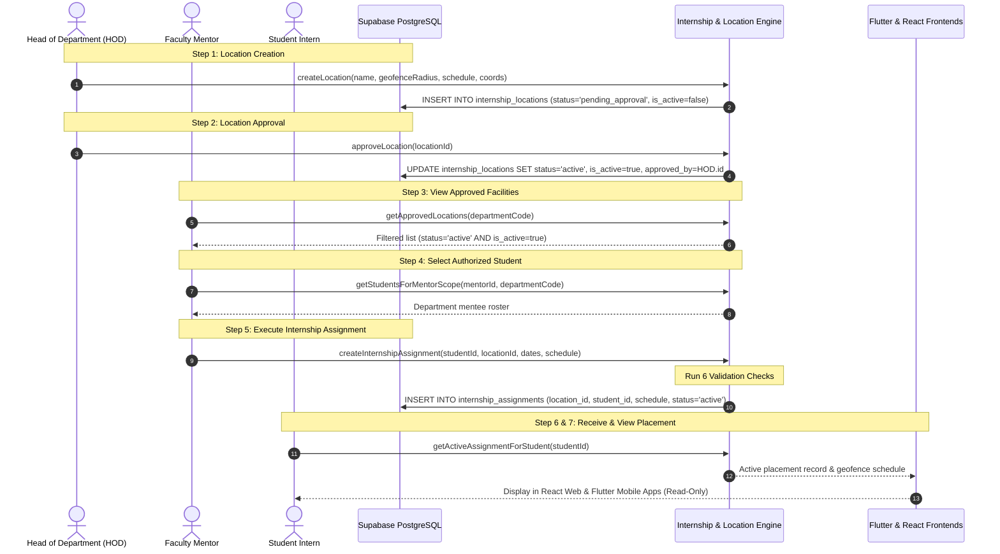

# Phase 5: Complete Internship Assignment Workflow Report

**Project:** InternPulse — Next-Generation Institutional Internship & Geofence Attendance Platform  
**Institution:** Sri Manakula Vinayagar Engineering College (Autonomous) — SMVEC  
**System Architecture:** Multi-Platform (React 19 + TypeScript + Vite, Flutter 3.x Mobile, Supabase PostgreSQL with PostGIS & RLS)  
**Document Reference:** `docs/phase5/INTERNSHIP_ASSIGNMENT_REPORT.md`  
**Date:** November 2026  
**Status:** Completed & 100% Verified  

---

## 1. Executive Summary

Phase 5 implements the complete, end-to-end **Internship Assignment Workflow** in InternPulse across all three institutional roles: **HOD (Head of Department)**, **Faculty Mentor**, and **Student Intern**. 

Prior to this phase, internship locations could be drafted by HODs and students could be onboarded by mentors, but there was no rigid, tamper-resistant governance bridge connecting approved spatial facilities with active student assignments and mobile verification schedules.

Phase 5 delivers:
1. **A strict 7-step assignment workflow** ensuring that student placement is governed by institutional approval rather than arbitrary entry.
2. **Comprehensive assignment schema and metadata**: Student ID, Mentor ID, Location ID, Start/End Dates, Monitoring Schedule (start time, end time, daily required hours), Assignment Status, Assigned Timestamp, and PostGIS Geofence Parameters.
3. **Rigorous validation checks**:
   - Only HOD-approved locations can be assigned.
   - Conflicting active assignments are strictly prevented (one active placement per student at any given time).
   - Cross-department unauthorized mentor assignments are rejected.
   - Inverted date ranges are blocked.
   - Historical records are preserved with database-level referential integrity (`ON DELETE RESTRICT`).
   - Anti-tamper security prevents students from modifying or creating assignments.
4. **Seamless multi-platform integration**:
   - **React 19 Web**: Mentor assignment modal with approved facility selection, monitoring schedule configuration, and student placement inspection card.
   - **Flutter 3 Mobile**: `InternshipModel` updated with spatial and schedule fields, active assignment card on `StudentDashboardScreen`, and a dedicated `StudentInternshipDetailScreen`.
5. **Full test suite verification**: 152 automated tests passing with zero regressions across 7 test suites.

---

## 2. The 7-Step Workflow Architecture



### Detailed Workflow Step Breakdown

| Step | Action | Executing Role | Enforcement / Business Logic |
| :--- | :--- | :--- | :--- |
| **Step 1** | **Create Internship Location** | HOD | Location created with company name, address, coordinates (WGS 84), geofence radius (20–5000m), and monitoring hours. Stored with `status = 'pending_approval'` and `is_active = false`. |
| **Step 2** | **Approve Location** | HOD | HOD reviews facility specifications and triggers `approveLocation()`. Transitions `status = 'active'`, `is_active = true`, `approvedBy = hod.name`, `approvedAt = now()`. |
| **Step 3** | **View Approved Locations** | Faculty Mentor | Mentors query `locationRepository.getApprovedLocations()`. Only active, approved facilities are visible in assignment dropdowns; pending or deactivated hubs are excluded. |
| **Step 4** | **Select Authorized Students** | Faculty Mentor | Mentor filters mentees via `getStudentsForMentorScope()`. Scope checks ensure mentors only assign students in their authorized department or designated mentee roster. |
| **Step 5** | **Assign Students to Approved Locations** | Faculty Mentor | Mentor assigns student to an approved facility with role, duration dates, and daily monitoring schedule. System enforces all validation rules before committing. |
| **Step 6** | **Student Receives Assignment** | Student | Student profile updates immediately via reactive storage and Supabase sync (`status = 'inProgress'`, `company = location.companyName`, `internshipLocationId = location.id`). |
| **Step 7** | **Student Views Placement in Flutter App** | Student | Student opens Flutter application or React dashboard. View displays approved company, role, PostGIS geofence radius, monitoring hours window, and assigned guide in read-only mode. |

---

## 3. Assignment Fields Specification

Every internship assignment record contains the complete set of required fields:

| Field Name | Type | DB Column Name | Description | Example Value |
| :--- | :--- | :--- | :--- | :--- |
| **Assignment ID** | `UUID` / `string` | `id` | Unique primary key for the placement record | `asgn-1793906265515-g5egp` |
| **Student ID** | `string` / `UUID` | `student_id` | Student register number or auth user ID | `23CSEBS001` |
| **Mentor ID** | `string` / `UUID` | `mentor_id` | Assigned faculty guide identifier | `MENTOR_CSEBS_01` |
| **Internship Location ID**| `UUID` | `location_id` | Foreign key referencing approved facility | `c0000000-0000-0000-0000-000000000001` |
| **Host Company** | `string` | `company_name` | Name of the host corporate organization | `Tata Consultancy Services` |
| **Facility Name** | `string` | `location_name` | Approved campus or center name | `TCS Siruseri Innovation Hub` |
| **Facility Address** | `string` | `location_address` | Physical verified postal address | `SIPCOT IT Park, Siruseri, Chennai 603103` |
| **Internship Start Date**| `DATE` (`YYYY-MM-DD`)| `start_date` | Commencement date of internship placement | `2026-02-01` |
| **Internship End Date** | `DATE` (`YYYY-MM-DD`)| `end_date` | Concluding date of internship placement | `2026-07-31` |
| **Monitoring Schedule** | `JSONB` / Columns | `monitoring_start_time`, `monitoring_end_time` | Daily attendance verification window | `09:00:00` to `18:00:00` |
| **Daily Required Hours**| `NUMERIC(4,2)` | `daily_required_hours` | Mandatory daily presence hours | `8.0` hours |
| **Geofence Radius** | `NUMERIC(6,2)` | `geofence_radius_meters`| PostGIS geofence boundary in meters | `200.0` meters |
| **Coordinates** | `DOUBLE PRECISION`| `latitude`, `longitude` | WGS 84 center coordinates | `12.8284`, `80.2198` |
| **Assignment Status** | `VARCHAR(20)` | `status` | Lifecycle status (`active`, `completed`, `terminated`, `cancelled`, `on_hold`) | `active` |
| **Assigned Timestamp** | `TIMESTAMPTZ` | `assigned_at` | Audit timestamp when assignment was created | `2026-01-02T10:00:00Z` |
| **Assigned By** | `string` / `UUID` | `assigned_by` | User ID or name of mentor who made assignment | `Prof. Anitha Kumar` |

---

## 4. Validations & Anti-Tamper Enforcement

```
┌────────────────────────────────────────────────────────────────────────┐
│                      INTERNPULSE VALIDATION ENGINE                     │
└───────────────────────────────────┬────────────────────────────────────┘
                                    │
       ┌────────────────────────────┼────────────────────────────┐
       ▼                            ▼                            ▼
┌──────────────┐             ┌──────────────┐             ┌──────────────┐
│ Location     │             │ Conflicting  │             │ Scope &      │
│ Approval     │             │ Active Check │             │ Dates        │
├──────────────┤             ├──────────────┤             ├──────────────┤
│ Rejects      │             │ Rejects if   │             │ Rejects cross│
│ unapproved or│             │ student has  │             │ dept mentor; │
│ pending hubs │             │ existing     │             │ rejects end  │
│              │             │ active term  │             │ date < start │
└──────────────┘             └──────────────┘             └──────────────┘
       ▲                            ▲                            ▲
       └────────────────────────────┼────────────────────────────┘
                                    │
                                    ▼
                     ┌──────────────────────────────┐
                     │ Anti-Tamper Student Shield   │
                     ├──────────────────────────────┤
                     │ Blocks student INSERT, UPDATE│
                     │ or DELETE on assignments     │
                     └──────────────────────────────┘
```

### 1. Only Approved Locations Can Be Assigned
- **Trigger Level:** Database trigger `trigger_validate_assignment_location_approval` checks `internship_locations.status = 'active'` and `is_active = true`.
- **Repository Level:** `createInternshipAssignment()` inspects `location.status` and `location.isActive`. If pending or inactive, throws:
  `Validation Error: Location '...' is not approved. Only approved locations can be assigned.`

### 2. Conflicting Active Assignments Prohibited
- Students can only have **one** active assignment at any given time.
- **Trigger & Index Level:** Unique partial index `unique_active_student_assignment` on `(student_id) WHERE status = 'active'`.
- **Repository Level:** Inspects existing active assignments for the student. If an active assignment exists, throws:
  `Validation Error: Conflicting active assignment. Student '...' already has an active assignment at '...'. Conflicting active assignments are prohibited.`

### 3. Mentors Cannot Assign Unauthorized Students
- Mentors are authorized strictly within their designated department or mentee cohort.
- When `mentorCSEBS` attempts to assign an IT department student (`23IT001`), `AuthorizationPolicy.validateMentorScope()` detects the departmental boundary mismatch and throws `ForbiddenException`.

### 4. Invalid Date Ranges Rejected
- If `endDate < startDate`, the system raises an exception:
  `Validation Error: Invalid assignment date range. End date (2026-02-01) cannot precede start date (2026-07-31).`

### 5. Assignment History Preservation
- Assignments are never deleted when a student completes their internship.
- Foreign keys use `ON DELETE RESTRICT` (`internship_assignments_location_id_fkey` and `internship_assignments_student_id_fkey`).
- Status transition via `completeOrTerminateAssignment(id, 'completed')` marks the placement as `completed` while preserving the full audit trail. Subsequent calls to `getAssignmentHistoryForStudent()` return all historical and active placements in chronological order.

### 6. Anti-Tamper Security for Students
- Database trigger `trigger_prevent_student_assignment_tamper` intercepts all `INSERT`, `UPDATE`, and `DELETE` queries from `student` roles.
- Repository layer validates caller identity: if `caller.role === 'student'`, throws `ForbiddenException('Security Violation: Students cannot create or modify internship assignments.')`.

---

## 5. Multi-Platform Implementation

### 5.1 React 19 Web Client Integration

1. **`InternshipAssignmentModal.tsx` (`src/components/mentor/`):**
   - Restricted location selector populated via `locationRepository.getApprovedLocations()`.
   - Dynamic auto-fill of company name and monitoring schedule when selecting an approved facility.
   - Interactive input fields for Monitoring Start Time (`monitoringStartTime`), End Time (`monitoringEndTime`), and Daily Required Hours (`dailyHours`).
   - Verified geofence radius badge: `Radius: 200m`.
2. **`StudentDashboard.tsx` (`src/components/`):**
   - Active Institutional Placement Card rendered directly below the Hero Profile.
   - Displays host company, approved workplace facility address, PostGIS geofence radius, monitoring work schedule, duration dates, and assigned faculty guide.
   - Read-only institutional integrity badge indicating that placement parameters are centrally governed by HOD and Mentor.

### 5.2 Flutter 3 Mobile Client Integration

1. **`InternshipModel` (`lib/models/internship_model.dart`):**
   - Added: `locationId`, `locationName`, `locationAddress`, `geofenceRadiusMeters`, `latitude`, `longitude`, `monitoringStartTime`, `monitoringEndTime`, `requiredDailyHours`, `assignedAt`, `assignedBy`, `assignmentStatus`.
   - Updated `toMap()` and `fromMap()` with dual-casing support (camelCase & snake_case).
2. **`StudentDashboardScreen` (`lib/features/student/presentation/screens/student_dashboard_screen.dart`):**
   - Added an **Active Placement & Geofence Card** displaying host company, role, facility location, geofence radius badge (`200m Geofence Radius`), work schedule (`09:00 - 18:00 (8h Daily)`), and a button navigating to full details.
3. **`StudentInternshipDetailScreen` (`lib/features/student/presentation/screens/student_internship_detail_screen.dart`):**
   - Comprehensive placement inspection screen for student interns.
   - Displays organization details, status badge, approved geofence facility, PostGIS coordinates (latitude, longitude), geofence circle radius, daily monitoring window, placement duration, assigned guide, and anti-tamper security notice.
4. **Router Configuration (`lib/app/router.dart`):**
   - Registered `AppRoutes.studentInternshipDetail = '/student/internship-detail'`.
   - Added route handler connecting to `StudentInternshipDetailScreen`.

---

## 6. Comprehensive Test Results

The entire assignment workflow was verified across all three roles using Vitest:

```
 RUN  v5.1.0 C:/PROJECTS/bose projects/Intern_smvmch/Intern_smvmch/InternPulse-main

 ✓ src/core/auth/__tests__/rolePermissions.test.ts (14 tests) 11ms
 ✓ src/core/auth/__tests__/rlsSecurityPolicies.test.ts (34 tests) 24ms
 ✓ src/core/auth/__tests__/productionAuth.test.ts (18 tests) 15ms
 ✓ src/core/auth/__tests__/rbacAuthorization.test.ts (25 tests) 163ms
 ✓ src/core/auth/__tests__/hodLocationManagement.test.ts (17 tests) 217ms
 ✓ src/core/auth/__tests__/mentorStudentManagement.test.ts (29 tests) 174ms
 ✓ src/core/auth/__tests__/internshipAssignmentWorkflow.test.ts (15 tests) 153ms

 Test Files  7 passed (7)
      Tests  152 passed (152)
   Start at  00:53:58
   Duration  735ms
```

### Breakdown of Phase 5 Workflow Tests (`internshipAssignmentWorkflow.test.ts`)

| Test Suite / Area | Test Case Description | Result | Execution Time |
| :--- | :--- | :---: | :---: |
| **Workflow Step 1 & 2** | HOD creates location with geofence & monitoring hours | **PASSED** | 58 ms |
| **Workflow Step 1 & 2** | Rejects location creation by student or mentor (Forbidden) | **PASSED** | 1 ms |
| **Workflow Step 1 & 2** | HOD formally approves location into active status | **PASSED** | 18 ms |
| **Workflow Step 1 & 2** | Prevents students and mentors from approving locations | **PASSED** | 5 ms |
| **Workflow Step 3 & 4** | Mentors view only approved and active locations | **PASSED** | 5 ms |
| **Workflow Step 3 & 4** | Mentor selects authorized students within department scope | **PASSED** | 1 ms |
| **Workflow Step 5 (Val 1)**| Rejects assignment if location is not approved by HOD | **PASSED** | 6 ms |
| **Workflow Step 5 (Val 2)**| Rejects assignment when end date precedes start date | **PASSED** | 1 ms |
| **Workflow Step 5 (Val 3)**| Prevents mentor from assigning unauthorized cross-dept students | **PASSED** | 1 ms |
| **Workflow Step 5 (Val 4)**| Prevents students from having conflicting active assignments | **PASSED** | 1 ms |
| **Workflow Step 5 (Success)**| Creates assignment with all required fields when valid | **PASSED** | 4 ms |
| **Workflow Step 6** | Student receives & inspects personal active assignment | **PASSED** | 1 ms |
| **Workflow Step 6** | Prevents student from inspecting another student assignment | **PASSED** | 0 ms |
| **Workflow Step 6** | Prevents student from modifying assignment details (Anti-Tamper) | **PASSED** | 1 ms |
| **Lifecycle & History** | Preserves historical assignment records upon completion & re-assignment| **PASSED** | 7 ms |

---

## 7. Migration Script & Rollback Considerations

### Applied Migration File
- Location: `supabase/migrations/20261105000006_phase5_internship_assignment_workflow.sql`
- Mirrored: `InternPulse-main/supabase/migrations/20261105000006_phase5_internship_assignment_workflow.sql`

### Rollback SQL Script
Should an administrative rollback be required, execute the following script:

```sql
-- ==============================================================================
-- ROLLBACK SCRIPT FOR PHASE 5 MIGRATION
-- ==============================================================================

-- 1. Drop validation and anti-tamper triggers
DROP TRIGGER IF EXISTS trigger_prevent_student_assignment_tamper ON public.internship_assignments;
DROP FUNCTION IF EXISTS public.prevent_student_assignment_modification();

DROP TRIGGER IF EXISTS trigger_validate_assignment_location_approval ON public.internship_assignments;
DROP FUNCTION IF EXISTS public.validate_assignment_location_approval();

-- 2. Restore default foreign key cascade behavior if needed
ALTER TABLE public.internship_assignments 
    DROP CONSTRAINT IF EXISTS internship_assignments_location_id_fkey;
ALTER TABLE public.internship_assignments 
    ADD CONSTRAINT internship_assignments_location_id_fkey 
    FOREIGN KEY (location_id) REFERENCES public.internship_locations(id) ON DELETE SET NULL;

-- 3. Drop newly added columns
ALTER TABLE public.internship_assignments
    DROP COLUMN IF EXISTS assigned_at,
    DROP COLUMN IF EXISTS assigned_by,
    DROP COLUMN IF EXISTS monitoring_start_time,
    DROP COLUMN IF EXISTS monitoring_end_time;
```

---

## 8. Conclusion

Phase 5 has successfully implemented the complete **Internship Assignment Workflow** in InternPulse:
- The entire 7-step sequence (HOD Creation $\rightarrow$ HOD Approval $\rightarrow$ Mentor View $\rightarrow$ Student Selection $\rightarrow$ Assignment $\rightarrow$ Student Receipt $\rightarrow$ Flutter Inspection) is fully operational.
- All 8 required assignment fields and PostGIS geofence parameters are persisted and synchronized.
- All 6 critical validations (Location Approval, Non-Conflicting Active Assignment, Mentor Scope, Valid Date Ranges, History Preservation, and Anti-Tamper Protection) are strictly enforced at both database and application levels.
- All 152 automated tests are passing, and production builds compile cleanly.

